# 操作系统实验报告

## 实验基本信息

| 项目 | 内容 |
|------|------|
| **实验名称** | Lab 2：物理内存管理 |
| **小组成员** | 2412449-石晨昊、2410966-王策、2410668-吕昊远 |
| **完成日期** | 2026-10-20 |

### 小组分工

本次按三个相对完整的模块划分工作，每人均承担原理分析、提示词整理、实现核对和验证工作，跨模块接口共同复核。

| 成员 | 负责的练习/模块 |
|------|----------------|
| 2412449-石晨昊 | 练习1，challenge |
| 32410966-王策 | 练习3，分支任务 |
| 2410668-吕昊远 | 练习1，challenge |

报告分工与模块对应：

| 成员 | 报告职责 |
|------|----------|
| 2412449-石晨昊 | 实验目的、整体逻辑、练习一/二、物理内存发现、默认配置验证 |
| 2410966-王策 | Buddy 实现与测试、构建配置、变异测试、页管理相关原理总结 |
| 2410668-吕昊远 | SLUB 实现与测试、测试证据整理、对象管理与 AI 协作经验 |

## 一、实验目的

1. 理解启动映射、设备树内存信息、物理页号与 `Page` 描述符之间的关系，正确划分保留页和可分配页。
2. 理解连续物理页分配中的查找、分裂、释放和合并，实现 Best-Fit，并与 First-Fit 比较。
3. 实现 Buddy System，掌握以阶组织空闲块、按幂取整和 XOR 伙伴合并的方法。
4. 在页分配之上实现简化 SLUB，为小对象提供可复用槽位，为大对象记录完整的底层分配信息。
5. 使用结构化提示词分阶段与 AI 协作；用独立测试、失败路径和变异测试检查实现，区分编译成功、启动成功与行为正确。

## 二、实验环境

实验与复验使用以下环境。

| 项目 | 实际环境 |
|------|----------|
| 宿主系统 | Windows，PowerShell；仓库位于 Windows 文件系统 |
| 构建环境 | WSL 2，发行版名称 `CompilerLab`，Ubuntu 22.04.5 LTS |
| 目标平台 | QEMU `virt`，RV64，单 hart，128 MiB DRAM |
| 交叉编译器 | `/opt/riscv-elf-toolchains/bin/riscv64-unknown-elf-gcc`，GCC 15.1.0（g1b306039ac4） |
| 调试器 | `/opt/riscv-elf-toolchains/bin/riscv64-unknown-elf-gdb`，GDB 16.3.90.20250610-git |
| 模拟器 | `/home/compiler/.local/opt/qemu-4.1.1/bin/qemu-system-riscv64`，QEMU 4.1.1 |
| 固件 | QEMU 默认固件 OpenSBI 0.4，Runtime SBI 0.1，见启动日志 |
| 构建工具 | GNU Make 4.3 |
| Python | `/usr/bin/python3`，Python 3.10.12 |
| 页大小与内存范围 | `PGSIZE=4096`，DRAM 为 `[0x80000000, 0x88000000)` |
| 验证方式 | QEMU 上实际执行内核；启动日志、官方评分、Buddy/SLUB 专项测试 |

小组使用的 AI 工具及模型如下：

| 成员 | AI 编程工具 | 底层模型 | 备注 |
|------|------------|----------|----------|
| 2412449-石晨昊 | Codex | GPT-6.1 sol | 无 |
| 2410966-王策 | Codex | GPT-6.1 sol | 无 |
| 2410668-吕昊远 | Codex | GPT-6.1 sol | 无 |

## 三、实验整体逻辑分析

### 3.1 本章节的逻辑主线

本实验解决的问题是：内核已经能够启动，但还需要知道哪些内存属于自己、哪些页面可以分配，以及怎样把页面交给不同大小的使用者。

物理页分配器管理的是连续页面，SLUB 管理的是页面内部的对象。两者通过 `alloc_pages/free_pages` 连接。内核的高地址虚拟映射用于访问这些页面。

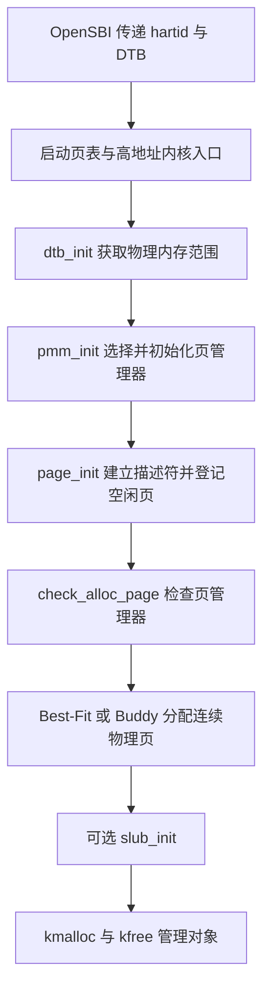

Buddy 夹具测试是这一正常流程中的特殊测试入口：它在真实 `page_init()` 之前临时替换描述符数组，完成后恢复全局状态并清空管理器；真实内存测试则在 `check_alloc_page()` 之后执行。SLUB 测试在 `slub_init()` 之后执行。

### 3.2 功能的逐步实现

| 阶段 | 任务 | 原因 |
|------|------|----------------|
| 1 | `page_init()` | 先确定物理范围、元数据和保留区，分配器才不会分出内核自身的页面 |
| 2 | First-Fit 分析、Best-Fit 实现与默认启动 | 先建立连续页分配的基线，并完成默认官方评分 |
| 3 | Buddy 实现与配置选择 | 在公共接口不变的情况下引入不同的组织方式和取整契约 |
| 4 | Buddy 独立专项测试 | 用受控布局验证伙伴关系，再在真实页面上验证读写与恢复 |
| 5 | 简化 SLUB 实现与基本验证 | 在已验证的 Buddy 上增加对象粒度，保留底层分配信息 |
| 6 | SLUB 独立专项测试与配置回归 | 验证对象隔离、布局、耗尽和跨层资源恢复，并检查配置互不污染 |

提示词保存在 [prompt.md](prompt.md)。

## 四、实验内容与实现

### 4.1 练习一：物理内存初始化与 First-Fit 分析

**负责人：2412449-石晨昊。**

#### 模块功能描述

主要实现位于 [pmm.c](../code/kern/mm/pmm.c)，First-Fit 参考实现位于 [default_pmm.c](../code/kern/mm/default_pmm.c)。相关接口为：

```c
static void page_init(void);
static void init_memmap(struct Page *base, size_t n);
struct Page *alloc_pages(size_t n);
void free_pages(struct Page *base, size_t n);
size_t nr_free_pages(void);
```

`page_init()` 从已经解析的 DTB 中获取起点和大小，建立描述符数组，并将数组之后剩余的完整页面登记到当前页管理器。

首先设置 `va_pa_offset=PHYSICAL_MEMORY_OFFSET`。框架采用线性地址关系：

```text
VA = PA + 0xffffffff40000000
PA = VA - va_pa_offset
pages[i] 对应物理页号 nbase+i
nbase = 0x80000000 / 4096 = 0x80000
npage = floor(受上界约束后的物理末端 / 4096)
描述符数量 = npage - nbase
```

`npage` 是物理页号的排他上界，不是 DRAM 的页数。例如 128 MiB 配置下，它为 `0x88000`，而描述符数量才是 `0x8000=32768`。

描述符从内核链接符号 `end` 向上按页对齐后开始存放。当前 RV64 布局中 `sizeof(struct Page)=40`，32768 个描述符占 `1310720` 字节，即 320 页。它们本身占用物理内存，不能再次交给分配器。

| 区域 | 范围的确定方式 | 状态 |
|------|----------------|------|
| 固件及内核前保留区 | `[DRAM_BASE, KERNEL_BEGIN_PADDR)` | 保留 |
| 内核及页对齐填充 | `[KERNEL_BEGIN_PADDR, PADDR(ROUNDUP(end, PGSIZE)))` | 保留 |
| 页描述符数组及其对齐占用 | 从上述对齐地址起放置 `npage-nbase` 个 `Page` | 保留 |
| 剩余完整页面 | 从数组末端向上页对齐，到 `npage << PGSHIFT` | 交给当前分配器 |

实现先检查内存起点是否为 `DRAM_BASE`、长度是否非零、末端加法是否回绕，然后将末端限制在 `PHYSICAL_MEMORY_END` 内；在写描述符之前确认内核和数组都能容纳。每个描述符先设为 Reserved，再由 `init_memmap()` 解除空闲区的保留状态。如果数组之后没有完整页面，则不调用 `init_memmap()`。

当前实现按一段连续 DRAM 建立描述符；更复杂的内存布局处理见 4.4 节。

#### First-Fit 的工作过程与改进空间

First-Fit 使用按地址递增排列的空闲块链表。仅块首页设置 `PageProperty`，首页的 `property` 表示块长，`page_link` 将首页挂入链表，`nr_free` 表示所有空闲块的页数总和。

1. `default_init()` 初始化链表和空闲页计数。
2. `default_init_memmap()` 清除待登记页的保留状态，建立块首页，将块按地址插入链表。
3. `default_alloc_pages(n)` 从链表头开始查找第一个长度不小于 `n` 的块。取走前 `n` 页；剩余部分以新首页继续留在链表，计数减少 `n`。
4. `default_free_pages(base,n)` 将区间按地址插回链表。若前一块末端等于本块起点，或本块末端等于后一块起点，则合并，并移除被吞并块的首页标志和链表节点。

按地址排列的意义是便于只检查插入位置前后的块是否相邻；它不意味着分配时必须选最小块。First-Fit 的分配查找和释放插入位置查找最坏均为 `O(F)`，其中 `F` 是空闲块数；描述符初始化还涉及与区间长度相关的工作。

可以用 next-fit 游标减少从头扫描，或用地址树加快插入定位，但 next-fit 会改变选择策略，并不保证碎片更少。也可以引入按大小分组的链表，代价是维护额外索引和合并时的一致性。

#### 规格设计与提示词组织

物理内存初始化的规格以“内存范围正确、元数据不被分配、空闲区完整”为主线。提示词 1 的 `[RELY]` 明确分页已开启，以及 `end`、`pages` 和物理页号各自的地址含义；`[SPECIFICATION]` 再规定布局计算与异常分支，避免只要求“初始化所有页”而遗漏描述符数组自身的占用。

| 规格项目 | 具体约定 | 验收方法与覆盖情况 |
|----------|----------|--------------------|
| 前置条件 | `dtb_init()` 已提供内存信息，当前管理器已初始化；启动映射可访问内核及描述符区域 | 核对 `kern_init()`、`pmm_init()` 的调用顺序和地址转换前置条件 |
| 成功结果 | 设置 `va_pa_offset`、`npage` 和 `pages`；描述符覆盖 `[nbase,npage)`，只注册数组之后的完整空闲页 | 结合启动日志、布局计算及官方 page-init 检查核对 |
| 无效信息或布局失败 | 非预期基址、零长度、末端回绕、内核或描述符数组放不下时 panic | 代码分支核对 |
| 零空闲页 | 描述符可容纳但其后没有完整页时，不调用要求 `n>0` 的 `init_memmap()` | 边界计算和条件调用核对 |
| 状态不变量 | 固件、内核和描述符占用页保持 Reserved；空闲区不含这些页及末尾残页 | 核对保留标记、上下界和登记范围，后续分配检查验证正常路径 |

#### 最终提示词

见 [附录提示词 1](#prompt-1)。

#### 实现迭代过程

第一轮完成描述符与空闲区布局，随后与 Best-Fit 联合启动。联调中发现分页开启到高地址跳转之间还需要低地址恒等映射，修复见 4.6 节；布局计算与启动输出的对照见 5.2 节。

复核 First-Fit 参考实现时发现，`default_init_memmap()` 和 `default_free_pages()` 的尾插分支也缺少退出循环的 `break`。新节点被再次插入后，前驱链接损坏，释放时可能遗漏相邻块合并。两处均在 `list_add()` 后补上 `break`，回归结果见 5.3 节。

### 4.2 练习二：Best-Fit 物理页分配器

**负责人：2412449-石晨昊。**

#### 模块功能描述

实现位于 [best_fit_pmm.c](../code/kern/mm/best_fit_pmm.c)，通过 `best_fit_pmm_manager` 接入 `pmm_manager`。主要私有函数为：

```c
static void best_fit_init(void);
static void best_fit_init_memmap(struct Page *base, size_t n);
static struct Page *best_fit_alloc_pages(size_t n);
static void best_fit_free_pages(struct Page *base, size_t n);
static size_t best_fit_nr_free_pages(void);
```

Best-Fit 沿用地址有序的空闲块表示方式。分配时遍历全部空闲块，选择 `property>=n` 且长度最小的块；相同长度时保留先遇到的候选。选中后取前 `n` 页，将尾部余块插回原位置，清除已分配块首页的 `PageProperty`，计数只减少 `n`。没有合适连续块时返回 `NULL`，总空闲页数足够也不保证成功。

例如地址有序链表的块长依次为 8、5、12，请求 4 页时，First-Fit 选择 8 页块，Best-Fit 选择 5 页块。Best-Fit 的目标是减小本次分配后的余块，不是保证未来所有分配都最优；小余块过多仍会造成外部碎片。

释放时重新设定块头和长度，按地址插入，再依次合并前后相邻块。`nr_free` 只按新归还的 `n` 页增加一次，合并本身不改变空闲页总量。默认 `init_pmm_manager()` 选择 Best-Fit。

#### 规格设计与提示词组织

Best-Fit 的关键是把选择规则与分裂、合并、计数规则一起写进规格。提示词 2 在 `[RELY]` 中提供 First-Fit 参考实现和 `pmm_manager` 接口，在 `[GUARANTEE]` 中要求交付完整管理器及注册结构，在 `[SPECIFICATION]` 中按管理函数定义状态变化，并明确不得修改原有测试。

| 规格项目 | 具体约定 | 验收方法 |
|----------|----------|----------|
| 前置条件 | `init_memmap(base,n)` 接收合法、仍为 Reserved 的页区间；正常分配请求 `n>0`，零请求触发断言 | 核对初始化及调用约束 |
| 分配成功 | 从全部合格块中选最小块，当前实现同长时保留先遇到者；返回连续 `n` 页，余块保留，空闲计数减 `n` | 原有 `basic_check()`、`best_fit_check()` 及官方 Best-Fit 检查；同长策略结合代码核对 |
| 分配失败 | 总量不足或不存在足够大的连续块时返回 `NULL`，空闲链表和计数不变 | 原有测试检查耗尽、碎片与失败后可继续分配的场景 |
| 释放结果 | 仅归还合法且尚未释放的分配区间；计数增加归还页数，再合并地址相邻的前后空闲块 | 核对原有测试中的分裂、部分区间归还及最终计数恢复 |
| 状态不变量 | 空闲块按地址有序且互不重叠，仅首页表示块长并挂链；块长之和等于 `nr_free` | 结构遍历、计数断言与分配行为检查配合，保留框架测试逻辑 |

#### 最终提示词

见 [附录提示词 2](#prompt-2)。

#### 实现迭代过程

第一轮补齐管理器并在 `init_pmm_manager()` 中接入 Best-Fit，与 `page_init()` 联合验证。

后续复核发现，`best_fit_init_memmap()` 和 `best_fit_free_pages()` 在链表尾部插入新空闲块后没有退出遍历，下一轮再次插入同一节点，破坏前驱链接，使两次仍存活的申请可能返回同一页。

两处尾插分支均在 `list_add()` 后增加 `break`，保证每次登记或释放只插入一次块头。验收增加“两个存活分配不得重叠”的判据，并补充初始化尾插、释放尾插两种回归；构造与修复前后结果见 5.3 节。

#### 改进空间

当前 Best-Fit 每次最坏扫描 `F` 个空闲块，即 `O(F)`。遇到长度恰为 `n` 的块后可以立即结束，因为不可能有更小的合格块。进一步可使用按长度排序的平衡树实现近似 `O(log F)` 的最小合格块查找，再辅以地址索引支持相邻合并；代价是双索引维护、元数据开销和更复杂的错误恢复。按大小分级可减少搜索，但可能只实现近似 Best-Fit。

### 4.3 练习三：Buddy System 与独立测试

**负责人：2410966-王策。**

#### 模块功能描述

新增 [buddy_pmm.c](../code/kern/mm/buddy_pmm.c)、[buddy_pmm.h](../code/kern/mm/buddy_pmm.h)，导出 `buddy_pmm_manager`。不改变 `struct Page` 和 `pmm_manager` 的公共布局。

```c
static void buddy_init(void);
static void buddy_init_memmap(struct Page *base, size_t n);
static struct Page *buddy_alloc_pages(size_t n);
static void buddy_free_pages(struct Page *base, size_t n);
static size_t buddy_nr_free_pages(void);
static void buddy_check(void);
```

实现使用 16 条空闲链表，阶为 0..15。第 `k` 阶块占 `2^k` 页。对齐原点是 `pages[0]`，对应物理页号 `nbase`，不是可分配区的第一张页面。

```text
off = block - pages
块对齐条件：off % 2^k == 0
伙伴偏移：buddy_off = off XOR 2^k
合并条件：对方在范围内、确为空闲块头，且阶与当前块相同
```

空闲块首页的 `property` 在 Buddy 中表示阶，不再表示页数。分配后首页标志清除，内部页不挂入空闲链表。初始化时将任意区间拆成若干满足起点对齐、长度不越界的最大幂次块，因此不要求空闲区起点或总长度为 2 的幂。

分配请求 `n` 向上取整为 `B=2^ceil(log2(n))`。从目标阶向上寻找非空链表，再不断二分，返回低半块并将高半块挂回相应阶。实际空闲计数减少 `B`。释放时调用者传回原返回指针和原请求 `n`，由管理器重新得到 `B`，只增加一次计数，再递归合并伙伴。

| 项目 | Best-Fit | Buddy |
|------|----------|-------|
| 请求 3 页的实际占用 | 3 页 | 4 页 |
| 空闲块头 `property` | 块长 | 阶 |
| 合并依据 | 地址相邻 | 同阶 XOR 伙伴 |
| 分配选择 | 最小合格空闲块 | 最小可用阶并分裂 |
| 主要代价 | 线性查找与外部碎片 | 幂次取整带来的内部碎片 |

Buddy 的查阶、分裂和伙伴合并至多跨越 16 个阶；释放还逐页清理 `B` 个描述符，包含 `O(B)` 的工作。

#### 规格设计与提示词组织

Buddy 分两轮编写规格。提示词 3 先固定页管理器的分配与释放契约；提示词 4 在 `[RELY]` 中沿用该契约，再要求独立设计测试。两轮都以 `pages[0]` 为对齐原点，以实际占用 `B` 为计数依据，避免实现和测试对“申请 n 页”的含义不同。

| 实现规格项目 | 具体约定 | 验收方法 |
|--------------|----------|----------|
| 前置条件 | 登记区间合法且仍为 Reserved；分配请求 `n>0`；释放传回存活分配的原指针和原请求 `n`，不支持部分释放 | 核对入口断言、接口说明及测试调用序列 |
| 初始化与分配成功 | 任意合法区间按全局对齐拆成幂次块；请求 `n` 实际占用 `B` 页，返回块对齐且不重叠，计数减 `B` | 用例 1..4、6..7 及真实内存用例 11..12 |
| 分配失败 | 无可用目标阶或请求超出能力时返回 `NULL`；计数和空闲结构不变，之后仍能正常分配 | 用例 5、8、10 检查合法失败及后续可用性 |
| 释放与不变量 | 归还完整 `B` 页，计数只增加一次；只合并范围内的同阶 XOR 伙伴；保留页不参与分配 | 用例 6..10 检查乱序合并、真伙伴及相邻非伙伴，结构检查核对各阶页数 |

| 测试规格项目 | 具体约定 | 验收方法 |
|--------------|----------|----------|
| 前置条件与隔离 | 夹具在真实页登记之前运行，只操作私有描述符；结束后恢复全局变量并清空管理器，再执行真实内存测试 | 核对两个测试入口及恢复流程，随后真实启动和分配检查应成功 |
| 独立判据 | 使用显式取整表、预期偏移集合和合法分配记录；不复用被测算法计算期望，不按单页拆还一个多页分配 | 用例 4、8、9 对应取整、相邻与伙伴关系，变异结果检验部分判据的检错能力 |
| 成功与失败输出 | 每项通过后输出 PASS；断言失败即报告并 panic | 12 项成功标记及两种变异的失败记录，详见 5.4 节 |
| 最终状态 | 每个真实分配按原请求释放，空闲计数恢复运行内基准；读内存前先写入确定内容 | 用例 11..12 检查真实块读写、重用和资源恢复 |

#### 最终提示词

实现使用 [附录提示词 3](#prompt-3)，独立测试使用 [附录提示词 4](#prompt-4)。

#### 实现与测试迭代

第一轮完成管理器与配置接入。联调中暴露出共享镜像未重链的问题，构建修正见 4.6 节。

第二轮增加 [buddy_test.c](../code/kern/mm/buddy_test.c) 和头文件。受控夹具使用 128 个静态描述符，临时替换 `pages/npage`，通过描述符偏移检查算法；结束后恢复全局状态，再开始真实页初始化和内存读写测试。

复核时发现，相邻与伙伴对照用例最初先申请一个 4 页块，再按单页释放块内偏移，违反了“原指针、原请求、不部分释放”的契约。修正为四次独立 `alloc_pages(1)`，按实际返回地址建立偏移映射，再分别释放偏移 1/2 或 0/1，使每次释放都对应一笔完整的原始分配。用例与变异测试结果见 5.4 节。

### 4.4 Challenge：不知道物理内存大小时如何发现可用内存

**负责人：2412449-石晨昊。**

内核通常从固件或引导程序提供的硬件描述获取内存布局。本实验中，OpenSBI 向内核传递 DTB 地址，启动汇编保存 `a1`，`dtb_init()` 解析内存节点，再由 `get_memory_base/get_memory_size` 提供结果。启动日志中的基址为 `0x80000000`，大小为 `0x08000000`。

不同平台可使用不同来源：

| 平台或启动方式 | 可用信息 | 内核应做的处理 |
|----------------|----------|----------------|
| 本实验 RISC-V 平台 | DTB 的 memory 节点及保留区描述 | 解析地址/长度，排除固件、内核、DTB、设备保留区等不能分配的部分 |
| UEFI | `GetMemoryMap()` 得到的内存类型与区域 | 按类型筛选并遵循启动服务退出后的生命周期要求 |
| x86 BIOS | E820 内存映射 | 处理可用、保留、ACPI 等区域，不能把所有地址段都算作 RAM |
| 标准引导协议 | 引导程序提供的内存映射 | 验证结构、边界和重叠，建立内核自己的区域记录 |

描述符可以覆盖物理页号范围，但必须只将确认为可用的完整页面登记为空闲；存在孔洞时需要额外区域记录或保留标志。盲目向未知地址读写可能访问 MMIO、覆盖固件数据、发生访问异常，也可能因别名得到错误容量，因此不能作为本实验的通用发现方案。

当前框架只读取一个连续内存范围，并使用 `PHYSICAL_MEMORY_END` 限制可管理上界。这个常量约束实现容量和映射范围，实际容量仍由设备树提供。扩展到多段内存时，应先取得区域列表，校验地址与长度，排除保留区，再将剩余完整页交给分配器。

### 4.5 Challenge：简化 SLUB 对象分配器与独立测试

**负责人：2410668-吕昊远。**

#### 模块功能描述

实现位于 [slub.c](../code/kern/mm/slub.c) 和 [slub.h](../code/kern/mm/slub.h)，提供：

```c
void slub_init(void);
void *kmalloc(size_t size);
void kfree(void *ptr);
void slub_check(void);
```

`slub_init()` 在真实页初始化和页管理器检查之后执行，只初始化静态管理结构，不预先占用页面。`kmalloc(0)` 返回 `NULL`，`kfree(NULL)` 无操作；正常返回地址至少按 16 字节对齐，不保证内存清零。调用者只能访问原请求大小，释放必须传回仍存活的原始指针。

**小对象路径。** 1..2048 字节进入最小可容纳类别，每个 slab 恰占 Buddy 的 1 页。当前 RV64 布局中，小 slab 头结构体占 40 字节，向上按 16 字节对齐后预留 48 字节；其后的空闲槽用自身第一个指针宽度存放下一槽地址，不占用存活对象的数据。

| 类别大小/字节 | 16 | 32 | 64 | 128 | 256 | 512 | 1024 | 2048 |
|---------------|----|----|----|-----|-----|-----|------|------|
| 每页容量 `floor((4096-48)/class)` | 253 | 126 | 63 | 31 | 15 | 7 | 3 | 1 |

每类维护 `partial` 和 `full` 两条链。没有可用槽时申请并初始化一页；分配最后一个空闲槽时从 partial 移到 full；释放满页对象时先移回 partial；页面最后一个存活对象释放后立即摘除记录，清理标记并 `free_pages(base,1)`，不缓存全空 slab，也不在还页后读取该页元数据。

**大对象路径。** 大于 2048 字节时申请连续页。块首保留对齐后的 48 字节头，记录原始 `Page *base`、原页请求数 `nr_pages`、用户大小及存活链指针。用户地址固定为块首加 48，因此原返回指针仍落在首页，向下页对齐即可找到头部。

```text
total = size + 48
nr_pages = ceil(total / 4096)          // 向 Buddy 发出的原请求
actual = 向上取到 2 的幂(nr_pages)    // Buddy 的真实占用
kfree 时使用保存的 base、nr_pages 归还
```

例如 8193 字节加头后需要 3 页，Buddy 实际占 4 页。释放时传回原请求 3，由 Buddy 恢复 4 页占用，而不是只还用户字节覆盖的页。大对象记录先从存活链摘除，再归还底层块。所有加法与页向上取整前先检查溢出，底层分配失败时不写入元数据。

当前大对象释放需要线性查找存活链，查找开销随存活大对象数量增长。

#### 规格设计与提示词组织

提示词 5 的 `[RELY]` 先明确底层 Buddy 的原请求释放契约，`[GUARANTEE]` 限定对象分配接口与构建接入，`[SPECIFICATION]` 再分别描述初始化、小对象、大对象和检查函数。

| 实现规格项目 | 具体约定 | 验收方法与覆盖情况 |
|--------------|----------|--------------------|
| 前置条件 | 真实页管理器为 Buddy，已完成页初始化和检查；`slub_init()` 只执行一次；释放只接受存活对象的原指针 | 核对启动顺序与初始化断言 |
| 分配成功 | 返回至少 16 字节对齐、可访问原请求长度且与其他存活对象隔离的空间；小对象选最小合格类别，大对象保存底层原指针和原页请求 | B2、B3、B5 检查写读与隔离，L8..L10 检查当前容量、步长和实际占用，L11 检查满页释放后的原槽复用且不增加页面占用 |
| 正常空操作与失败 | 初始化后 `kmalloc(0)` 返回 `NULL`、`kfree(NULL)` 无操作；溢出或底层不足时返回 `NULL`，不损坏已有对象与管理状态 | B1 检查零请求和超大请求，B7 检查真实耗尽、失败及恢复 |
| 释放与不变量 | 页面保留到最后一个对象释放；全空 slab 立即还页；大对象按记录向 Buddy 完整归还，存活记录及链表计数一致 | B4..B7 检查生命周期和恢复，`slub_check()` 检查结构 |

专项测试按公共行为和当前布局分别设置判据：

| 测试规格项目 | 具体约定 | 验收方法 |
|--------------|----------|----------|
| 前置条件与接口 | 在刚初始化且为空的对象分配器上开始；通过公开对象接口及页接口测试，不复制私有结构体或包含 `slub.c` | 核对测试入口、依赖及各用例开始时的空闲页基准 |
| 独立判据 | B 组验证对齐、隔离、合法失败和生命周期；L 组单独验证公开的 48 字节头部等当前布局约束 | 布局调整时同步更新 L 组预期 |
| 成功与失败输出 | 每项通过才输出 PASS，失败立即输出 FAIL 并 panic；全部通过后输出最终成功标记 | 12 项用例输出及终检 |
| 最终状态 | 逐项释放对象及耗尽用例暂存的单页分配；计数恢复动态基准，分配器全空且结构一致 | B7 的逐页归还、后续重新申请、L11 的满页复用后归还及用例 12 的基准和结构检查 |

#### 最终提示词

实现使用 [附录提示词 5](#prompt-5)，专项测试使用 [附录提示词 6](#prompt-6)。提示词 6 存档的截断位置见附录说明。

#### 实现迭代过程

1. **对象分配与生命周期。** 完成小对象链表、大对象记录和构建接入。基本检查曾误以为释放 2048 字节对象后应保留页面；该类别实际每页只有一个槽，释放后即为空页，因此将断言改为立即还页。
2. **检查函数。** 补齐大对象遍历总数与 `slub_large_count` 的比较。范围检查先在整数域验证页号和起点偏移，再用 `actual <= nr_desc-start` 检查整个实际占用块，随后执行地址转换；同时检查 Buddy 对齐、加头和向上取整的溢出，以及记录的 `base` 与头部所属页是否一致。
3. **独立测试。** 增加 [slub_test.c](../code/kern/mm/slub_test.c)、头文件和测试配置。大对象布局用例首次沿用了前一次分配的空闲页基准，混入其他存活对象的占用；改为每次操作前刷新基准，按增量核对页数。
4. **满页复用。** 原有容量与槽位复用用例没有连接成完整的状态转换过程，因此新增 L11，覆盖满页释放后重新进入可分配链的路径；场景、截图和结果见 5.5 节。

### 4.6 启动映射与构建配置

**负责人：石晨昊负责启动链分析，王策负责构建配置，吕昊远负责 SLUB 配置接入与回归核对。**

**启动映射。** [entry.S](../code/kern/init/entry.S) 开启 Sv39 后，CPU 尚未跳到高地址内核，仍会在 `0x80200000` 附近取指。该低地址的根页表索引为 2；仅有索引 511 的高地址映射不能覆盖它。因此增加索引 2 的 1 GiB 恒等映射，保留索引 511 对 `0xffffffffc0000000` 起始高地址窗口的映射，再跳转到高地址 C 入口。

**镜像装载。** Makefile 的运行、调试目标通过 `-kernel bin/ucore.img` 装载内核；评分脚本使用 `-device loader,file=bin/ucore.img,addr=0x80200000`。

**配置隔离。** 最初只使用 `obj/$(PMM)` 隔离对象，共享的 `bin/kernel` 仍可能比另一配置的旧对象更新，使 `make` 跳过重链。修正后，[Makefile](../code/Makefile) 用 `PMMCFG` 决定对象目录，同时在 `bin/.pmm_config` 记录镜像配置；配置不匹配时，将 `$(KERNEL_FORCE)` 加入内核目标依赖强制重链。首次修改遗漏了该依赖接入，联调后补齐。配置切换验证见 5.6 节。

| 构建命令 | 配置身份 | 启用功能 |
|----------|----------|----------|
| `make` | `best_fit` | 默认 Best-Fit 与原有检查 |
| `make PMM=buddy` | `buddy` | 普通 Buddy 与结构检查 |
| `make PMM=buddy BUDDY_TEST=1` | `buddy_test` | Buddy 专项测试 |
| `make PMM=buddy SLUB=1` | `buddy_slub` | Buddy 与 SLUB 初始化 |
| `make PMM=buddy SLUB=1 SLUB_TEST=1` | `buddy_slub_test` | SLUB 专项测试 |

三个开关均只接受 0/1。SLUB 和两种专项测试都要求 Buddy；SLUB_TEST 还要求 SLUB=1；BUDDY_TEST 与 SLUB/SLUB_TEST 互斥。普通构建不会运行专项测试。

### 4.7 分支任务：GDB 调试页表查询过程

**负责人：2410966-王策。** 使用普通 GDB 调试 QEMU 4.1.1 源码，使用 RISC-V GDB 连接 QEMU 的 GDB Stub，分别观察模拟器的地址翻译和内核指令执行。下面以 `memset()` 中的数据写入及 `kern_init` 的取指过程为例。

#### 访存指令的地址转换

本部分使用两个 GDB 配合调试：RISC-V GDB 连接 QEMU 的 GDB Stub，查看内核正在执行的指令和寄存器；普通 GDB 则直接调试带符号信息的 QEMU 4.1.1，观察模拟器如何处理这次访存。先在 Guest 中找到真实的数据写入指令，再在 QEMU 中跟踪相同地址，确认两边对应的是同一次访问。 在 `libs/string.c` 的 `memset()` 中，通过 `break memset` 和 `disassemble /r memset` 找到 `0xffffffffc0201736` 处的 `sb a1,-1(a5)`。这条指令把 `a1` 的低 8 位写入 `a5-1` 指向的地址。在第一次写入前，`a1=0`，由寄存器计算出的数据虚拟地址为 `0xffffffffc0206018`。这里要区分指令自身的 PC `0xffffffffc0201736` 和它要访问的数据地址，两者不是同一个地址。 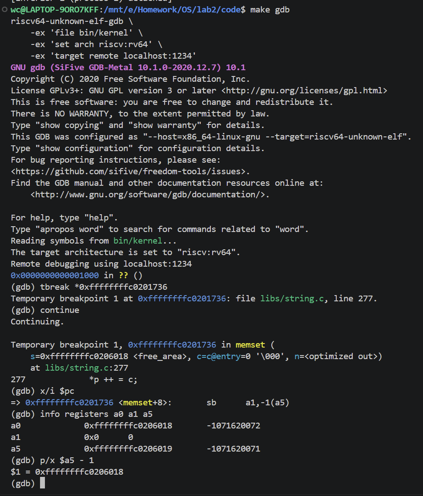 在普通 GDB 中对 `get_physical_address()` 设置 `addr == 0xffffffffc0206018 && access_type == 1` 的条件断点后，实际命中时 `addr` 与 Guest 中计算出的地址一致，`access_type=1` 表示数据 Store，`satp=0x8000000000080205` 表明此时已开启 Sv39 分页。 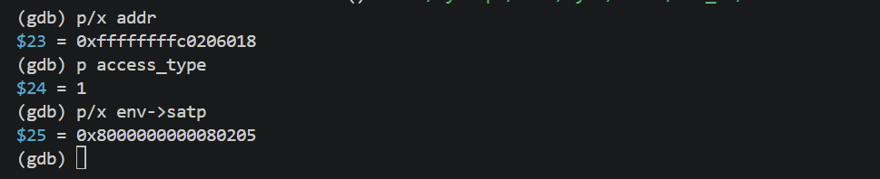 调用栈进一步给出了此次写入在 QEMU 中经过的路径： ```text sb a1,-1(a5)（Guest 指令）  → helper_ret_stb_mmu()  → store_helper()  → tlb_fill()  → riscv_cpu_tlb_fill()  → get_physical_address() ``` `store_helper()` 负责处理字节写入，`tlb_fill()` 说明这次访问没能直接使用已有的软件 TLB 映射；随后进入 RISC-V 专用的 `riscv_cpu_tlb_fill()`，由 `get_physical_address()` 根据当前分页模式查找物理地址。`riscv_cpu_tlb_fill()` 会检查 `get_physical_address()` 的返回值：翻译成功便调用 `tlb_set_page()` 保存映射和访问权限，失败则进入相应的异常处理。这条调用路径既说明了访存为什么会进入页表查询，也说明查询成功后并不是每次都要重查页表。 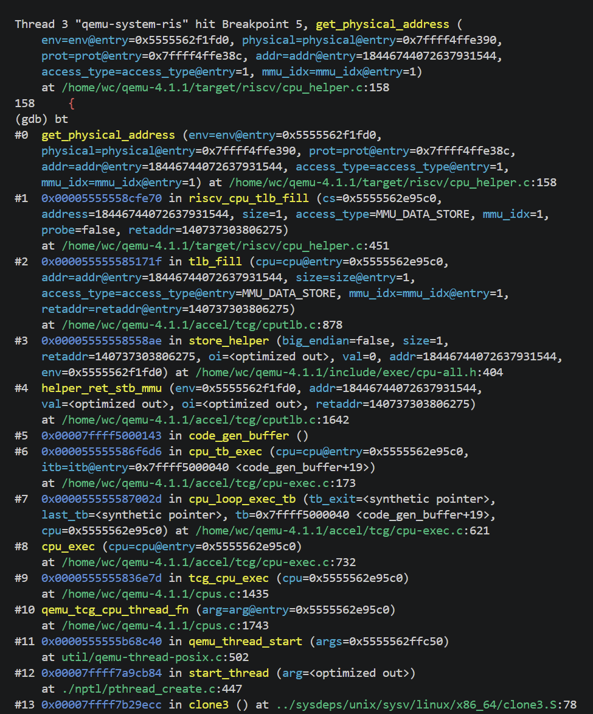 为了看清这条 `sb` 如何完成虚实地址转换，继续沿这次 Store 的调用栈单步，记录了下面几个实际结果。 **（1）从指令算出数据虚拟地址。** 在 RISC-V GDB 中通过 `tbreak *0xffffffffc0201736` 停在 `sb a1,-1(a5)` 执行前。此时 `a0=0xffffffffc0206018`、`a1=0`、`a5=0xffffffffc0206019`。`sb` 的寻址方式是 `a5-1`，因此这次写入的数据虚拟地址是 `0xffffffffc0206018`，写入值为 `0`。`0xffffffffc0201736` 只是这条指令自身的 PC，并不是它访问的数据地址（见图 `1.png`）。 **（2）确认 QEMU 收到的是同一次写入。** 在普通 GDB 中设置条件断点： ```gdb break get_physical_address if addr == 0xffffffffc0206018 && access_type == 1 ``` 继续执行 Guest 的 `sb` 后，断点命中 `target/riscv/cpu_helper.c:158`。打印得到 `addr=0xffffffffc0206018`、`access_type=1`、`mmu_idx=1`，与 Guest 计算出的数据地址一致。调用栈显示这次访问依次经过 `helper_ret_stb_mmu()`、`store_helper()`、`tlb_fill()`、`riscv_cpu_tlb_fill()`，最终进入 `get_physical_address()`。说明本次 Store 没有直接使用已有的软件 TLB 映射，需要进行页表查询（见图 `2.png`、`3.png`）。 **（3）根据虚拟地址找到实际的 PTE。** QEMU 读取 `satp=0x8000000000080205`，确定采用 Sv39，根页表物理基址为 `0x80205000`。当前从根级开始查询，使用虚拟地址的 VPN[2] 作为索引： ```text idx      = (0xffffffffc0206018 >> 30) & 0x1ff = 0x1ff pte_addr = 0x80205000 + 0x1ff * 8        = 0x80205ff8 pte      = ldq_phys(cs->as, pte_addr)    = 0x200000cf ppn      = pte >> 10                      = 0x80000 ``` 在 `cpu_helper.c:256` 的 GDB 断点处，实际打印出 `base=0x80205000`、`idx=0x1ff`、`pte_addr=0x80205ff8`、`pte=0x200000cf` 和 `ppn=0x80000`。其中 `ldq_phys()` 是从模拟物理内存取出 PTE，右移 10 位则是提取其中的 PPN。PTE 的 V、R、W、X 位有效，说明根级表项本身就是可写的 1 GiB 叶子映射，不需要继续查下两级页表。 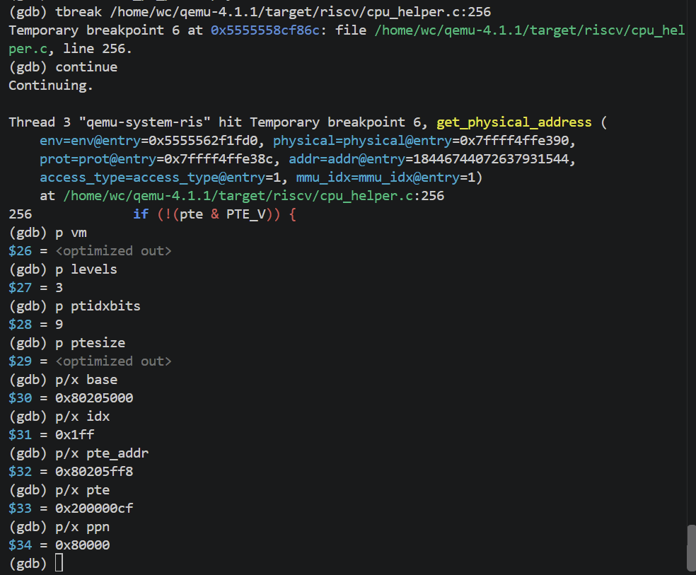 **（4）计算写入位置对应的物理地址。** 对于根级 1 GiB 叶子项，QEMU 需要保留虚拟页号中的低 18 位，把它们与叶子 PTE 给出的 PPN 组合。`cpu_helper.c` 中的实际计算语句为： ```c *physical = (ppn | (vpn & ((1L << ptshift) - 1))) << PGSHIFT; ``` 此时 `ptshift=18`、`PGSHIFT=12`，因此： ```text vpn 低 18 位  = (0xffffffffc0206018 >> 12) & 0x3ffff = 0x206 物理页基址    = (0x80000 | 0x206) << 12 = 0x80206000 页内偏移      = 0xffffffffc0206018 & 0xfff = 0x18 最终物理地址  = 0x80206000 | 0x18 = 0x80206018 ``` 在 `cpu_helper.c:337` 处，GDB 打印出的 `*$store_pa_ptr` 为 `0x80206000`，再结合保存的虚拟地址计算页内偏移 `0x18`，最终得到 `0x80206018`。这与页表项计算结果一致。 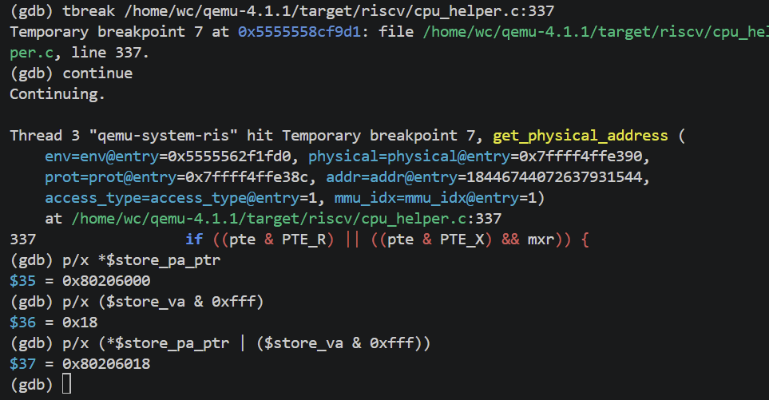 因此，本次调试完整对应了 **`sb a1,-1(a5)` → 数据虚拟地址 `0xffffffffc0206018` → 查询 Sv39 根页表项 → 物理页基址 `0x80206000` → 实际物理地址 `0x80206018`** 的过程。QEMU 随后可以使用这个翻译结果填充软件 TLB，并完成对相应 Guest 内存位置的写入。

#### Sv39 页表查询过程

在 `target/riscv/cpu_helper.c` 中单步 `get_physical_address()`，可以将查询过程分成确定分页配置、定位页表项、检查页表项和计算物理地址四步。

首先，函数从 `satp` 读取分页模式和根页表物理页号。 `satp=0x8000000000080205`，其 MODE 字段为 8，即 Sv39；根页表物理基址 `base=0x80205000`。Sv39 使用三级页表，每级索引 9 位，每个 PTE 占 8 字节，普通页的页内偏移为 12 位。GDB 在循环入口实际读到了 `levels=3`、`ptidxbits=9` 和 `base=0x80205000`。

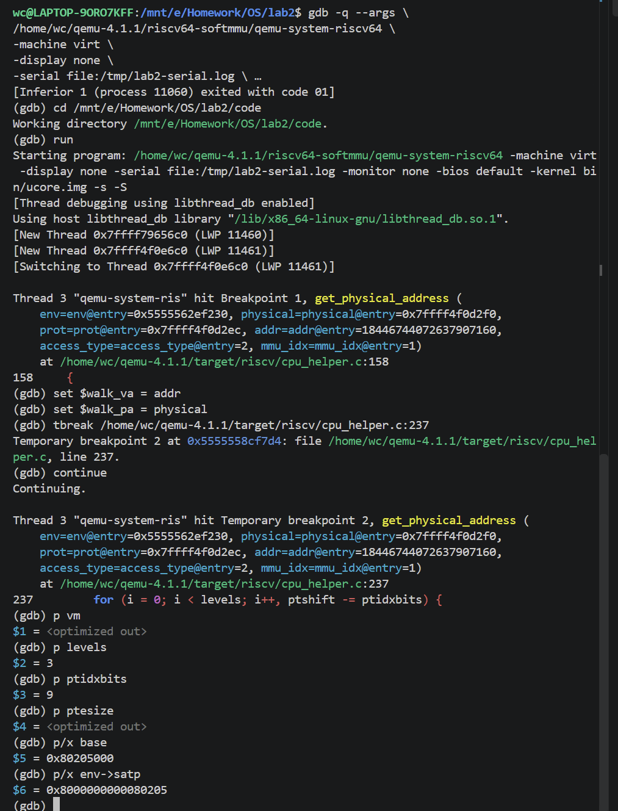

接下来执行的代码是一个最多迭代三次的 `for` 循环，而不是三个彼此独立的循环。第一次 `ptshift=18`，使用虚拟地址中的 VPN[2] 查根页表；如果 PTE 指向下一级页表，就依次把 `ptshift` 减为 9、0，改用 VPN[1]、VPN[0] 继续查。

循环中先计算索引，再定位当前 PTE：

```c
idx = (addr >> (PGSHIFT + ptshift)) & ((1 << ptidxbits) - 1);
pte_addr = base + idx * ptesize;
pte = ldq_phys(cs->as, pte_addr);
ppn = pte >> PTE_PPN_SHIFT;
```

对于 `0xffffffffc02000d8` 和 `0xffffffffc0206018` 这两个内核高地址，根级索引均为 `0x1ff`（511），因此 `pte_addr=0x80205000+511×8=0x80205ff8`。其中 `ldq_phys()` 才是真正从 Guest 物理内存读取 8 字节 PTE 的操作；下一行 `pte >> 10` 只是从已经读出的 PTE 中提取物理页号，不会再访问一次页表。取指单步得到 `pte=0x200000cf`、`ppn=0x80000`，Store 查询也得到相同的根级 PTE。

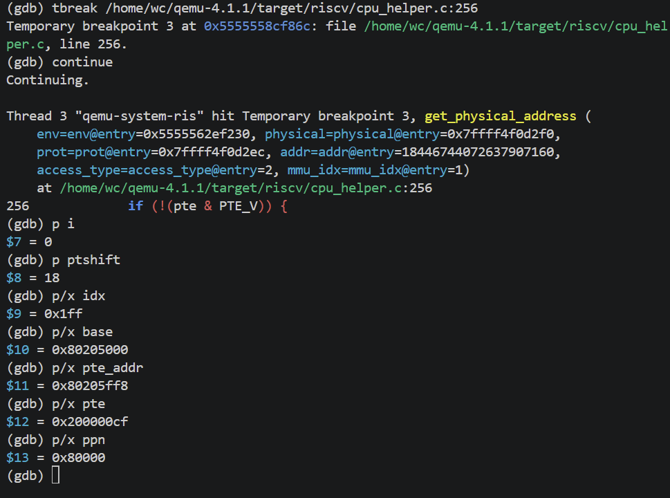


读取 PTE 后，QEMU 会先判断 `PTE_V` 是否有效，再根据 R/W/X 位区分叶子项和下一级页表指针，同时检查访问权限、特权级、大页对齐以及 A/D 位。本次 `PTE=0x200000cf` 的 V、R、W、X、A、D 位均为 1，属于根级的 1 GiB 叶子映射，所以可以直接计算物理地址，不必进入第二级页表。

在物理地址计算处，QEMU 用叶子 PTE 的 PPN 与虚拟页号中的低位组合，得到包含在大页内的 4 KiB 物理页基址，再保留原虚拟地址的低 12 位页内偏移：

```c
*physical = (ppn | (vpn & ((1L << ptshift) - 1))) << PGSHIFT;
```

对 `kern_init` 取指地址 `0xffffffffc02000d8`，单步得到物理页基址 `0x80200000`、页内偏移 `0xd8`，因此完整物理地址为 `0x802000d8`。

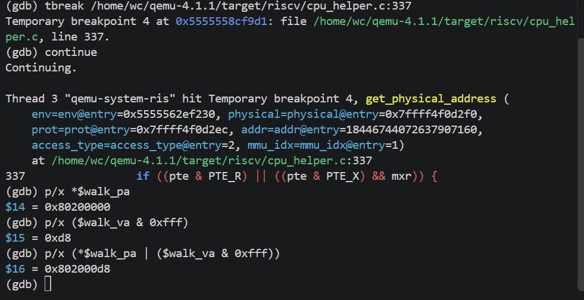

对前面 `memset()` 的 Store 地址 `0xffffffffc0206018`，查到的仍是同一个 1 GiB 叶子 PTE，但页内对应的物理页不同。GDB 得到物理页基址 `0x80206000`、偏移 `0x18`，最终为 `0x80206018`。这样就把 Guest 中执行的 `sb` 和 QEMU 计算出的物理地址对应了起来：

```text
Store 数据 VA：0xffffffffc0206018
物理页基址：  0x80206000
页内偏移：    0x18
最终 PA：     0x80206018
```


#### QEMU 软件 TLB 的查找

RISC-V 的地址转换通常先查 TLB，只有缓存不能提供有效映射时才需要遍历页表。QEMU 4.1.1 的对应实现位于 `accel/tcg/cputlb.c`。为观察这一过程，在普通 GDB 中对 `get_page_addr_code()` 设置断点，跟踪虚拟地址 `0xffffffffc02000d8` 的取指。

`get_page_addr_code()` 先通过 `tlb_index()` 定位软件 TLB 中的缓存位置，使用 `tlb_entry()` 取得条目，再执行 `tlb_hit(entry->addr_code, addr)` 检查当前条目是否对应需要取指的虚拟页。若主 TLB 未命中，代码先尝试 Victim TLB；仍未命中才调用 `tlb_fill()`。

```c
if (unlikely(!tlb_hit(entry->addr_code, addr))) {
    if (!VICTIM_TLB_HIT(addr_code, addr)) {
        tlb_fill(env_cpu(env), addr, 0, MMU_INST_FETCH, mmu_idx, 0);
        index = tlb_index(env, mmu_idx, addr);
        entry = tlb_entry(env, mmu_idx, addr);
    }
    assert(tlb_hit(entry->addr_code, addr));
}
```

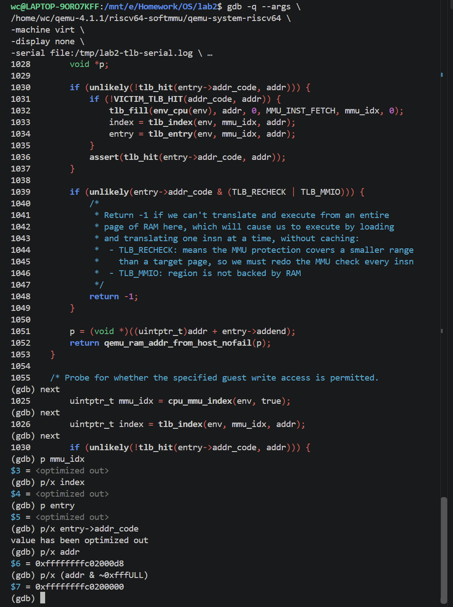

实际调试时，`get_page_addr_code()` 在第 1032 行进入 `tlb_fill()`，说明本次取指没有可用的主 TLB 或 Victim TLB 条目。调用栈中依次出现 `get_page_addr_code → tlb_fill → riscv_cpu_tlb_fill`，本次访问地址仍为 `0xffffffffc02000d8`，访问类型为 `MMU_INST_FETCH`，`mmu_idx=1`。

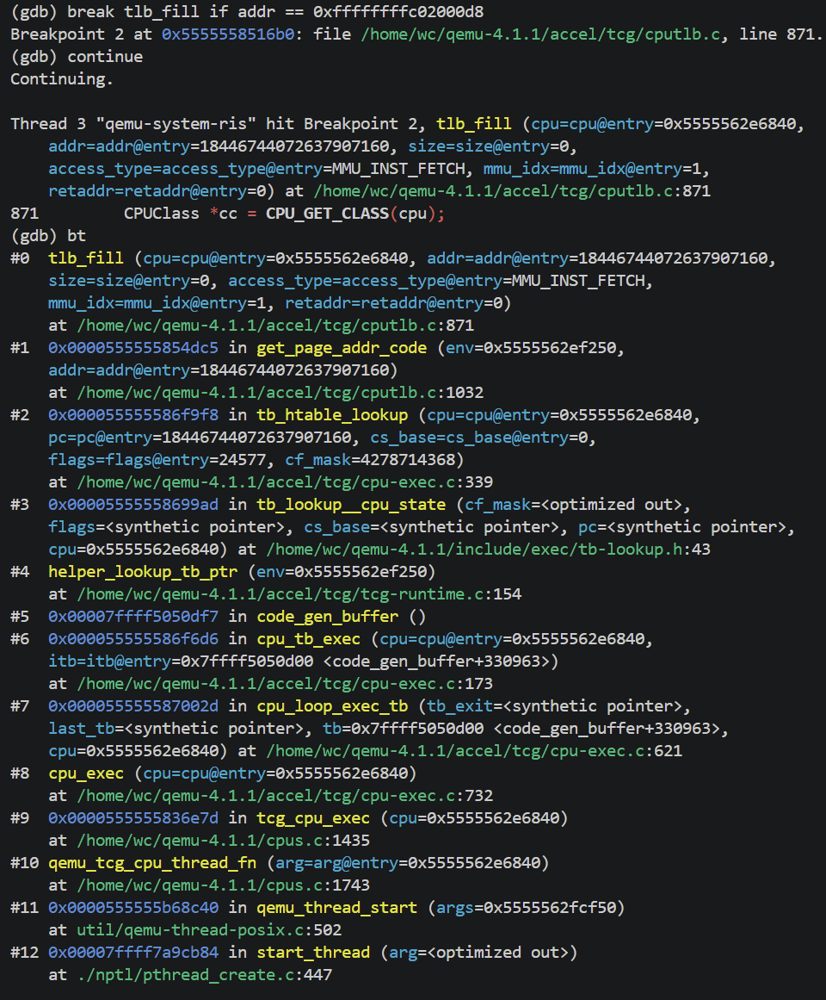

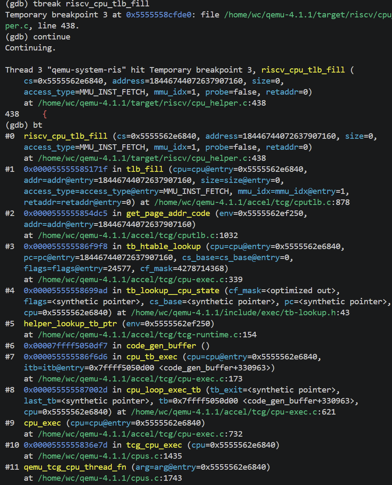

接下来，`riscv_cpu_tlb_fill()` 调用 `get_physical_address()` 按 Sv39 查询页表。该函数实际返回成功状态 `0`，得到物理页基址 `0x80200000`，权限 `prot=0x7`。在成功分支中，`tlb_set_page()` 收到虚拟页 `0xffffffffc0200000`、物理页 `0x80200000`、`mmu_idx=1` 和填充大小 `4096` 字节。虽然 Guest 的 PTE 是 1 GiB 大页映射，QEMU 仍可为当前访问对应的 4 KiB 子区域建立软件 TLB 条目。

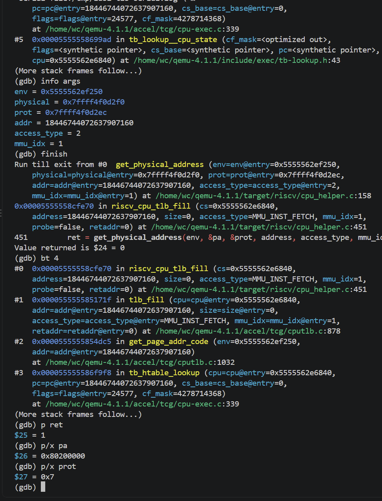

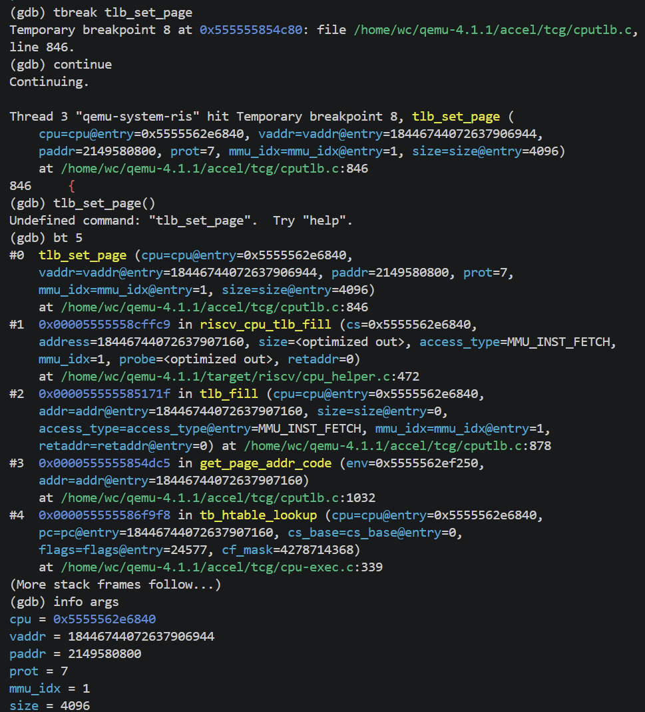

最后返回 `get_page_addr_code()`，程序运行到 `assert(tlb_hit(entry->addr_code, addr))`。此时打印出 `entry->addr_code=0xffffffffc0200000`，与本次取指所在的虚拟页一致；`next` 又正常执行到下一条检查语句，说明填充后的条目已经可用。

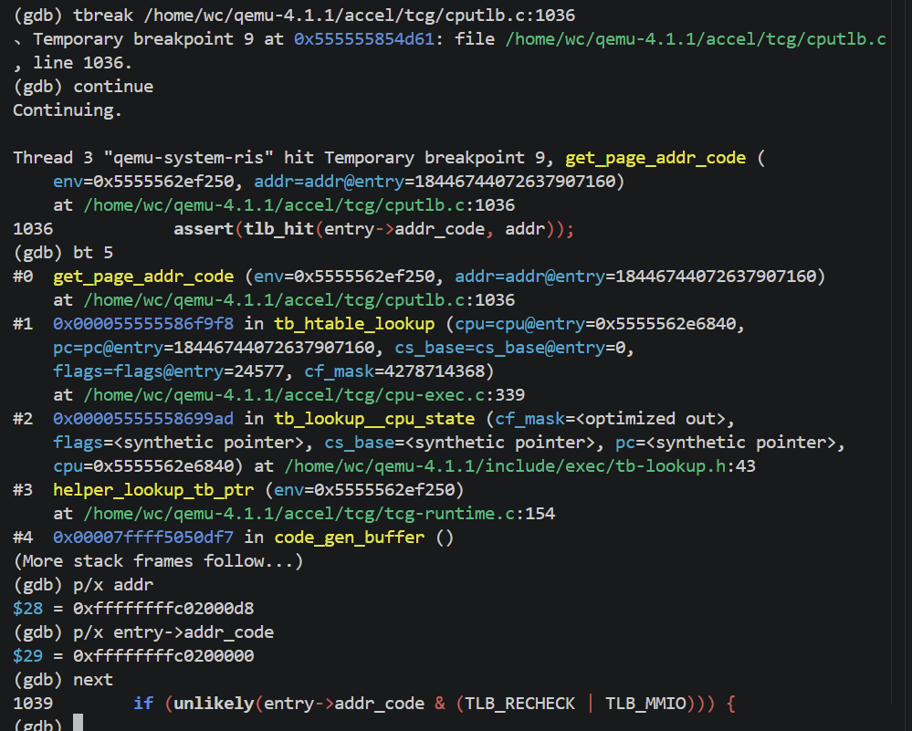

由此可以把取指过程连起来：先查询 QEMU 软件 TLB；Miss 后进入 `tlb_fill()` 和 RISC-V 的 Sv39 页表查询；成功后通过 `tlb_set_page()` 保存映射，再次检查发现 TLB 已可命中。数据 Store 则走 `store_helper()` 中相应的写入检查和填充路径。软件 TLB 已缓存同一虚拟页时，后续访问便不需要反复执行 `get_physical_address()`。

#### QEMU 软件 TLB 与真实 CPU 硬件 TLB 的区别

为了比较两者的区别，分别调试了开启分页前后的访存过程。

首先观察 `entry.S` 中设置 `satp` 之前的 `sd a0,0(t0)` 指令。此时还没有开启 Sv39 分页，QEMU 在处理地址转换时不需要查询页表，而是直接将访问地址作为 Guest 物理地址。但在软件 TLB 中没有对应缓存时，QEMU 仍可能调用 `tlb_fill()` 建立映射。

随后观察开启 Sv39 后的访存。此时 QEMU 同样会先查软件 TLB，未命中时才调用 `get_physical_address()`，根据 `satp` 找到根页表，逐级读取 PTE，计算出物理地址，再通过 `tlb_set_page()` 缓存转换结果。

对比发现，真实 CPU 的硬件 TLB 主要用于缓存虚拟页到物理页的映射，减少页表查询；在 Bare 模式下，CPU 不需要进行这种页表转换。而 QEMU 的软件 TLB 除了缓存 Guest 的地址映射和访问权限，还要帮助模拟器快速找到对应的宿主内存。因此，即使 Guest 没有开启分页，QEMU 仍可能使用软件 TLB。

也就是说，真实 CPU 的 TLB 主要是为了加速地址翻译，而 QEMU 的软件 TLB 还要加速整个模拟访存过程。这也是为什么 Bare 模式下仍然可能观察到 QEMU 的 TLB 填充操作。

#### 调试现象与收获

调试过程中遇到了几个比较有意思的现象。

首先，在单步执行 `memset()` 中的 `sb` 指令时，发现每次写入的地址都增加 1，但 QEMU 并没有每次都进入 `get_physical_address()`。结合 TLB 查询代码才明白，这些地址都在同一个虚拟页内，第一次完成地址转换后，后续访问可以直接使用软件 TLB 中已有的映射，不需要反复查页表。

另外，有一次明明在 `get_physical_address()` 处命中了断点，查看调用栈后却发现，它并不是由 CPU 访存触发的，而是 GDB 删除断点时，QEMU 为了更新相关信息而主动进行的地址查询。这也让我意识到，同一个函数可能在不同情况下被调用，不能只看到断点命中就认为找到了想要的执行路径，还要结合调用栈判断。

调试时还遇到过部分变量显示 `<optimized out>` 的情况，因此有时需要通过函数返回值和后续执行的代码来判断结果。这次实验也让我对 QEMU 如何用软件模拟 CPU 的地址翻译和 TLB 缓存机制有了更具体的认识。

#### 大模型辅助调试记录

这次实验主要使用大模型辅助理解 QEMU 源码，以及解决 GDB 调试过程中遇到的问题。

一开始对两个 GDB 的分工不太清楚，后来通过向大模型询问，弄明白了普通 GDB 用来调试 QEMU 本身，而 RISC-V GDB 用来控制模拟器中的内核。之后在调试 `get_page_addr_code()` 时，我尝试打印 `access_type` 和 `physical`，却一直提示变量不存在。将报错和调用栈发给模型分析后，才发现自己把 TLB 查询函数和页表翻译函数中的变量混在了一起。

后面还有一次，虽然成功进入了 `get_physical_address()`，但调用栈与预期不符。模型提醒我检查上层调用关系，最后发现这次调用是由 GDB 删除断点引起的，并不是真正的 TLB Miss。于是重新设置断点，先确认进入 `riscv_cpu_tlb_fill()`，再跟踪 `get_physical_address()`、`tlb_set_page()` 和 `tlb_hit()`，最终观察到了完整的 TLB 查询与填充过程。

整个过程中，大模型主要帮助我分析报错、理解代码和确定下一步该怎么调试，实际的函数调用关系、地址转换结果和 TLB 命中情况都是通过 GDB 逐步验证的。

## 五、测试与验证

### 5.1 复验准备

测试使用第二章的 CompilerLab 与 QEMU 4.1.1 环境。代码基线为 `lab2` 分支提交 `176f6aae68c566627b9d99e8fa5b708cc49ca6de`，本次提交在该基线上包含 Best-Fit 与 First-Fit 尾插修复、独立回归工具、任务标记调整及 SLUB 满页复用测试。日志来源见 [验证材料说明](validation/README.md)。

在 Windows PowerShell 中进入 WSL：

```powershell
wsl -d CompilerLab
```

随后在 WSL 中设置工作目录和工具路径：

```bash
cd /mnt/c/Users/18695/Desktop/Operating-System/code
source "$HOME/.config/compilerlab/riscv-env.sh"
hash -r
export QEMU="$HOME/.local/opt/qemu-4.1.1/bin/qemu-system-riscv64"
"$QEMU" --version
riscv64-unknown-elf-gcc --version
```

以下命令均在 `code/` 目录执行。通过 `make ... qemu` 启动的内核在检查完成后停留于内核循环，按 `Ctrl+A`，松开后按 `X` 退出，再执行下一项；评分及回归脚本会自行结束。

### 5.2 默认启动与官方评分

#### 默认启动与页初始化

```bash
make PMM=best_fit qemu
```

默认启动完成设备树解析、页描述符建立及 `check_alloc_page()` 自检，选择的管理器为 `best_fit_pmm_manager`。

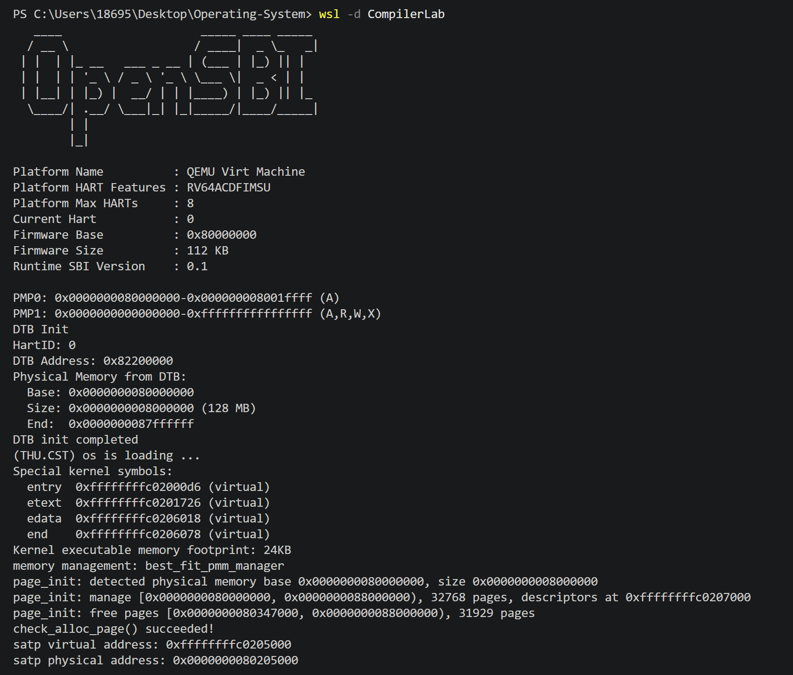

| 观察项 | 本次截图中的结果 | 对应含义 |
|--------|------------------|----------|
| 物理内存范围 | 基址 `0x80000000`，大小 `0x08000000`（128 MiB），末字节 `0x87ffffff` | 设备树提供了当前 RAM 的起点与容量 |
| 描述符数量与起点 | 32768 个，位于虚拟地址 `0xffffffffc0207000` | 对管理范围内的物理页逐页建立描述符 |
| 初始空闲区 | `[0x80347000,0x88000000)`，31929 页 | 排除了固件、内核、描述符及对齐占用 |
| 页分配检查 | `check_alloc_page() succeeded!` | 当前 Best-Fit 的原有框架检查执行成功 |
| 启动根页表位置 | 虚拟地址 `0xffffffffc0205000`，物理地址 `0x80205000` | 两者按当前内核映射偏移对应，输出的是页表地址 |

#### 官方评分

```bash
make grade
```

页面初始化、Best-Fit 两项均为 OK，评分 **20/20**。

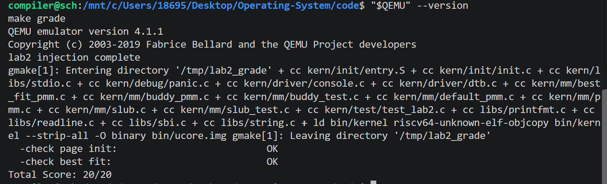

两次评分输出分别见 [Best-Fit 修复后](validation/qemu411-grade.log)和 [SLUB 满页复用测试补充后](validation/qemu411-full-reuse-grade.log)的日志。

### 5.3 页分配器尾插缺陷回归

#### Best-Fit

```bash
python3 tools/check_best_fit_tail.py
```

[回归脚本](../code/tools/check_best_fit_tail.py)复制源码到独立临时目录，将 [回归用例](../code/tools/test_best_fit_tail.c)接入真实页初始化之前。用例使用 16 个受控描述符验证 Best-Fit 的合法调用序列，结束后恢复全局变量和空管理器，随后继续执行真实 `page_init()` 与原有框架自检。

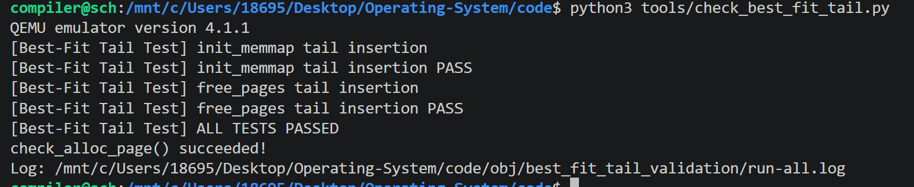

| 用例 | 构造与关键判据 | 修复前 | 修复后 |
|------|----------------|--------|--------|
| 初始化尾插 | 依次登记低地址 2 页块和不相邻的高地址 1 页块，连续申请单页，检查地址互异、耗尽及归还后的链表连接 | 两个存活申请返回同一页，`x != y` 断言失败 | PASS |
| 释放尾插 | 将 16 页分成 2/1/1/12 页四块，释放第一、第三块，连续单页申请应互异；全部归还后可重新申请完整 16 页 | 两个存活申请返回同一页，`x != y` 断言失败 | PASS |

两项回归 **2/2 通过**，恢复真实页管理后继续输出 `check_alloc_page() succeeded!`。

修复前在未加入两处 `break` 的临时副本上分别运行 `--case init`、`--case free`，日志见 [初始化尾插](validation/best-fit-tail-before-init.log)和 [释放尾插](validation/best-fit-tail-before-free.log)。修复后完整输出见 [回归通过日志](validation/best-fit-tail-after.log)。

#### First-Fit 参考实现

```bash
python3 tools/check_best_fit_tail.py --manager first_fit
```

同一运行器在临时内核副本中选择 First-Fit，并接入 [First-Fit 回归用例](../code/tools/test_first_fit_tail.c)。

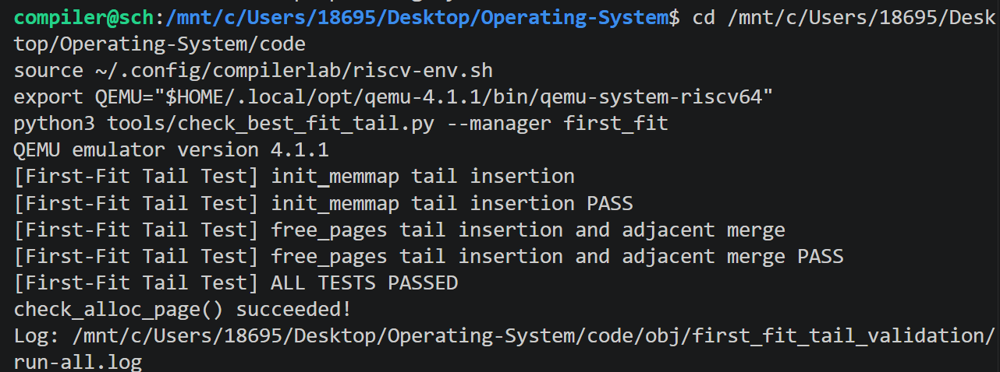

| 用例 | 关键判据 | 修复前 | 修复后 |
|------|----------|--------|--------|
| 初始化尾插 | 登记低地址 2 页块和高地址 1 页块，检查双向链接及按地址分配 | 新尾节点的前驱链接断言失败 | PASS |
| 释放尾插与合并 | 将 16 页分成 2/1/13 页三块，释放前两块后应能申请连续 3 页；最终可重建 16 页块 | 连续 3 页申请失败 | PASS |

QEMU 4.1.1 上两项 **2/2 通过**，随后 First-Fit 原有页分配检查成功。日志见 [修复前初始化](validation/first-fit-tail-before-init.log)、[修复前释放](validation/first-fit-tail-before-free.log)及 [修复后](validation/first-fit-tail-after.log)。同轮 [Best-Fit 回归](validation/best-fit-after-first-fit-fix.log)仍为 2/2，[官方评分](validation/qemu411-first-fit-fix-grade.log)仍为 20/20。

### 5.4 Buddy 专项测试

```bash
make PMM=buddy BUDDY_TEST=1 qemu
```

复验 **12/12 通过**，最终标记为 `[Buddy Test] ALL TESTS PASSED (12 cases)`。真实页初始化得到 31923 空闲页，测试结束后计数恢复。完整输出见 [Buddy 日志](validation/qemu411-buddy.log)。

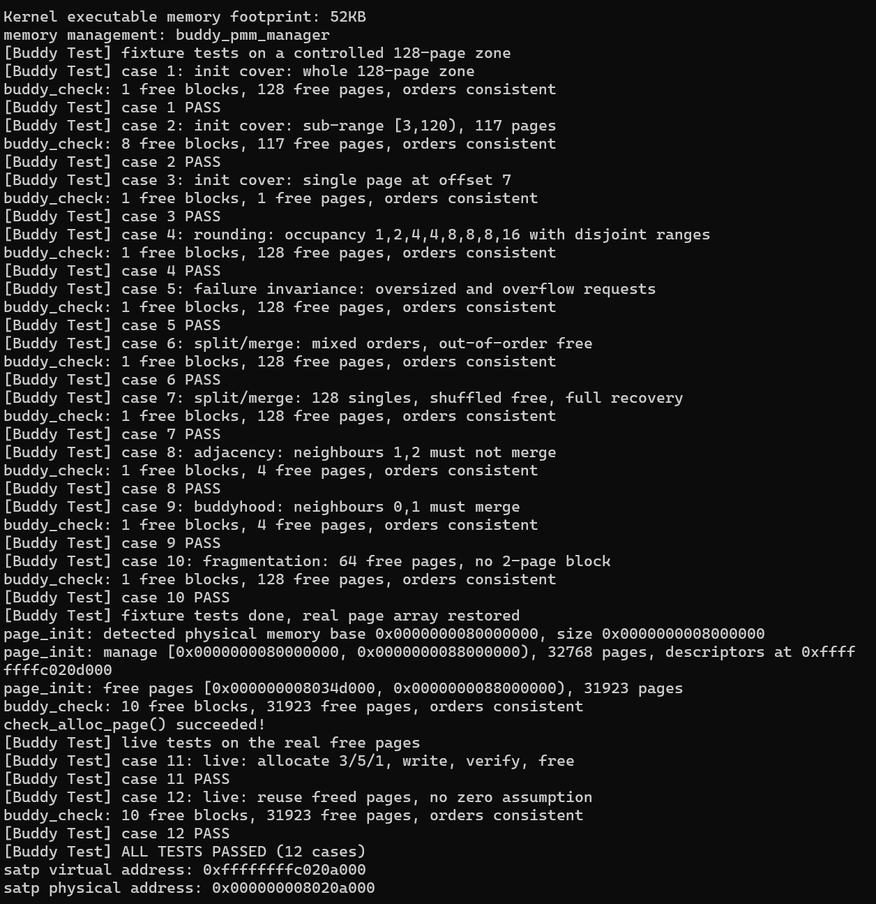

| 用例 | 场景与关键断言 | 针对的错误 |
|------|----------------|------------|
| 1 | 登记 `[0,128)`，申请 128 个互异单页，第 129 次失败，全部释放恢复 | 漏登记、重复分配、错误计数 |
| 2 | 登记 `[3,120)` 的 117 页，返回偏移集合恰为 3..119，区外保持 Reserved | 非对齐区间越界或遗漏 |
| 3 | 仅登记偏移 7 一页，耗尽、释放、再次取得同一页 | 单页退化路径 |
| 4 | 请求 1/2/3/4/5/7/8/9，实际占用显式为 1/2/4/4/8/8/8/16，并检查对齐与互不重叠 | 非整幂取整、按原请求扣页、分裂重叠 |
| 5 | 超总量、32769、`SIZE_MAX` 失败，计数不变，之后仍能正常申请 | 失败污染状态、溢出或阶越界 |
| 6 | 16/3/1 混合阶分配，非原顺序释放，最终可申请完整 128 页 | 跨阶合并缺失、合并重复计数 |
| 7 | 128 个单页按固定排列打乱释放，每次只加 1，最终重建 128 页块 | 不同释放顺序下递归合并不完整 |
| 8 | 四次单页申请后释放偏移 1、2：总空闲 2，但申请 2 页必须失败 | 把相邻但非伙伴的块合并 |
| 9 | 独立重建后释放偏移 0、1：申请 2 页成功，再归还其他原始分配并重建 4 页块 | 真伙伴未合并 |
| 10 | 只释放 64 个偶数单页，申请 2 页失败；补齐奇数页后重建整块 | 将总空闲量误当连续块可用性 |
| 11 | 真实分配 3/5/1，按实际块占用检查计数、范围和不同数据模式 | 真实地址转换、块重叠、归还泄漏 |
| 12 | 真实释放再分配 2 页，先写再读，不依赖内存原有内容 | 重用路径和资源恢复 |

结构检查核对链表节点的阶、头标志、对齐、首页范围和页数总和；逐页分配及地址集合断言检查完整覆盖与块间隔离。

**变异测试。** 在临时副本中分别引入以下错误，观察独立测试是否能将其检出：

| 变异 | 失败位置 | 观察结果 |
|------|----------|----------|
| `nr_free -= B` 改成 `nr_free -= n` | 用例 4 | 3 页请求只扣 3 页，期望为 4；FAIL 后 panic |
| 禁止伙伴合并 | 用例 6 | 全部释放后仍无法申请 128 页；FAIL 后 panic |

### 5.5 SLUB 专项测试

```bash
make PMM=buddy SLUB=1 SLUB_TEST=1 qemu
```

补充满页复用用例后的复验：**12/12 通过**，最终标记为 `[SLUB Test] ALL TESTS PASSED (12 cases)`。本次镜像初始空闲页为 31859，全部释放后恢复该基准。完整输出见 [增强测试日志](validation/qemu411-slub-full-reuse.log)，构建输出见 [构建日志](validation/qemu411-slub-full-reuse-build.log)。

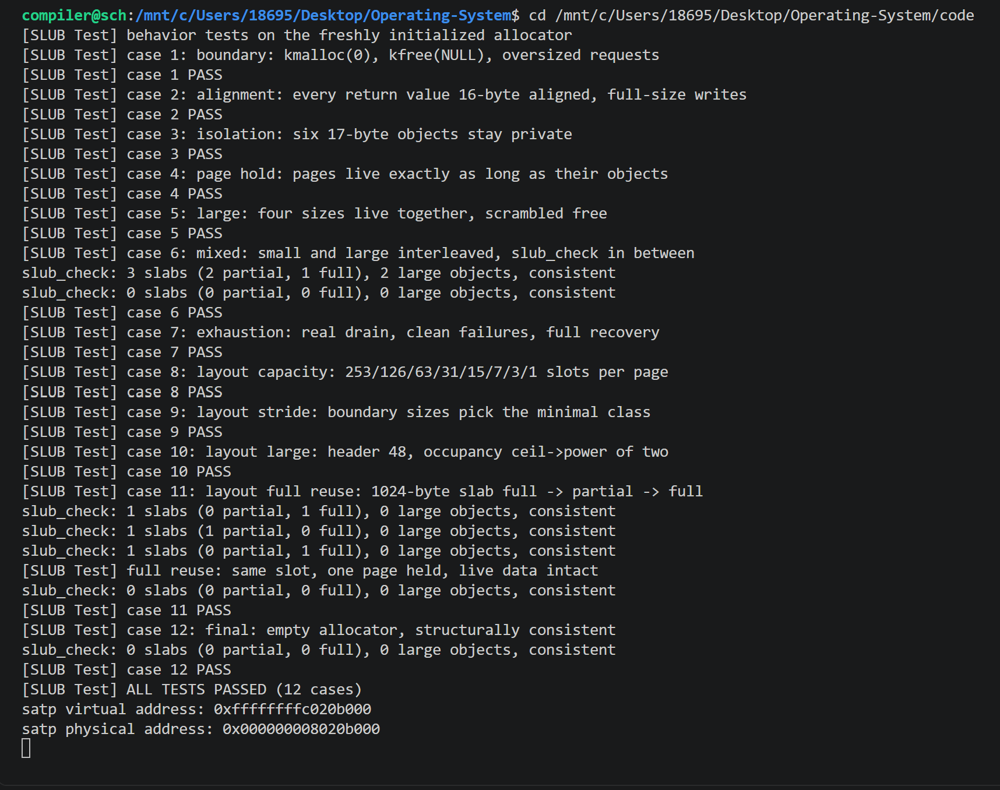

B1..B7 验证公共行为，L8..L11 验证当前布局，用例 12 作全空终检。

| 用例 | 场景与关键断言 | 针对的错误 |
|------|----------------|------------|
| B1 | 0/NULL 不耗页，`SIZE_MAX` 与半最大值失败且状态不变，之后可继续申请 | 零请求、溢出和失败路径污染 |
| B2 | 10 种大小含 1、2048/2049、4096、10000，检查 16 字节对齐并写读完整请求范围 | 对齐、可用空间不足或对象相互覆盖 |
| B3 | 六个 17 字节对象区间互不重叠，写入不同模式，中间释放后重分配 | 类别选小、别名和跨对象破坏 |
| B4 | 单个 2048 对象释放后还页；两个 16 字节对象仍有一个存活时页面保留，全部释放恢复 | 提前还页或空页泄漏 |
| B5 | 2049/4096/8193/10000 四个大对象与小对象共存，乱序释放并复查幸存对象 | 大对象覆盖、归还参数或元数据记录错误 |
| B6 | 小大对象混合，存活与全空时调用 `slub_check()` | 链表状态、槽计数和大对象计数不一致 |
| B7 | 底层排空至 3 页时 12288 请求失败、2049 请求仍可用；排空至 0 时大小路径都失败；逐页归还并复验可用 | 资源不足未检查 NULL、失败扣页、恢复泄漏 |
| L8 | 每类分配到容量，再多分一个必须新开一页；首槽偏移 48 | 当前布局容量或头部计算错误 |
| L9 | 14 组边界请求验证最小类别的槽步长；释放槽再次返回且不耗新页 | 类别选大、槽位置和复用错误 |
| L10 | 2049/4048/4049/8193/16385/65536 的实际占用显式为 1/1/2/4/8/32 页，逐次分配与释放核对增量 | 大对象加头计算、Buddy 取整、释放占用错误 |
| L11 | 三个 1024 字节对象填满一页；释放中间对象再申请，地址相同且不增页，幸存对象数据完整，全部释放恢复基准 | 满页释放后未移回可分配链、错误新开页、返回存活槽或数据破坏 |
| 12 | 全局页数恢复基准，空状态结构检查通过 | 累计资源泄漏或管理记录残留 |

L11 的结构输出依次为 `1 full → 1 partial → 1 full → 0 slabs`，对应满页、释放中间槽、原槽复用及全部归还；整个过程中保留其他存活对象并核对其数据。

耗尽用例通过静态数组保存并归还 31859 个原始单页分配，避免将大量记录压入内核栈。

### 5.6 配置切换回归

开发阶段已完成七相位不 clean 切换，观察到各配置均选择了对应管理器，专项测试输出只出现在相应测试配置中：

| 阶段 | 配置 | 观察结果 |
|------|------|----------|
| A | `best_fit` | Best-Fit 正常检查，无 SLUB/专项测试输出 |
| B | `buddy` | Buddy 结构检查，无专项测试输出 |
| C | `buddy_slub` | 出现一次 SLUB 启用行，不运行专项测试 |
| D | `buddy_slub_test` | 当时 SLUB 11/11 通过，不运行 Buddy 专项测试；增强后的 12/12 结果见 5.5 节 |
| E | `buddy_test` | Buddy 12/12 通过，无 SLUB 输出 |
| F | `buddy` | 切回普通 Buddy，无测试残留 |
| G | `best_fit` | 切回默认管理器，无 SLUB/测试残留 |

切换时重新链接共享镜像，五个配置的对象目录分别保留。

非法组合在开发阶段验证为 `make` 解析时报错、退出码 2，包括未知 PMM、非 0/1 开关、默认 Best-Fit 启用 SLUB/测试、Buddy 未启用 SLUB 却要求 SLUB_TEST、BUDDY_TEST 与 SLUB 或 SLUB_TEST 同时启用。

### 5.7 验证边界

内核体积和测试静态数组会改变 `end` 与描述符起点，各配置据本次运行的空闲页基准核对分配、释放增量及最终恢复值。

本次未执行随机交错压力测试、SLUB 变异测试、私有元数据损坏注入、设备树异常布局及零空闲页启动注入、Buddy 零请求预期 panic、多核或中断并发测试，以及性能基准。满页复用专门用例覆盖 1024 字节类别。当前实现使用单段 DRAM 和单 hart；多段物理内存与保留区管理、并发同步仍需扩展。

## 六、实验总结与收获

### 6.1 对操作系统的理解

| 实验中的知识点 | 对应 OS 原理 | 本实验的具体含义与边界 |
|----------------|-------------|----------------------|
| `Page` 数组和保留区 | 物理内存管理、系统元数据 | 描述物理内存需要先占用物理内存；可映射不等于可分配 |
| First-Fit/Best-Fit | 连续分配与外部碎片 | 选择策略影响余块分布；空闲总量不能替代连续区间条件 |
| Buddy | 分级管理、分裂合并与内部碎片 | XOR 关系确定唯一伙伴；3 页请求占 4 页体现速度与空间利用的取舍 |
| SLUB 类别与槽位 | 对象分配、分层资源管理 | 多个小对象共享页以减少逐页分配浪费，但仍有类别取整和头部开销 |
| 原始页请求记录 | 资源所有权和生命周期 | 对象层必须保存足够信息，才能完整释放页层资源 |
| 启动恒等映射 | 地址翻译与引导过程 | 开启分页到跳转高地址之间的取指也必须有映射 |
| 独立测试和变异 | 不变量与错误检测 | 结构一致、计数恢复和行为正确各有不同证据，不能互相替代 |

本实验通过启动映射访问内存，并处理物理页和对象的分配。OS 原理中重要但尚未在本实验对应实现的内容包括用户进程地址空间、按需分页与缺页处理、页替换和交换、写时复制、进程调度、文件系统，以及多核同步和内存一致性。

### 6.2 AI 协作开发的经验

**实现前先统一接口含义。** Buddy 的原请求页数、实际占用和释放参数必须在实现轮与测试轮使用同一约定。把这些含义写进提示词，才能让生成的模块和调用它的测试相互匹配。

**按状态转换补充测试。** Best-Fit 尾插和 SLUB 满页复用都表明，单次操作通过后，还应检查前后操作如何连接。测试设计可以从“登记—分配—释放”和“部分使用—满页—再次可用”等状态转换出发，再选择能区分错误实现的序列。

**测试代码同样需要审查。** 测试失败时，先核对调用序列是否合法，再检查期望值和计数基准，最后定位分配器。Buddy 的部分释放用例和 SLUB 的生命周期、占用断言均按这个顺序修正。

**检查函数也要保证运算安全。** 先验证整数范围，再构造指针；以剩余容量的差值检查块长，避免检查过程本身发生溢出或越界。

## 附录：提示词汇总

以下六段与 [prompt.md](prompt.md) 保持一致，环境路径、构建命令和运行条件已统一为当前 CompilerLab 与 QEMU 4.1.1 配置，其余任务约束和阶段要求按现有材料收录。提示词 6 的截断情况已在 4.5 节注明。

<a id="prompt-1"></a>

### 提示词 1：物理内存初始化

~~~~markdown
[PROMPT]

任务：
完成 ucore 的物理内存初始化模块。在 code/kern/mm/pmm.c 的“//lab2 function1 YOUR CODE”位置实现 static void page_init(void)。目标是把设备树报告的物理内存转化为 Page 描述符数组，保留已被系统占用的页面，并将剩余完整页面登记到当前分配器。

操作要求：
- 直接修改实际文件，主要修改范围为 code/kern/mm/pmm.c。
- 保留当前 First-Fit 管理器及已有初始化流程，不实现 Best-Fit。
- 可以增加本文件内部的 static 辅助函数，不改变公共接口。
- 不修改现有分配器和官方测试。
- 在 lab2 分支工作，保留已有改动；未经我逐次明确允许，不执行 commit，也不执行 push。
- 保留 lab2 任务标记，不猜测负责人的学号。
- 暂不修改实验报告。

输出要求：
说明实际改动，并用“固件 → 内核 → 描述符数组 → 空闲页”解释最终布局。列出执行过的检查和真实结果；不能运行的检查要说明具体阻塞，不得声称已经通过。


[RELY]

以下是当前框架的相关接口和约定，请先阅读对应代码核对。

1. 初始化调用关系

kern_init() 已先执行 dtb_init()，随后调用 pmm_init()。
pmm_init() 的顺序是：

init_pmm_manager();
page_init();
check_alloc_page();

进入 kern_init() 前，启动汇编已经开启 Sv39 分页。page_init() 不需要再次建立或启用页表。

2. 设备树查询接口，位于 code/kern/driver/dtb.h

uint64_t get_memory_base(void);
uint64_t get_memory_size(void);

两者返回物理内存起始地址和字节长度。当前框架采用从 DRAM_BASE 开始的一段连续物理内存模型。

3. 地址与页面定义

code/libs/riscv.h：
#define DRAM_BASE 0x80000000

code/kern/mm/mmu.h：
#define PGSIZE  4096
#define PGSHIFT 12
#define PPN(la) (((uintptr_t)(la)) >> PGSHIFT)

code/kern/mm/memlayout.h：
#define PHYSICAL_MEMORY_END    0x88000000
#define PHYSICAL_MEMORY_OFFSET 0xFFFFFFFF40000000
#define KERNEL_BEGIN_PADDR     0x80200000
#define KERNEL_BEGIN_VADDR     0xFFFFFFFFC0200000
#define KERNBASE               0xFFFFFFFFC0200000

libs/defs.h 已提供 ROUNDUP 和 ROUNDDOWN。实际写代码时使用工程宏，不再定义另一套地址常量。

4. 页描述符，位于 code/kern/mm/memlayout.h

struct Page {
    int ref;
    uint64_t flags;
    unsigned int property;
    list_entry_t page_link;
};

工程提供 SetPageReserved、PageReserved 等状态宏。

5. pmm.c 已定义的全局状态

struct Page *pages;
size_t npage = 0;
uint64_t va_pa_offset;
const size_t nbase = DRAM_BASE / PGSIZE;

含义：
- npage 是可管理物理页号的排他上界。
- 描述符数量是 npage - nbase。
- pages[i] 描述物理页号 nbase + i。

6. 可用接口和链接符号

extern char end[];
static void init_memmap(struct Page *base, size_t n);

end 表示内核镜像结束位置的虚拟地址。init_memmap() 将页面区间交给当前管理器；现有 First-Fit 要求这些页面在登记前处于 Reserved 状态。

pmm.h 已提供：
- PADDR(kva)：从内核虚拟地址转换为物理地址，转换依赖 va_pa_offset。
- pa2page(pa)：取得对应描述符，依赖 pages 和 npage。其实现只检查页号上界，调用方还需保证下界有效。
- page2pa(page)：取得描述符对应的物理页起始地址。

还可以使用 cprintf()、panic()。


[GUARANTEE]

必须实现：

static void page_init(void);

成功返回后：
- va_pa_offset、npage、pages 已正确建立；
- 已输出探测到的物理内存范围；
- 固件、内核和描述符数组占用的页面保持保留；
- 剩余完整页面已交给当前管理器，且只登记一次。

不修改 init_pmm_manager() 的管理器选择。


[SPECIFICATION]

## page_init

Pre-Condition：
- 启动映射已经建立。
- 设备树解析已经执行。
- 当前物理内存管理器已经完成自身初始化，尚未登记物理内存空闲区。

Post-Condition：
- 地址转换偏移与启动映射一致，在首次依赖该偏移前已设置。
- 可管理范围同时满足设备树报告范围和 PHYSICAL_MEMORY_END 的上界约束。
- 内存末端不足一页的部分不计入可管理页。
- pages 位于 end 之后，按页对齐；数组具有 npage - nbase 个描述符，并且整体位于合法内存中。
- 描述符先全部建立保留状态，再将合法空闲区交给分配器。
- 固件、内核、描述符数组及它们涉及的对齐占用，均不属于空闲区。
- 空闲区按整页计算，登记页数与区间长度一致。

Case 1：内存信息有效，且布局后仍有完整空闲页。
完成描述符初始化，登记描述符数组之后的完整可用页面。返回后，这些页面可以被现有 First-Fit 正常分配。

Case 2：内存信息无效，或无法容纳内核与完整描述符数组。
对零长度、地址范围溢出、不支持的内存起点、内核或数组超出可管理范围等情况，使用 panic 终止初始化。在确认数组能够容纳之前，不向数组范围写入数据。

Case 3：内核和描述符数组能够容纳，但之后没有完整空闲页。
保留正确的描述符布局，不调用 init_memmap()；分配器的空闲页数保持为零。

Requirements：
- 区分物理地址、虚拟地址、物理页号和描述符地址。
- 范围相加、描述符大小计算、向上对齐不得发生整数溢出。
- 不把设备树报告的总页数直接赋给 npage。
- 不假设描述符数组不占物理内存。
- 不引入宿主系统内存分配函数或额外动态分配器。

验证：
1. 根据代码给出默认 128 MiB 内存下的布局计算关系，检查描述符数量、首尾边界和空闲页数。
2. 检查物理页与描述符之间的转换是否符合现有接口。
3. 检查无效内存、描述符空间不足和没有完整空闲页三类边界。
4. 尝试实际编译；当前 Best-Fit 框架还缺少管理函数和内部状态，可能使整个工程无法编译。若因此受阻，记录具体错误，不通过修改 Best-Fit、删除源码或改动测试来绕过。完整启动和评分将在 Best-Fit 实现后联合验证。
~~~~

<a id="prompt-2"></a>

### 提示词 2：Best-Fit

~~~~markdown
[PROMPT]

任务：
在 code/kern/mm/best_fit_pmm.c 实现 Best-Fit 物理页分配器，并在 code/kern/mm/pmm.c 中启用它。

先阅读当前项目的 code/kern/mm/default_pmm.c：理解 First-Fit 如何维护空闲块链表、初始化页面、分配连续页面、释放页面并合并相邻空闲块。然后参照相同的框架约定实现 Best-Fit。两种算法的关键区别是：分配 n 页时，选择所有足以满足请求的空闲块中最小的那一块；分配后若块有剩余，保留剩余页作为一个有效空闲块。这是一个完整的分配器模块任务，包含分配器内部状态、管理器接口实现、测试接入点和管理器选择，不是只补一个函数。

操作要求：
- 直接修改实际文件，不能只输出代码片段。
- 核心修改范围为 code/kern/mm/best_fit_pmm.c 和code/kern/mm/pmm.c；若确有编译所需修改，说明原因并保持范围最小。
- 不改 best_fit_pmm.c 中已有的 basic_check() 和 best_fit_check()，不改 tools/ 下的测试及注入脚本。
- 在 pmm.c 中将 init_pmm_manager() 使用的管理器切换为best_fit_pmm_manager；保留 page_init() 和调用顺序。
- 保留现有改动；不切换分支。未经我逐次明确允许，不执行 commit、amend 或 push。
- 暂不修改实验报告。


[RELY]

请以当前仓库文件为准，以下是实现所需的接口和约定。

1. pmm_manager，定义在 code/kern/mm/pmm.h：

struct pmm_manager {
    const char *name;
    void (*init)(void);
    void (*init_memmap)(struct Page *base, size_t n);
    struct Page *(*alloc_pages)(size_t n);
    void (*free_pages)(struct Page *base, size_t n);
    size_t (*nr_free_pages)(void);
    void (*check)(void);
};

Best-Fit 模块应提供与这些成员匹配的私有函数，并导出 `const struct pmm_manager best_fit_pmm_manager`，声明已在 best_fit_pmm.h 中。

2. 页面描述符，定义在 code/kern/mm/memlayout.h：

struct Page {
    int ref;
    uint64_t flags;
    unsigned int property;
    list_entry_t page_link;
};

当前标志接口包括 PageReserved、SetPageReserved、ClearPageReserved、PageProperty、SetPageProperty 和 ClearPageProperty。

3. 链表接口在 code/libs/list.h。First-Fit 使用 list_entry_t 和 page_link 维护空闲块的双向链表；新增链表操作应使用项目已有接口。

4. 分配器测试位于 best_fit_pmm.c，并直接访问文件作用域名称：
- `free_list`：空闲块链表头。
- `nr_free`：当前空闲页总数。

请在该文件中以兼容方式定义这两个名称，保持测试代码不变。测试会检查链表每个块头的 PageProperty 状态和 property 块长度，并验证所有块的页数总和等于 nr_free_pages()。

5. 测试对行为的要求：
- 分配的页面互不相同，引用计数为 0，物理地址在有效范围内。
- 空闲块不足时分配返回 NULL。
- 释放连续页面后，空闲页计数正确。
- 切分块后，余下块仍能被分配。
- 最佳适配确实选择最小的可满足空闲块。
- 回收和相邻空闲块合并后，较大的连续请求可以成功。
- 测试过程中会临时保存、清空并恢复 free_list 和 nr_free，所以状态布局必须能配合现有测试操作。

6. `default_pmm.c` 可作为 Page 状态清理、链表插入和释放合并的工程内参考，但选择策略必须实现 Best-Fit，不能复制 First-Fit 后仅改管理器名称。

7. pmm.c 的 init_pmm_manager() 当前选择 default_pmm_manager；best_fit_pmm.h 已声明 best_fit_pmm_manager。
pmm_init() 会先初始化管理器，再调用 page_init() 登记空闲区，最后调用 pmm_manager->check()。


[GUARANTEE]

必须在 best_fit_pmm.c 实现并注册：

- 初始化管理器内部空闲链表和空闲页计数的函数。
- 初始化空闲物理页区间的函数。
- Best-Fit 连续页分配函数。
- 连续页释放与相邻空闲块合并函数。
- 查询空闲页数的函数。
- 调用框架提供的 Best-Fit 检查函数的管理器 check 接口。
- `const struct pmm_manager best_fit_pmm_manager`。

必须在 pmm.c 中把当前管理器切换为
`&best_fit_pmm_manager`。

允许增加 best_fit_pmm.c 内部的 static 辅助函数和状态；保持管理器公共接口不变。


[SPECIFICATION]

## 分配器初始化

Pre-Condition：
管理器开始初始化；没有页面区间登记。

Post-Condition：
空闲链表为空，空闲页数为零。

## init_memmap

Pre-Condition：
输入区间长度大于零；区间中的页面处于 Reserved 状态；输入区间由 page_init() 提供，彼此不重叠。

Post-Condition：
输入区间中的页面转为空闲状态；首页面标记为有效空闲块头，property 等于区间页数；链表记录这个空闲块；空闲页总数增加对应页数。

## alloc_pages

Pre-Condition：
请求页数大于零。

Post-Condition：
成功时返回连续的 n 个页面，分配页面不再作为空闲块出现，空闲页计数减少 n；若选中块比请求更大，剩余页面作为新的空闲块正确保留。失败时返回 NULL，空闲链表和页数不变。

Case 1：存在多个大小不小于 n 的空闲块。
选择大小最接近 n 的块；从该块起始位置分配 n 页，并正确登记可能产生的剩余块。若大小相同，允许稳定且确定的任一选择规则。

Case 2：没有大小不小于 n 的空闲块。
返回 NULL，不改变分配器状态。

## free_pages

Pre-Condition：
输入是一个由分配器分配、尚未释放、长度大于零的连续页面区间；区间不能与现有空闲区重叠。

Post-Condition：
释放页面转为空闲状态，引用计数归零，空闲页数增加 n；链表按物理页顺序维护相邻区间合并后的空闲块，块头 property 与块长度一致，非块头不保留过期块头状态。

Case 1：释放区间紧邻前一个空闲块。
将释放区间与前块合并为一个空闲块。

Case 2：释放区间紧邻后一个空闲块。
将释放区间与后块合并为一个空闲块。

Case 3：释放区间同时紧邻前后空闲块。
合并成一个覆盖三段的空闲块，链表中只保留一个有效块头。

Case 4：释放区间不与任何空闲块相邻。
将其作为新的独立空闲块插入正确位置。

## 空闲页查询与检查

nr_free_pages 返回当前空闲页总数。管理器的 check 接口调用现有 best_fit_check()。不得修改、删除、跳过该测试，也不得伪造其输出。

## 管理器接入

pmm_init() 初始化 Best-Fit 管理器后，沿用现有 page_init() 登记初始空闲页，再调用管理器检查。启动日志应能确认当前使用的管理器是 Best-Fit。

Requirements：
- 保持 `free_list` 和 `nr_free` 与现有测试的直接访问方式兼容。
- 块切分、插入、合并时保持 property 和 PageProperty 一致。
- Best-Fit 搜索不得退化为找到第一个适配块就立即分配。
- 正常测试约定下保证空闲页总数等于所有空闲块大小之和。
- 不改官方测试行为来迎合实现。


[验证]

1. 从 code 目录执行项目可用的编译及 make grade；不在源码树直接执行 tools/inject.py，make grade 会复制到临时目录注入测试。
2. 检查日志确认 page-init 和 Best-Fit 测试均通过，管理器名称显示 Best-Fit。
3. 若编译、QEMU 或 grade 因本机缺少工具而无法运行，报告实际错误，不将未运行写成通过。
4. 检查 pmm.c 的 page_init() 改动仍在，并汇报它是否通过验证。
~~~~

<a id="prompt-3"></a>

### 提示词 3：Buddy 实现

~~~~markdown
[PROMPT]

任务：
为当前 ucore 内核新增 Buddy System 物理页分配模块，接入现有 pmm_manager 框架，并支持通过编译选项选择运行。

新增：
- code/kern/mm/buddy_pmm.c：Buddy 分配器实现。
- code/kern/mm/buddy_pmm.h：管理器声明。

修改：
- code/kern/mm/pmm.c：根据编译选项选择 Best-Fit 或 Buddy。
- code/Makefile：提供 PMM=best_fit 和 PMM=buddy 两种构建配置，默认 best_fit。

本轮完成分配器及接入，只进行编译、启动和必要的基本检查；完整的 Buddy 行为测试将在下一轮单独设计。

操作要求：
- 直接修改项目实际文件。
- 保留已完成的 page_init()、Best-Fit 和现有启动修复。
- 不修改 First-Fit、Best-Fit 的算法和测试；不修改 tools/ 下的官方测试、注入及评分脚本。
- 不修改 struct Page 的公共布局或 pmm_manager 的接口。
- 在 lab2 分支工作，保留所有已有改动。
- 未经我逐次明确允许，不执行 commit、amend 或 push。
- 暂不编写实验报告，不实现 SLUB。

输出要求：
完成后说明：
1. 空闲块和已分配块如何记录，字段含义是什么。
2. order 的定义、对齐原点和伙伴关系。
3. 非 2 的幂请求的占用与释放契约。
4. 两种管理器的实际构建、启动命令及结果。
5. 下一轮测试可以使用的接口及内部不变量。

区分启动成功、基本检查通过与完整算法验证通过。


[RELY]

以下是当前项目已经存在的接口和状态；开始前核对实际文件。

1. 物理页管理接口，位于 code/kern/mm/pmm.h：

struct pmm_manager {
    const char *name;
    void (*init)(void);
    void (*init_memmap)(struct Page *base, size_t n);
    struct Page *(*alloc_pages)(size_t n);
    void (*free_pages)(struct Page *base, size_t n);
    size_t (*nr_free_pages)(void);
    void (*check)(void);
};

外部调用：
struct Page *alloc_pages(size_t n);
void free_pages(struct Page *base, size_t n);
size_t nr_free_pages(void);

#define alloc_page() alloc_pages(1)
#define free_page(page) free_pages(page, 1)

2. 页面结构，位于 code/kern/mm/memlayout.h：

struct Page {
    int ref;
    uint64_t flags;
    unsigned int property;
    list_entry_t page_link;
};

已有 PageReserved、SetPageReserved、ClearPageReserved、PageProperty、SetPageProperty、ClearPageProperty、set_page_ref() 和双向链表接口。允许在 Buddy 模块中定义自己的私有元数据和字段使用约定，但不得破坏其他管理器，也不能依赖尚未存在的动态内存分配器。

3. 地址及描述符关系：

PGSIZE = 4096
DRAM_BASE = 0x80000000
PHYSICAL_MEMORY_END = 0x88000000

extern struct Page *pages;
extern size_t npage;
extern const size_t nbase;

pages[i] 对应物理页号 nbase + i。
page2ppn()、page2pa()、pa2page() 已由 pmm.h 提供。

当前最多管理 32768 个物理页描述符，实际可用页面更少，因为要排除固件、内核和描述符数组。

4. 当前启动顺序：

init_pmm_manager()
    → 所选管理器 init()
page_init()
    → 所选管理器 init_memmap(base, n)
check_alloc_page()
    → 所选管理器 check()

page_init() 提供合法的连续空闲区，传入页面最初都处于 Reserved 状态。这个区间的起点不保证满足高阶 Buddy 块对齐，长度也不保证是 2 的幂。

5. Best-Fit 已完成，pmm.c 当前选择 &best_fit_pmm_manager。其原有测试不适用于 Buddy 的取整契约，不能直接复用。

6. 当前 Makefile 的 qemu、debug、test 目标使用 -kernel 加载。entry.S 已补充开启分页后跳转到高地址前所需的低地址映射，保留这些修复。

7. 官方注入测试要求当前管理器是 Best-Fit。因此默认模式必须继续使用 Best-Fit，Buddy 使用独立构建配置。


[GUARANTEE]

新增并实现以下 Buddy 私有函数：

static void buddy_init(void);
static void buddy_init_memmap(struct Page *base, size_t n);
static struct Page *buddy_alloc_pages(size_t n);
static void buddy_free_pages(struct Page *base, size_t n);
static size_t buddy_nr_free_pages(void);
static void buddy_check(void);

导出并在 buddy_pmm.h 声明：

extern const struct pmm_manager buddy_pmm_manager;

可增加模块内部 static 辅助函数和元数据。

构建行为：
- PMM 未指定或 PMM=best_fit：选择 Best-Fit。
- PMM=buddy：选择 Buddy。
- 不支持的 PMM 值应明确报错。
- 切换配置时必须保证旧目标文件不会使选择失效：可以实现可靠的配置依赖，也可以明确要求切换前 make clean。不需要为此重构整个构建系统。


[SPECIFICATION]

## 全局分配契约

order=k 表示包含 2^k 个物理页的块。

对于大小为 B=2^k 页的块，其起点物理页号相对 nbase 的偏移必须是 B 的整数倍。伙伴必须具有相同 order，并属于同一个对齐的 2B 页父块；相邻不代表互为伙伴。

申请 n>0 页时，实际占用最小的、满足 B>=n 的 2 的幂页数 B。例如申请 3 页占用 4 页，申请 5 页占用 8 页。

释放契约：
调用者传入原始返回指针和原请求数 n。free_pages(p, 3) 应归还该次申请实际占用的完整 4 页。本轮不支持部分释放一个 Buddy 分配块。

nr_free_pages() 统计真实空闲页数：
申请 3 页成功后减少 4，释放后增加 4。

非法请求 n=0 使用断言拒绝。其他释放请求以前置条件为约束；不得承诺尚未实现的任意非法指针、重复释放或错误长度检测能力。

## buddy_init

Pre-Condition：
Buddy 管理器尚未登记可用内存。

Post-Condition：
各阶空闲结构为空，空闲页数为零；私有元数据处于可接收初始空闲区的状态。

## buddy_init_memmap

Pre-Condition：
n>0，输入区间合法、不与已登记区间重叠，所有输入页面处于 Reserved 状态。

Post-Condition：
输入区间被完整划分为对齐、互不重叠的 2 的幂空闲块。不能为了方便只取最大的一块而丢弃剩余页面。所有块都位于输入区间内，不包括前后的保留页。新增空闲页数恰好为 n，注册页面引用计数为零。

Requirements：
正确处理起点不满足高阶对齐、长度不是 2 的幂、以及单页区间。元数据容量和最大 order 必须覆盖当前框架支持的内存范围，不得越界。

## buddy_alloc_pages

Pre-Condition：
n>0，管理器已初始化。

Post-Condition：
成功时返回一个实际大小为 B 页的连续块，满足全局契约；返回块与其他分配块、空闲块及保留区均不重叠，引用计数为零，空闲页数减少 B。失败时返回 NULL，所有空闲结构、元数据和计数保持不变。

Case 1：存在目标 order 的空闲块。
移出一个该阶块并登记其分配状态。

Case 2：目标阶没有空闲块，但更高阶存在。
分裂较大的块，直到得到目标阶块；未分配的分裂伙伴进入对应空闲结构。

Case 3：不存在足够大的块。
即使总空闲页数足够，也应返回 NULL，不能把不连续页面拼成一次连续分配。

Case 4：请求或向上取整结果超出支持范围。
返回 NULL，不发生整数溢出、非法移位或状态变化。

## buddy_free_pages

Pre-Condition：
base 是仍未释放的 Buddy 分配块起点；n 是该次分配的原始请求页数。

Post-Condition：
整个实际分配块重新变为空闲；空闲页数只增加该实际块的页数，不能在每次合并时重复增加。所有空闲链表和私有元数据保持一致。

Case 1：同阶伙伴空闲，且确实属于同一个父块。
合并后继续检查更高阶伙伴，直到无法继续合并。

Case 2：伙伴已分配、保留、越界或阶数不同。
停止合并，将当前块作为该阶空闲块保留。

Requirements：
不得合并仅仅物理相邻、但不满足伙伴关系的块。不得跨入固件、内核或描述符数组区域。释放时不依赖调用者把 n 改写为取整后的大小。

## buddy_nr_free_pages

Pre-Condition：
管理器已初始化。

Post-Condition：
返回真实空闲页总数，不修改状态。

## buddy_check

Pre-Condition：
管理器已完成初始空闲区登记。

Post-Condition：
只进行本阶段必要的结构一致性检查：块大小、对齐、范围、块头状态，以及各阶页数之和与空闲页计数相符。检查不改变可分配资源。

该检查不能是无条件输出成功的空函数。完整的分配、释放、碎片和边界行为测试留到下一轮；本轮不要把结构检查描述成完整算法验证。

## 管理器选择

在 init_pmm_manager() 中按编译配置选择管理器，保持 init → page_init → check 的顺序。

Best-Fit 默认配置下，现有功能及原测试保持可运行。Buddy 配置下，启动日志必须显示 buddy_pmm_manager，并实际调用 Buddy 的接口。


[验证与交付，属于本轮操作要求]

- 在 WSL 中分别清理、编译、启动默认模式与 Buddy 模式。
- 确认两种模式日志显示各自的管理器名称。
- 默认模式继续运行现有 Best-Fit 检查。
- Buddy 模式完成初始化和结构检查。
- 若进行申请 3 页再释放的基本检查，应验证空闲页数先减少 4 再恢复，并清理临时验证改动。
- 记录实际命令、结果及失败原因，不伪造 PASS。
- 不为运行 Buddy 而修改官方 Best-Fit 测试。
- 使用当前 QEMU 4.1.1 直接执行原有 make grade；若启动或评分失败，记录具体原因，不修改官方评分逻辑。
~~~~

<a id="prompt-4"></a>

### 提示词 4：Buddy 独立测试

~~~~markdown
[PROMPT]

任务：
为已实现的 Buddy 物理页分配器设计并实现独立测试，验证初始化、分裂、取整、伙伴合并、碎片失败和资源恢复。本轮重点是测试设计与实现，不重写分配器。测试通过公开管理器接口操作分配器，期望结果依据下述契约，不能复制被测代码的计算方法来生成“正确答案”。

建议新增：
- code/kern/mm/buddy_test.c
- code/kern/mm/buddy_test.h

允许对 code/Makefile 和 code/kern/mm/pmm.c 做最小测试接入。若采用其他文件组织，先说明其目的。

操作要求：
- 直接修改实际文件。
- 默认构建不运行专项测试。
- 提供 PMM=buddy BUDDY_TEST=1 测试配置；对非 Buddy 模式启用 BUDDY_TEST=1 明确报错。
- 测试配置必须与普通 Buddy 配置隔离对象文件，并纳入共享镜像的配置切换判断。
- 保留 Best-Fit、现有启动修复和官方测试。
- 不修改 tools/ 下的官方评分和注入逻辑。
- 原则上不改 buddy_pmm.c 的算法；若测试发现缺陷，先给出可复现失败，再做必要的最小修复并记录。
- 在 lab2 分支工作，未经我逐次明确允许，不执行 commit、amend 或 push。
- 暂不编写实验报告正文。

输出要求：
交付测试代码、可重复执行命令、逐项测试结果，以及“测试场景—断言—能识别的错误”对应说明。不得把结构检查通过当作完整行为测试通过。


[RELY]

1. 公开接口

code/kern/mm/buddy_pmm.h：
extern const struct pmm_manager buddy_pmm_manager;

code/kern/mm/pmm.h：
struct pmm_manager {
    const char *name;
    void (*init)(void);
    void (*init_memmap)(struct Page *base, size_t n);
    struct Page *(*alloc_pages)(size_t n);
    void (*free_pages)(struct Page *base, size_t n);
    size_t (*nr_free_pages)(void);
    void (*check)(void);
};

struct Page *alloc_pages(size_t n);
void free_pages(struct Page *base, size_t n);
size_t nr_free_pages(void);

2. 当前 Buddy 契约

- order=k 的块包含 2^k 页。
- 对齐原点为 pages[0]，即物理页号 nbase。
- n>0 的请求占用最小的、大小不小于 n 的 2 的幂页数 B。
- free_pages(p, n) 传原指针和原请求 n，归还完整 B 页。
- 不支持部分释放。
- 请求失败返回 NULL，状态不变。
- n=0 由断言拒绝。
- 不承诺检测所有非法指针、重复释放和错误释放长度。

3. 当前私有状态

buddy_pmm.c：
- static list_entry_t buddy_free_lists[16]
- static size_t nr_free

空闲块头 PageProperty 为真，property 表示 order；已分配块不保留 PageProperty。这些私有状态不应暴露成新的生产公共接口。

4. 全局描述符关系

extern struct Page *pages;
extern size_t npage;
extern const size_t nbase;

pages[i] 对应物理页号 nbase+i。描述符有效数量为 npage-nbase。

struct Page {
    int ref;
    uint64_t flags;
    unsigned int property;
    list_entry_t page_link;
};

现有 Page 状态宏、page2pa()、page_ref()、set_page_ref() 和 PHYSICAL_MEMORY_OFFSET 可以使用。

5. 当前启动流程

init_pmm_manager();
page_init();
check_alloc_page();

当前 Buddy check 只做结构检查。Best-Fit 默认构建的算法与测试保持原样。

6. 构建

Makefile 已支持 PMM=best_fit / PMM=buddy，使用 obj/$(PMM) 隔离对象，并用 bin/.pmm_config 判断共享镜像是否需要强制重链。新增测试配置后，配置身份必须包含测试开关。不能只增加宏而继续复用普通 Buddy 对象或旧镜像。QEMU 运行目标使用 -kernel。构建环境为 WSL 的 CompilerLab，交叉工具链位于 /opt/riscv-elf-toolchains/bin，QEMU 4.1.1 位于 /home/compiler/.local/opt/qemu-4.1.1/bin；source ~/.config/compilerlab/riscv-env.sh 后执行 export QEMU=/home/compiler/.local/opt/qemu-4.1.1/bin/qemu-system-riscv64。


[GUARANTEE]

新增：

void buddy_run_fixture_tests(void);
void buddy_run_live_tests(void);

允许增加测试文件内部的 static 辅助函数和静态数据。

buddy_run_fixture_tests：
在管理器已初始化、真实页面尚未登记时运行，使用受控描述符区间验证分配器行为；结束后恢复全局状态，并让管理器回到空状态，随后正常执行真实 page_init()。

buddy_run_live_tests：
在真实 page_init() 和原管理器检查完成后运行，验证真实页面的分配、读写、释放及资源恢复。

两者只在明确启用的 Buddy 测试配置中调用。


[SPECIFICATION]

## 测试夹具与状态隔离

Pre-Condition：
当前选择 Buddy；管理器尚未登记真实空闲内存。

Post-Condition：
所有受控测试通过后，恢复原 pages、npage 等被临时替换的状态，重新初始化空管理器，确保真实 page_init() 可以正常运行。

Requirements：
- 可以使用至少 128 个静态 Page 描述符构造模拟管理区，临时设置 pages 和 npage，保持 nbase 不变。
- 通过 buddy_pmm_manager 的回调操作真实分配器代码。
- 每个测试重新初始化夹具和页面状态，彼此独立。
- 模拟描述符不代表真实可分配 RAM，禁止根据其 page2pa() 地址读写物理页内容。
- 不在真实内存已经登记后重置管理器。
- 不通过浅拷贝链表头来保存或恢复分配器。
- 大型指针表、位图和夹具放静态存储，避免耗尽内核栈。
- 只在返回指针属于夹具数组的合法范围后才做索引运算。


## 初始化区间完整覆盖

Pre-Condition：
夹具描述符全部标记 Reserved，管理器为空。

Post-Condition：
登记区间里的每个页面恰好可分配一次；区间外的页面不可分配，且保留状态不变。

Case 1：登记 [0,128)。
连续申请单页直到耗尽，恰好得到 128 个互不重复的页面；再次申请返回 NULL；全部释放后恢复 128 页。

Case 2：登记偏移 [3,120)，共 117 页。
单页耗尽结果恰好覆盖这些偏移，没有遗漏、重复和越界；不允许硬编码启动时空闲页数来判断。

Case 3：只登记偏移 7 的单页。
首次申请成功，再次申请失败，释放后可以重新申请。

说明：本阶段针对单次区间登记，不额外要求相邻的多次 init_memmap 调用自动合并，避免扩展上一轮契约。


## 分配取整与失败不变性

Pre-Condition：
使用资源足够的独立夹具。

Post-Condition：
每次申请的计数变化、返回块对齐和释放恢复符合契约。

Case 1：
覆盖请求 1、2、3、4、5、7、8、9，其实际占用分别为 1、2、4、4、8、8、8、16 页。使用明确的期望值，不调用被测取整辅助函数计算答案。

Case 2：
连续保留多个不同大小的分配块。根据各自实际占用检查它们互不重叠；释放使用各自原始请求数，最终计数恢复。

Case 3：
申请大于可用总量的请求、32769 和 (size_t)-1，均应返回 NULL。除了检查计数不变，还要验证失败之后原有可用页面仍可正常分配，避免只检查计数遗漏链表损坏。

Requirements：
不要求非法释放被识别。n=0 会触发 panic，不能放在正常成功路径中执行；若验证该断言，使用单独运行配置，并把它作为预期失败报告。


## 分裂与跨阶合并

Pre-Condition：
使用完整对齐的 [0,128) 夹具。

Post-Condition：
小块分配能触发大块分裂；全部释放后，重新申请 128 页成功。

Case 1：
分配不同阶的块并保留，随后以与分配不同的顺序释放，验证最终能恢复整个高阶块。

Case 2：
将 128 页全部分配为单页，再按固定乱序释放。最后申请 128 页应成功，检测递归合并链是否完整。

Requirements：
断言基于返回页面实际偏移，不依赖空闲链表的遍历顺序。每次计数变化必须准确，合并不能重复增加空闲页数。


## 相邻页面不一定是伙伴

Pre-Condition：
登记 [0,4)，将四页全部分配，按实际返回地址建立“偏移到指针”的映射。

Post-Condition：
只有满足父块对齐关系的页面能够合并。

Case 1：
仅释放偏移 1 和 2。此时空闲页总数为 2，但申请 2 页必须失败；失败后两个单页仍然可分配。

Case 2：
在独立重建的夹具中，仅释放偏移 0 和 1。申请 2 页应成功，返回块起点为偏移 0。

这组对照必须存在，用于区分“相邻合并”和真正的伙伴合并。


## 碎片导致的分配失败

Pre-Condition：
将 [0,128) 全部分配为单页。

Post-Condition：
空闲总量足够不等于存在可分配的高阶块。

Case：
仅释放所有偶数偏移页面，共 64 页；申请 2 页应失败且不改变状态。随后释放仍持有的奇数页面，重新申请 128 页应成功。


## 真实内存集成检查

Pre-Condition：
真实 page_init() 完成，Buddy 已登记真实空闲页；原有结构检查通过。

Post-Condition：
测试后空闲页数恢复，所有测试分配都已释放，没有修改固件、内核或描述符数组。

Case：
记录本次运行的初始空闲页数。分配原请求为 3、5、1 页的多个块，计数分别按 4、8、1 页变化；核实块不重叠、页地址与阶对齐正确、范围合法。

通过 page2pa() 和当前虚实偏移访问实际分配内存，向每个实际块写入不同的确定性内容，再读取校验，确认不同分配之间不会相互覆盖。释放时使用原请求数，最终页数恢复。对释放后再次分配的内存先写后读，不假设分配器自动清零。

Requirements：
不要假定测试前后内核构建的空闲页数固定；新增测试代码和 BSS 可能改变内核结束地址。


## 测试可信性与自动执行

- 每项输出独立 PASS；断言失败时不能继续输出最终成功标记。
- 最终成功标记只在全部测试与清理完成后输出。
- 提供有界的自动运行方式，保存或展示真实日志。
- 内核本来会进入无限循环；超时终止只有在日志出现完整成功标记、且没有 panic/FAIL 时才可以作为预期结束。
- 不把 QEMU 进程被终止本身当作测试成功。


## 配置回归

验证：
普通 Best-Fit → 普通 Buddy → Buddy 测试 → 普通 Buddy → Best-Fit。

不 clean 切换也必须运行正确配置；普通 Buddy 模式不得残留专项测试执行。默认模式原有 Best-Fit 检查继续通过。在当前 CompilerLab 中使用 QEMU 4.1.1 直接运行原有 make grade，并记录实际命令和结果。


[本轮交付说明]

除代码和运行结果外，给出：
- 各测试为什么能发现对应错误。
- 测试尚未覆盖的内容。
- 若有算法修复，给出修复前失败与修复后通过的证据。

如环境允许，在临时副本做两项测试有效性检查：
1. 将非整幂请求的扣减错误改成按 n 扣减。
2. 禁止释放时的伙伴合并。

对应测试应失败；临时错误不能进入最终代码。如果没有执行，明确写未执行，不虚构结果。
~~~~

<a id="prompt-5"></a>

### 提示词 5：简化 SLUB 实现

~~~~markdown
[PROMPT]

任务：
在现有 Buddy 页分配器之上实现教学用的简化 SLUB 对象分配模块，提供任意请求大小的 kmalloc(size) / kfree(ptr) 接口，并接入内核初始化和可选构建配置。

新增：
- code/kern/mm/slub.c：对象分配器实现。
- code/kern/mm/slub.h：公共接口声明。

修改：
- code/kern/mm/pmm.c：在真实物理内存初始化完成后初始化 SLUB。
- code/Makefile：新增 SLUB=0/1 构建选项。

设计范围：
- 小对象按大小分类，同一类别的一页包含多个对象槽。
- 空闲对象槽可以复用。
- 页面最后一个对象释放后，立即将页面归还 Buddy。
- 大对象直接申请连续物理页，释放时归还整个实际分配块。
- 不实现 Linux SLUB 的多核、每 CPU 缓存或无锁优化。

操作要求：
- 直接修改实际文件。
- 保留当前 page_init()、Buddy、Best-Fit 和所有已有测试。
- 保留工作区中尚未提交的 Buddy 测试修正。
- 不修改 struct Page 或 pmm_manager 的公共布局。
- 不修改 tools/ 下的官方评分和注入逻辑。
- 在 lab2 分支工作，未经我逐次明确允许，不执行 commit、amend 或 push。
- 本轮实现模块及必要的基本验证，不提前编写完整 SLUB 测试套件，不改实验报告正文。
- 如果发现与本轮无关的问题，先报告位置和影响，不自行扩大修复范围。

输出要求：
说明对象类别、页内布局、空闲槽管理、满页/部分使用页的状态转换、大对象记录方式，以及如何保证全部释放后底层页数恢复。给出真实构建和基本验证结果，区分已验证与尚未验证内容。


[RELY]

以下来自当前仓库，开始前核对真实定义。

1. 页分配公共接口，位于 code/kern/mm/pmm.h：

struct Page *alloc_pages(size_t n);
void free_pages(struct Page *base, size_t n);
size_t nr_free_pages(void);

#define alloc_page() alloc_pages(1)
#define free_page(page) free_pages(page, 1)

SLUB 通过这些接口取得和归还底层页面，不能直接访问 Buddy 的私有空闲链表。

2. 当前 Buddy 的分配与释放契约

- n>0 的申请实际占用最小的、大小不小于 n 的 2 的幂页数。
- 申请失败返回 NULL。
- free_pages(base, n) 必须传原分配返回的 base 和原请求 n。
- 例如申请 3 页实际占用 4 页，释放仍传原请求 3。
- 不支持部分释放。
- SLUB 需要自行记录释放大对象所需的原页请求数；不能要求 kfree() 的调用者额外提供大小。

3. 地址转换和描述符

extern struct Page *pages;
extern size_t npage;
extern const size_t nbase;
extern uint64_t va_pa_offset;

page2pa(page) 返回物理页起始地址；
PADDR(kva) 将合法内核虚拟地址转换为物理地址；
pa2page(pa) 返回对应的 Page 描述符。

已分配页对应的可访问虚拟地址可由物理地址加 va_pa_offset 得到。PGSIZE 为 4096。pmm.h 中的 KADDR 宏被注释，不能当作可用接口。

4. 可用基础工具

工程提供：
- list_entry_t 及链表操作。
- ROUNDUP、ROUNDDOWN。
- memset、memcpy。
- assert、panic、cprintf。

不得使用宿主 malloc/free，也不能让 SLUB 为管理自身元数据递归调用 kmalloc。

5. 当前初始化顺序

init_pmm_manager()
可选 Buddy 描述符夹具测试
page_init()
check_alloc_page()
可选 Buddy 真实页面测试

SLUB 初始化必须发生在真实 page_init() 和管理器检查之后。

6. 当前构建配置

PMM=best_fit：默认 Best-Fit。
PMM=buddy：普通 Buddy。
PMM=buddy BUDDY_TEST=1：Buddy 专项测试。

Makefile 使用 PMMCFG 决定对象目录，并把配置写入 bin/.pmm_config；配置不同时强制重链共享镜像。新增选项必须进入相同的配置身份机制，不能只增加编译宏而继续复用旧对象或旧镜像。


[GUARANTEE]

在 slub.h 声明并在 slub.c 实现：

void slub_init(void);
void *kmalloc(size_t size);
void kfree(void *ptr);
void slub_check(void);

允许增加模块内部 static 函数、类别表和元数据。

构建行为：
- SLUB 默认为 0。
- PMM=buddy SLUB=1 启用对象分配器。
- SLUB 只接受 0、1。
- SLUB=1 要求 PMM=buddy。
- 本阶段不组合运行 Buddy 专项测试与 SLUB：BUDDY_TEST=1 SLUB=1 应明确报错。
- 原有三个配置保持有效。
- 新增 buddy_slub 配置身份，确保无须 clean 即可正确切换。


[SPECIFICATION]

## 对象分配总体契约

小对象类别为：16、32、64、128、256、512、1024、2048 字节。对于 1..2048 字节请求，请选择能够容纳请求的最小类别。对于大于 2048 字节的请求，则走大对象页分配路径。

返回地址至少按 16 字节对齐。成功返回的区域至少有 size 字节可由调用者自由读写，不能覆盖分配器元数据或其他仍存活对象。不保证返回内存已清零。调用者只能依赖请求的 size 字节，不依赖类别额外空间。

kmalloc(0) 返回 NULL，不申请页面。kfree(NULL) 不执行任何操作。kfree() 的其他输入必须是仍存活的、由 kmalloc() 返回的原指针；本轮不要求支持非法指针、内部指针、重复释放的检测。

单 hart、串行调用；不在中断处理程序中调用。不要求实现并发保护。


## slub_init

Pre-Condition：
当前页管理器为 Buddy，真实物理内存已经初始化；SLUB 尚未初始化。

Post-Condition：
各对象类别及大对象管理状态为空，可以接受 kmalloc/kfree 调用。初始化本身不预分配页面。

Requirements：
初始化只执行一次，不允许通过再次初始化丢弃存活分配。


## 小对象分配

Pre-Condition：
SLUB 已初始化，size 在 1..2048 范围内。

Post-Condition：
返回正确类别的一个可用对象槽；该槽与所有存活对象不重叠，内部计数和空闲状态一致。

Case 1：该类别已有可用槽。
优先复用现有槽，不额外申请页面。

Case 2：该类别没有可用槽。
向 Buddy 申请一个页面，在页内建立元数据与对象槽，再交付其中一个槽。元数据和对齐空间不得被计入可用对象区域。

Case 3：底层页申请失败。
返回 NULL；不泄漏页面，不改变已有对象内容，不破坏原有类别状态。

Requirements：
- 每个小对象 slab 恰好占用一个底层页面。
- 每个类别都必须至少能在一页中容纳一个对象。
- 同类别的小对象能够共享页面，不能把每次 kmalloc 都实现为独立整页分配。
- 元数据放静态类别表和所申请页面内部，不额外依赖对象分配。
- 空闲槽可以保存内部链指针，但不能占用存活对象的有效字节。
- 能追踪满页和部分使用页，以便释放后重新使用。


## 小对象释放

Pre-Condition：
ptr 为仍存活的小对象原指针。

Post-Condition：
该对象槽可再次使用，存活对象数相应减少；其他对象内容保持不变。

Case 1：释放后页面仍有存活对象。
保留该页；若它之前是满页，现在应重新成为可分配页面。

Case 2：释放后页面没有存活对象。
先从所有 SLUB 管理结构移除该页，再以原页请求 1 归还 Buddy。

Requirements：
- 最后一个对象释放后立即归还空页，不保留空 slab 缓存。
- 归还页面后不能继续读取或修改其中的元数据。
- 对象所属页、类别和槽位置必须可以从有效原指针恢复。


## 大对象分配

Pre-Condition：
SLUB 已初始化，size>2048。

Post-Condition：
成功时返回至少 size 字节的连续虚拟内存，地址按 16 字节对齐；保存释放所需的信息。

Case 1：所需大小可表示且底层分配成功。
为元数据、对齐空间和有效载荷计算原始页请求数，通过 alloc_pages() 申请，记录原始 Page 指针及原页请求数。记录值必须符合 Buddy 的原指针、原请求释放契约。

Case 2：size、附加元数据、对齐或页数计算超出支持范围。
返回 NULL，不发生整数溢出、截断或非法移位。

Case 3：底层连续页不足。
返回 NULL，已有对象及计数不变，不泄漏元数据资源。

Requirements：
- 所有计算检查必须在实际写入元数据之前完成。
- 元数据与用户有效载荷不重叠。
- 可以在分配块首页保存头部，并从返回指针定位它；需明确保证这种定位方式对全部大对象都成立。
- 不承诺超过当前内存容量的请求能够成功。


## 大对象释放

Pre-Condition：
ptr 为仍存活的大对象原指针。

Post-Condition：
移除其 SLUB 管理记录，使用保存的原始 Page 指针和原页请求数调用 free_pages()，完整归还 Buddy 实际占用的块。

Requirements：
不能只根据用户请求字节数重新猜测原页请求数；不能忘记元数据、对齐造成的额外占用。页面归还后不再访问该块内元数据。


## slub_check

Pre-Condition：
SLUB 已初始化，调用期间没有分配与释放并发执行。

Post-Condition：
检查完成，不改变对象和页面所有权。

至少检查：
- 各 slab 属于有效类别，页内元数据和对象区域范围合法。
- 对象槽起点和步长满足对齐要求。
- 空闲槽全部位于对应对象区域，并落在合法槽边界。
- 空闲链不存在重复节点或环，遍历有合理上界。
- 空闲槽数与存活槽数之和等于页面容量。
- 满页、部分使用页及所属管理链状态一致。
- 正常调用结束后不存在仍被管理的空 slab。
- 大对象记录的页范围、有效载荷和原页请求数相符。

Requirements：
检查不能是无条件输出成功的空函数。结构检查不代表完整行为测试已经通过。


## 初始化接入与资源恢复

启用 SLUB 时，在真实页初始化和页管理器检查完成后调用 slub_init()，输出可以识别的启用信息。关闭 SLUB 时，不执行对象分配初始化，不改变原有 Buddy 或 Best-Fit 行为。只要全部 kmalloc 分配都通过 kfree 归还，底层 nr_free_pages() 就应恢复到这些分配开始前的值。

不得假设不同构建配置具有相同的初始空闲页数。


## 本轮基本验证

在临时副本或可清理的验证入口进行：

1. 初始化不消耗页面；
   kmalloc(0)、kfree(NULL) 不改变状态。

2. 连续申请两个 32 字节对象：
   两者不重叠且共享一个 slab 页面；释放一个后页面仍保留，释放最后一个后底层页数恢复。

3. 申请 2048 字节对象并写满请求范围，再释放；
   验证该最大类别没有因页头占用而越界。

4. 申请 8193 字节的大对象，写入并回读全部请求字节；
   验证元数据未被覆盖，kfree 能完整恢复底层空闲页数。

5. kmalloc((size_t)-1) 返回 NULL，不改变已有资源。

6. 在有存活对象和全部释放后的状态分别运行 slub_check。

这些只是实现轮的基本验证，完整的类别边界、跨 slab 复用、耗尽与失败恢复测试留到下一轮。

构建回归：
best_fit → buddy → buddy_slub → buddy_test → buddy → best_fit。

验证不 clean 切换正确，普通配置不残留 SLUB 初始化；Buddy 专项测试仍运行原有 12 项。非法配置应明确报错。QEMU 使用有界等待并检查实际日志；若缺少成功证据或出现 panic，不能只凭超时退出判断通过。

本轮结束交付实现、接口契约和实际验证记录，不提交代码，不提前编写完整 SLUB 专项测试套件。
~~~~

<a id="prompt-6"></a>

### 提示词 6：SLUB 专项测试

本段按定稿文件现存内容原样保留，末尾未补写。

~~~~markdown
[PROMPT]

任务：
为当前简化 SLUB 对象分配器实现独立专项测试，检验 kmalloc/kfree 的类别选择、对象隔离、页面复用、大对象管理、资源不足和完整资源恢复。

新增：
- code/kern/mm/slub_test.c
- code/kern/mm/slub_test.h

修改：
- code/kern/mm/pmm.c：在 slub_init() 之后接入测试。
- code/Makefile：新增 SLUB_TEST=0/1 配置。

本轮重点是测试，不重写分配器。

操作要求：
- 直接修改实际文件，保留已有未提交改动。
- 不修改 Buddy、Best-Fit 和现有测试。
- 原则上不修改 slub.c；若发现实现缺陷，先说明最小复现、原因和影响，等待我决定修复方式。
- 不修改 tools/ 下的官方评分、测试和注入逻辑。
- 在 lab2 分支工作，未经我逐次明确允许，不执行 commit、amend 或 push。
- 暂不编写实验报告正文。
- 所有释放必须针对尚未释放的原分配指针。不测试契约未承诺的内部指针、重复释放或非法指针。

输出要求：
交付可重复运行的测试及逐项结果。说明每项测试的断言能识别什么错误。区分代码检查、实际运行和未覆盖场景，不虚构成功结果。


[RELY]

1. SLUB 公共接口，位于 code/kern/mm/slub.h：

void slub_init(void);
void *kmalloc(size_t size);
void kfree(void *ptr);
void slub_check(void);

slub_init() 已由 pmm_init() 在真实页初始化、页管理器检查之后调用，不能在测试中再次初始化。

2. 当前行为契约

- kmalloc(0) 返回 NULL，不消耗页面。
- kfree(NULL) 不改变状态。
- 返回地址至少按 16 字节对齐。
- 返回内存不保证清零。
- 调用者只读写原请求 size 字节。
- 1..2048 字节请求进入最小可容纳对象类别。
- 类别为 16/32/64/128/256/512/1024/2048。
- 每个小对象 slab 恰好占一页。
- 优先使用已有空闲槽，没有槽才申请新页面。
- 页面最后一个对象释放后立即归还 Buddy。
- 大对象记录原始 Page 指针和原页请求数，kfree 不需要调用者提供大小。
- 不支持并发或中断上下文调用。

3. 当前实现的布局事实

小 slab：
- 页首元数据向上对齐后占 48 字节。
- 槽步长为对应类别大小。
- 各类别每页容量依次为：253、126、63、31、15、7、3、1。
- 类别分别维护 partial/full 链。
- 空闲槽用自身前一个指针宽度的空间串联；存活对象内容不能用于管理元数据。

大对象：
- 头部向上对齐后占 48 字节。
- 返回地址为块首虚拟地址 + 48。
- 原页请求数为 ceil((size+48)/4096)。
- Buddy 再将原页请求向上取整到 2 的幂，作为实际占用。
- kfree 使用保存的原指针、原页请求数归还完整块。

以上容量和头部大小属于当前实现的布局验收依据，应与通用行为测试区分。不要复制私有结构体到测试文件，不要通过包含 slub.c 来访问内部状态。

4. 页分配接口

struct Page *alloc_pages(size_t n);
void free_pages(struct Page *base, size_t n);
size_t nr_free_pages(void);

页描述符总数为 npage-nbase，当前框架最多为 32768。可以直接申请单页，制造真实的底层内存耗尽；每次必须以原返回指针和原请求 1 释放。

5. 当前配置

默认：PMM=best_fit
普通 Buddy：PMM=buddy
Buddy 测试：PMM=buddy BUDDY_TEST=1
普通 SLUB：PMM=buddy SLUB=1

Makefile 使用 PMMCFG 隔离对象文件，并通过 bin/.pmm_config 判断共享镜像是否需要重链。SLUB 与 BUDDY_TEST 当前互斥。


[GUARANTEE]

新增并声明：

void slub_run_tests(void);

允许增加测试文件内部 static 函数、对象记录和辅助数据。

构建配置：
- SLUB_TEST 默认为 0，只允许 0 或 1。
- SLUB_TEST=1 要求 PMM=buddy、SLUB=1、BUDDY_TEST=0。
- 测试配置使用独立身份 buddy_slub_test，同时参与对象目录
~~~~
