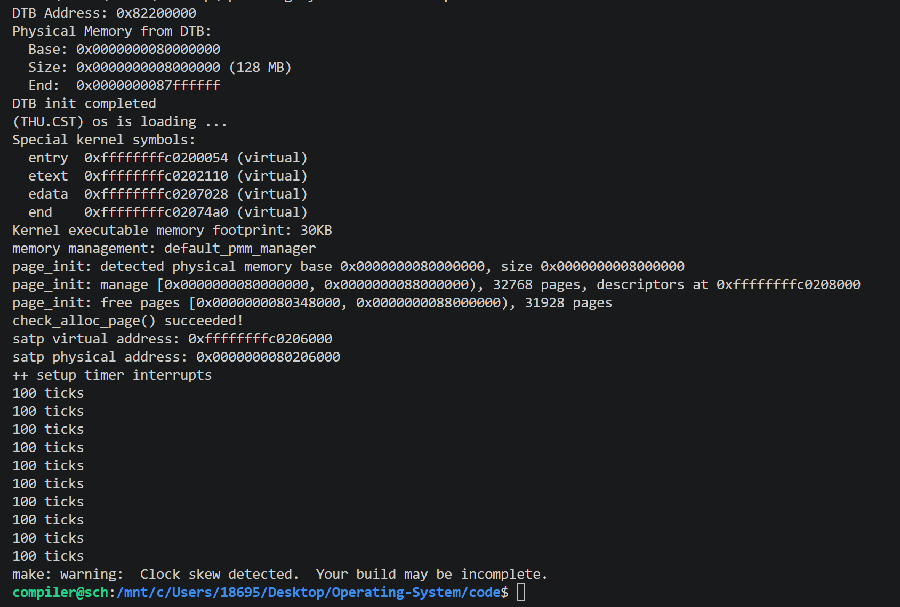
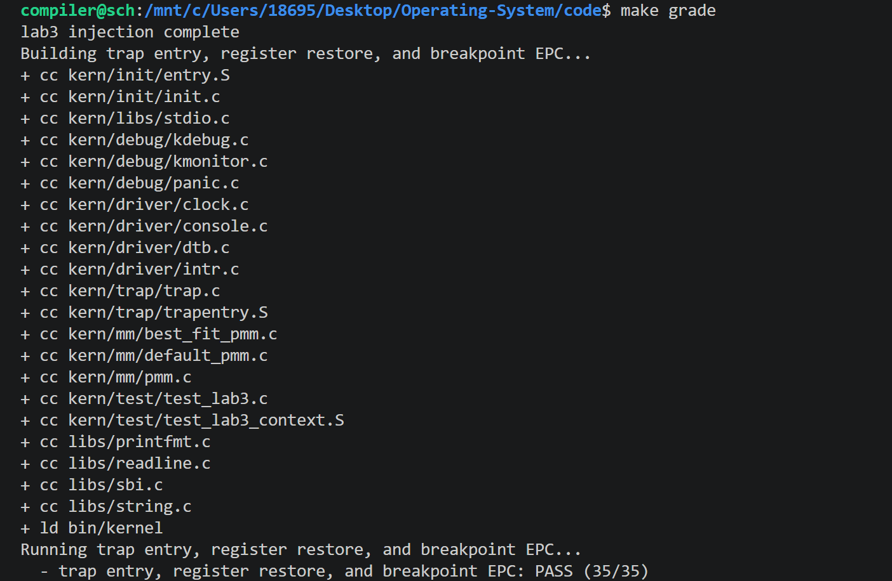
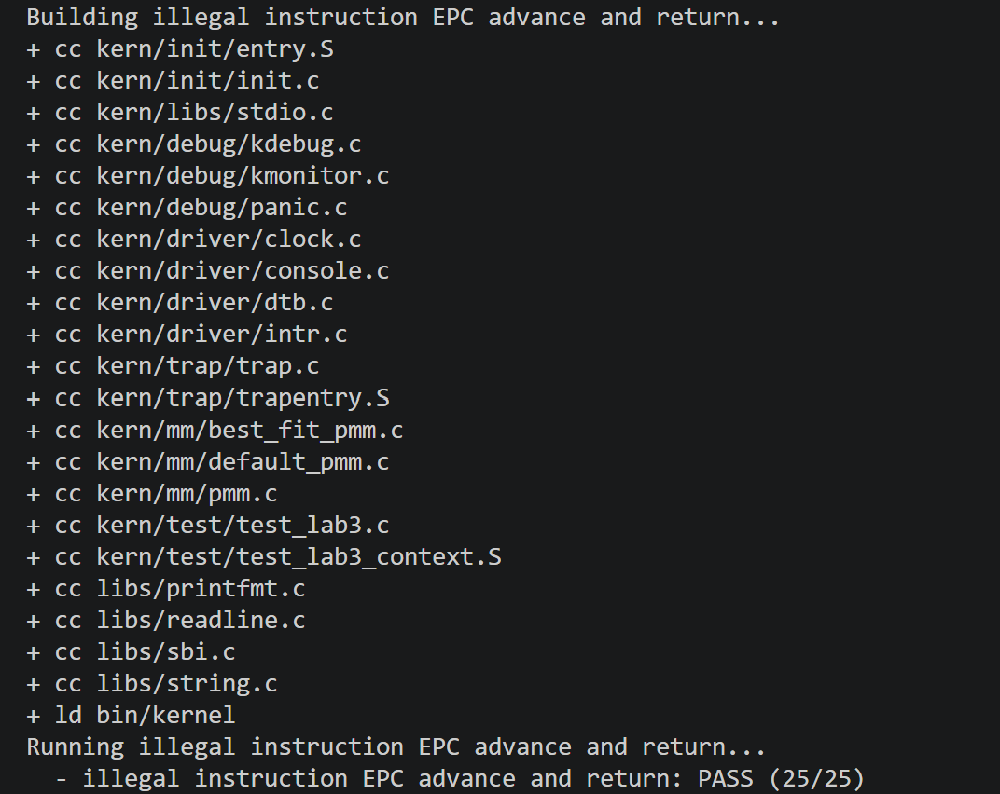
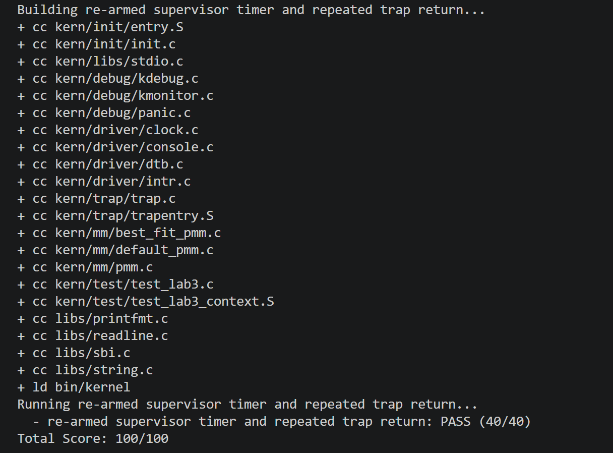

# 操作系统实验报告

## 实验基本信息

| 项目 | 内容 |
|------|------|
| **实验名称** | Lab 3：中断与异常处理 |
| **小组成员** | 2412449-石晨昊、2410966-王策、2410668-吕昊远 |
| **完成日期** | 2026-10-31 |

### 练习分工

| 成员 | 负责模块 |
|------|----------|
| 2412449-石晨昊 | Trap 入口与上下文恢复 |
| 2410966-王策 | 中断分类与持续时钟 |
| 2410668-吕昊远 | 异常处理与整体联调 |

### 报告分工

| 成员 | 报告分工 |
|------|----------|
| 2412449-石晨昊 | 实验目的、实验环境、实验整体逻辑分析、模块一、报告整合 |
| 2410966-王策 | 模块二及配套工作、测试与验证 |
| 2410668-吕昊远 | 模块二及配套工作、实验总结与收获 |

此外，全体成员均参与了报告的细节修改、润色与结果复核等工作。

## 一、实验目的

1. 理解 Trap 中硬件状态记录与软件上下文保存的分工，掌握 Trap frame 的布局和作用。
2. 实现汇编入口与 C 处理函数的衔接，正确恢复通用寄存器、栈指针和返回状态。
3. 实现持续时钟中断，理解中断使能、下一事件设置、计数和周期输出的关系。
4. 区分中断与异常，按照指令长度调整断点和非法指令的返回地址。
5. 运用结构化 Spec 和 Prompt 辅助实现，以状态不变量和实际运行结果核对代码正确性。

## 二、实验环境

本次实验使用以下环境。

| 项目 | 实际环境 |
|------|----------|
| 宿主系统 | Windows 11 |
| 构建环境 | WSL2 ，Ubuntu 26.04.1 LTS |
| 目标平台 | QEMU`virt`，RV64，单 hart，128 MiB DRAM |
| 交叉编译器 | GCC 15.1.0 |
| 调试器 | GDB 16.3.90.20250610-git |
| 模拟器 | QEMU 4.1.1 |
| 固件 | QEMU 默认固件 OpenSBI 0.4，Runtime SBI 0.1 |
| 构建工具 | GNU Make 4.3 |
| Python | Python 3.10.12 |

小组使用的 AI 工具及模型如下：

| 成员 | AI 编程工具 | 底层模型 | 备注 |
|------|------------|----------|----------|
| 2412449-石晨昊 | Codex | GPT-6.1 sol | 无 |
| 2410966-王策 | Codex | GPT-6.1 sol | 无 |
| 2410668-吕昊远 | Codex | GPT-6.1 sol | 无 |


## 三、实验整体逻辑分析

### 3.1 本章节的逻辑主线

本章围绕中断与异常处理展开，核心是让内核能够响应执行过程中发生的事件，并在处理结束后正确恢复执行。与 Lab2 主要管理内存资源不同，本实验关注执行状态的保护与控制转移：时钟事件可能在任意时刻打断内核，断点或非法指令也可能使当前执行暂时停止，系统需要在处理这些事件的同时，保证原有寄存器和返回位置符合预期。

实现这一目标的基础是统一的 Trap 机制。硬件在事件发生时记录原因、返回地址和相关状态，软件进一步保存通用寄存器，形成完整的 Trap frame。处理函数据此判断事件类型并执行相应操作，随后由恢复代码还原现场，通过异常返回指令继续运行。因此，上下文保存与恢复保证处理过程不会意外破坏原有执行状态，原因分类和处理策略则决定系统如何响应具体事件。

中断与异常虽然共用入口，返回语义却有所不同。时钟中断属于异步事件，处理后应保留原返回位置，并重新设置下一次时钟事件，以支持持续计数和周期输出；断点与非法指令属于同步异常，本实验在输出诊断信息后，按指令长度调整返回地址，避免重复执行同一条故障指令。由此，本章将现场保护、事件处理和正确返回联系起来，为后续进程调度、系统调用及更完整的故障处理建立基础。

### 3.2 功能的逐步实现

| 顺序 | 功能 | 依赖关系与目的 |
|------|------|----------------|
| 1 | 确定 Trap frame 布局，完成入口与恢复 | 建立可靠的现场保存、传参与返回机制，是所有处理函数的基础 |
| 2 | 恢复内存初始化，保证启动映射有效 | 为正式内核提供可运行的内存与地址环境 |
| 3 | 实现中断分类和持续时钟 | 在可正确返回的基础上处理重复异步事件 |
| 4 | 实现异常分类与 EPC 更新，完成整体验证 | 按同步异常语义选择返回位置，检查各模块能否协同运行 |

本实验复用 Lab2 的物理内存管理基础，重点转向执行状态的保存与恢复。当前默认页管理器为 First-Fit；Buddy、SLUB 等扩展不属于本次实现范围。

## 四、实验内容与实现

### 功能模块一：Trap 上下文恢复与 Trap 入口

**负责人：** 2412449-石晨昊

#### 模块功能描述

本模块在既有 `SAVE_ALL` 的基础上完成 Trap 返回路径，并把汇编入口与 C 语言处理函数连接起来。Trap 发生时，硬件记录原因、返回地址和状态，`SAVE_ALL` 再将通用寄存器保存为 Trap frame；本模块负责将该帧传给 `trap()`，在处理函数返回后恢复保存状态，最后由 `sret` 回到原执行位置。其正确性取决于保存布局、RISC-V 调用约定和特权返回语义的一致。

**需要实现/修改的函数：**

```asm
RESTORE_ALL
__alltraps
```

相关 C 接口为：

```c
void trap(struct trapframe *tf);
```

**功能说明：**

RV64 下 `REGBYTES=8`，Trap frame 由 36 个字宽组成，共 288 字节。槽位 0～31 对应 x0～x31，槽位 32～35 依次保存 `sstatus`、`sepc`、`sbadaddr/stval` 和 `scause`。`RESTORE_ALL` 先用临时寄存器恢复 `sstatus`、`sepc`，再恢复通用寄存器，最后从槽位 2 恢复 Trap 前的 `sp`。在恢复过程中保持当前 `sp` 作为帧基址，能够避免提前改动栈指针导致后续加载访问错误。

`__alltraps` 在 `SAVE_ALL` 后执行 `mv a0, sp; jal trap`，按调用约定把当前 Trap frame 作为第一个参数传递给 C 函数。`trap()` 返回后进入已有的 `__trapret`，由 `RESTORE_ALL` 和 `sret` 完成恢复。处理函数对帧中 `epc`、寄存器或 `sp` 的合法修改会在返回时生效，而 `badvaddr` 和 `cause` 只用于诊断，不在恢复宏中写回 CSR。

#### Spec 与 Prompt 设计

编写 Spec 时，先对照 `SAVE_ALL` 和 `struct trapframe` 核对槽位，再把“`sp` 指向有效 Trap frame、栈满足 16 字节对齐、保存的返回状态合法”写为前置条件。后置条件规定从帧中恢复通用寄存器、`sstatus` 和 `sepc`，并能衔接已有 `sret`。恢复期间保持帧基址有效是过程不变量，因此必须最后恢复 `sp`；返回地址是否推进则由异常处理层决定。

规格分别考虑“处理函数没有修改保存现场”和“处理函数合法修改寄存器、`sp` 或 `epc`”两种情况，要求都按帧内容恢复。这样可以约束 AI 使用槽位 2 中保存的栈指针，避免只通过固定栈增量猜测返回后的 `sp`。

| 模板部分 | 本模块的组织方式与目的 |
|----------|------------------------|
| `[PROMPT]` | 明确只填写 `RESTORE_ALL` 与 `__alltraps` 两处位置，使实现范围对应本人的练习分工 |
| `[RELY]` | 提供 RV64 宏、288 字节帧布局、已有 `SAVE_ALL` 和 C 调用约定，让 AI 依据真实接口生成代码 |
| `[GUARANTEE]` | 要求完成恢复与传参调用，保留保存流程、结构布局和其他成员模块，明确实现必须交付的行为 |
| `[SPECIFICATION]` | 按前置条件、后置条件、两类用例和恢复顺序编写约束，并要求用帧检查及真实断点返回验证 |

#### 最终提示词

见 [prompt.md](prompt.md) 中的`提示词 1：Trap 上下文恢复与 Trap 入口`。

#### 实现迭代过程

本模块经历 1 次实现迭代。

##### 第一次迭代

**最终结果：** 完成 `RESTORE_ALL` 和 `__alltraps`，并通过汇编布局核对、独立上下文检查和最终官方 CONTEXT 测试。寄存器、栈指针、CSR 和修改后 EPC 均能按帧内容恢复。

### 功能模块二：中断与异常处理

**负责人：** 2410966-王策；2410668-吕昊远

#### 模块功能描述

本模块由统一的 `trap_dispatch()` 分发中断和异常。中断处理使用 `scause` 的最高位区分中断标志，再按原因分类；Supervisor 时钟中断需要重新设置下一事件、累计 `ticks`、周期输出并在项目约定的次数后关机，其他已知中断只输出类别，未知中断输出原因和完整 Trap frame。异常处理针对非法指令和断点输出原始 EPC，并依据指令编码判断 16 位或 32 位长度后更新保存的 EPC；其他异常只作诊断输出。

**需要实现/修改的函数：**

```c
void interrupt_handler(struct trapframe *tf);
void exception_handler(struct trapframe *tf);
```

内部辅助函数为：

```c
static inline uintptr_t interrupt_reason(uintptr_t cause);
static size_t instruction_length(uintptr_t epc);
static void advance_epc(struct trapframe *tf, size_t len);
```

**功能说明：**

`interrupt_handler()` 去除 cause 的最高位后进行分类，同时保留帧中的原始 cause。对 `IRQ_S_TIMER`，每次调用 `clock_set_next_event()`，使下一次中断能够继续产生；随后将 `ticks` 加一，每 100 次调用已有的 `print_ticks()`。本项目将十次统计输出后的 `sbi_shutdown()` 作为运行结束策略，该数值是项目配置，不是实验框架额外规定。其他已知中断不修改 EPC 或时钟计数，未知原因以完整的 RV64 十进制编号输出并调用 `print_trapframe()`。

`exception_handler()` 对 cause 2 和 cause 3 分别处理非法指令和断点。它先输出异常发生时的 EPC，再读取 EPC 处的低 16 位编码：低两位不全为 1 时按 2 字节处理；低两位为 1 且低五位不全为 1 时按 4 字节处理；更长编码不在本实验支持范围内，只打印帧而不猜测长度。这样既能处理压缩断点，也能处理位于 2 mod 4 地址的 32 位指令，避免因统一加 2 或加 4 而重复执行或跳过后续指令。

#### Spec 与 Prompt 设计

本模块先依据原因宏和已有分发接口，把输入分为带中断标志的正常 Trap、评分直接调用时的裸原因编号，以及各类同步异常，再逐类规定输出和允许的状态变化。时钟规格要求每次重新设置下一事件、`ticks` 恰好加一，并在第 1000 次中断完成第十次输出后关机；其他中断保持保存帧和时钟状态。异常规格则将“仅按实际长度修改 `epc`，其他保存字段不变”作为后置条件，并要求长编码和默认异常保留诊断路径。

编写用例时，将 16/32 位编码、地址模 4 等于 2 的 32 位指令、裸原因与带标志原因分别列出，使规格能够检查固定加 2、固定加 4、错误取指和原因分类等问题。第二次迭代进一步把 `0x10000000f` 必须输出 `4294967311` 写成明确反例，让完整编号要求可以直接通过捕获输出验证。

| 模板部分 | 本模块的组织方式与目的 |
|----------|------------------------|
| `[PROMPT]` | 指定实现两个处理函数，并限定修改范围，避免将启动、内存管理或测试框架的问题混入本模块 |
| `[RELY]` | 提供 cause 宏、Trap frame、时钟和 SBI 接口，说明 `TICK_NUM=100` 及项目约定的关机策略 |
| `[GUARANTEE]` | 要求保留两个外部可调用接口和已有分发流程，允许内部辅助函数，保证实现可接入真实入口和直接调用测试 |
| `[SPECIFICATION]` | 分别规定各类中断、异常的前后状态、输出、EPC 增量和时钟边界，并在修复轮补充大编号及整帧保持断言 |

#### 最终提示词

基本实现见 [prompt.md](prompt.md) 中的`提示词 3：中断与异常处理`；专项检查与完整编号要求见其中的`提示词 5：专项检查与编号输出修复`。

#### 实现迭代过程

本模块经历 2 次实现迭代。

##### 第一次迭代

**最终结果：** 完成中断分类、持续时钟、非法指令和断点处理，内核编译通过。基础实现经启动映射修复后能够连续输出 `100 ticks`，并通过官方基本用例；启动前置问题见下文“启动页表映射修复”。

**关键改进点总结：**

1. 将时钟事件重设放在每次 Supervisor 时钟中断路径中，而不是只在初始化时设置。
2. 将异常 EPC 更新交给指令长度判断辅助函数，保留其他异常的诊断兜底路径。

##### 第二次迭代

**遇到的问题：** 未知中断原因曾使用 `int` 格式输出，RV64 原因值 `0x10000000f` 被截断为 `15`，没有体现完整的原因编号。

**问题解决策略：** 在 [prompt.md](prompt.md) 的`提示词 5：专项检查与编号输出修复`，补充了完整编号和保存帧不变的明确要求，增加 `0x10000000f` 必须输出 `4294967311` 的规格示例。实现改用 `%lu` 与 `(unsigned long)cause`，并核对带中断标志和裸原因两种调用形式。

**最终结果：** 未知原因能够输出完整十进制值 `4294967311`，同时 CONTEXT、ILLEGAL、TIMER 三个官方子项均通过。

### 配套工作：Lab2 内存管理基础的恢复

**负责人：** 2410966-王策；2410668-吕昊远

本实验依赖 Lab2 的物理内存初始化，因此从 Lab2 提取 `page_init()`、Best-Fit 管理器状态和五个管理函数，补回当前 Lab3 框架缺失的前置实现。迁移采用函数级选择，不整文件覆盖；当前默认管理器仍为 First-Fit，Lab2 的 Buddy、SLUB 等扩展不属于本实验范围。由于旧的 `PHYSICAL_MEMORY_END` 已从布局文件删除，物理上界改为 `(uint64_t)KERNTOP - PHYSICAL_MEMORY_OFFSET`，计算结果为 `0x88000000`，同时保留 Lab3 分配、释放和本地中断保护接口。

**需要实现/修改的函数：**

```c
static void page_init(void);
static void best_fit_init(void);
static void best_fit_init_memmap(struct Page *base, size_t n);
static struct Page *best_fit_alloc_pages(size_t n);
static void best_fit_free_pages(struct Page *base, size_t n);
static size_t best_fit_nr_free_pages(void);
```

**最终提示词：** 见 [prompt.md](prompt.md) 中`提示词 2：内存管理基础恢复`。其核心约束是“以当前 Lab3 接口和内存布局为准，按函数选择性迁移，保留现有中断保护，不引入未要求的分配器扩展”，并要求分别编译内存模块、区分选择性验证与完整内核验证。

**实现迭代过程：** 迁移后分别强制编译 `pmm.o` 和 `best_fit_pmm.o`，并在完整内核中验证内存自检通过。该部分作为运行前置条件完成，不改变本实验 Trap 处理的功能边界。

### 配套工作：启动页表映射修复

**问题与原因：** `code/kern/init/entry.S` 原有启动根页表仅设置第 511 项，用于高地址映射。内核写入 `satp` 开启分页时，PC 仍位于 `0x80200000` 附近的低地址，尚未跳转到高地址的 `kern_init`。由于低地址没有有效页表项，后续取指无法完成地址翻译，产生取指页故障，使内核不能正常完成启动。

**修复方法：** 在根页表第 2 项增加低地址恒等映射，保留第 511 项的高地址映射。两个项均为 1 GiB 叶子项，物理基址为 `0x80000000`，设置 `V/R/W/X/A/D` 标志，使同一段物理内存可以通过低地址和高地址访问。

| 根页表索引 | 虚拟地址窗口 | 作用 |
|------------|--------------|------|
| 2 | `0x80000000`～`0xbfffffff` | 通过恒等映射继续执行开启分页后的低地址指令，完成向高地址的跳转 |
| 511 | `0xffffffffc0000000`～`0xffffffffffffffff` | 供高地址内核代码、栈和数据继续访问原物理内存 |

根页表仍保持 512 项、4096 字节和按页对齐，原有 hartid/DTB 保存、栈设置及跳转逻辑继续沿用。这两个映射分别覆盖“开启分页但尚未跳转”和“已进入高地址内核”两个执行阶段。

**提示词与验证：** 该修复对应 [prompt.md](prompt.md) 中的“提示词 4：启动映射与基本验证”，规格要求低地址执行流能够继续取指，高地址映射和根表大小保持原样。修复后，内核能够进入 `kern_init`，完成内存自检、持续时钟输出和自动关机；完整评分为 100/100，实际输出见第五章。


## 五、测试与验证

### 5.1 内核启动测试

| 检查项 | 预期结果 |
|--------|----------|
| 物理内存初始化 | 识别默认 128 MiB 内存，选择 `default_pmm_manager` |
| 内存自检 | 出现 `check_alloc_page() succeeded!` |
| 时钟初始化 | 出现 `++ setup timer interrupts` |
| 持续中断与结束 | 输出十行 `100 ticks` 后主动关机，无 panic 或异常循环 |

正常启动、内存自检和持续时钟中断的实际输出如下：



### 5.2 最终评分

| 测试框架子项 | 检查内容 | 测试得分 | 满分 |
|----------|----------|------|--------------|
| CONTEXT | Trap 入口、寄存器恢复、断点返回 | 35 | 35 |
| ILLEGAL | 非法指令返回、中断分类和默认异常诊断 | 25 | 25 |
| TIMER | 时钟重新设置与持续返回，计数达到 200 | 40 | 40 |
| 合计 | - | **100** | **100** |

测试得分为 100/100，各项测试均通过。

Trap 入口、寄存器恢复与断点返回测试通过，得分 35/35：



非法指令 EPC 推进与返回测试通过，得分 25/25：



持续时钟中断与重复 Trap 返回测试通过，得分 40/40；最终总分为 100/100：




### 5.3 专项验证与边界检查

除完整内核评分外，开发阶段还进行了模块一隔离检查、处理函数直接调用、时钟精确边界和真实 Trap 返回测试。原始记录保存在历史提交 [029e0a1](https://github.com/Iriasoul/Operating-System/commit/029e0a1433a79422caa68063ddb014e3f26c9390) 中；已核对该记录对应的 `trapentry.S`、`trap.c` 和 `entry.S` 的处理逻辑与当前实现一致。以下是已有专项记录的汇总，上方截图对应本次完整内核评分。

| 测试输入或场景 | 预期结果 | 实际记录 | 原始证据 |
|----------------|----------|----------|----------|
| 模块一隔离测试：触发 16/32 位断点，由测试处理函数修改帧内通用寄存器、`sp`、`epc` 和返回状态 | 按修改后的帧恢复，返回到断点后的指令；检查帧地址、栈对齐和返回中断使能 | 两种断点均通过，输出 `MODULE1 ALL PASS` | [上下文日志](https://github.com/Iriasoul/Operating-System/blob/029e0a1433a79422caa68063ddb014e3f26c9390/report/validation/trapentry/qemu.log) |
| 直接调用中断处理函数，传入 `0x10000000f` 及其带 bit63 标志的形式 | 两者均输出完整编号 `4294967311`，保存帧及计数保持不变 | 两种形式均为 `ok`，输出完整编号 | [直接调用日志](https://github.com/Iriasoul/Operating-System/blob/029e0a1433a79422caa68063ddb014e3f26c9390/report/validation/trap/logs/direct.log) |
| 直接调用异常处理函数，分别提供 16/32 位断点及非法指令编码；32 位编码放在地址模 4 等于 2 的位置 | `epc` 分别增加 2/4，其余保存字段不变 | 四种用例均为 `ok` | [直接调用日志](https://github.com/Iriasoul/Operating-System/blob/029e0a1433a79422caa68063ddb014e3f26c9390/report/validation/trap/logs/direct.log) |
| 提供不支持的长指令编码，或 cause=20 且 EPC 为不可读哨兵的默认异常 | 输出帧诊断，保持 `epc`；默认异常不解引用 EPC | 长编码两例和默认异常均为 `ok` | [直接调用日志](https://github.com/Iriasoul/Operating-System/blob/029e0a1433a79422caa68063ddb014e3f26c9390/report/validation/trap/logs/direct.log) |
| 从零开始连续调用 Supervisor 时钟处理 1000 次，记录时钟重设、统计输出和关机调用 | 每次重设一次、计数加一；共十次统计，仅在第 1000 次输出后调用关机一次 | `tick=1000 stats=10 shutdown=1 order=1/1`，最终 `CLOCK BOUNDARY PASS` | [时钟边界日志](https://github.com/Iriasoul/Operating-System/blob/029e0a1433a79422caa68063ddb014e3f26c9390/report/validation/trap/logs/clock.log) |
| 执行真实的 16/32 位断点与非法指令，经过正式 `__alltraps`、处理函数和 `sret` | 四种指令均返回到下一条，检查的寄存器哨兵、`ra` 和 `sp` 保持正确 | 4/4 通过，输出 `REAL TRAP TESTS PASS`；编码核对通过 | [真实返回日志](https://github.com/Iriasoul/Operating-System/blob/029e0a1433a79422caa68063ddb014e3f26c9390/report/validation/trap/logs/real.log)、[编码核对](https://github.com/Iriasoul/Operating-System/blob/029e0a1433a79422caa68063ddb014e3f26c9390/report/validation/trap/logs/real_encoding_check.txt) |

直接调用测试共 21 项，除表中列出的代表用例外，还覆盖 11 类其他已知中断和小编号未知中断，最终输出 `DIRECT TESTS PASS`。大编号修复前的对应记录输出 `Unknown interrupt: cause 15`，两个大编号用例失败；修复后的记录输出 `Unknown interrupt: cause 4294967311`，两例均通过，形成了修复前后的对照。修复前证据见 [失败日志](https://github.com/Iriasoul/Operating-System/blob/029e0a1433a79422caa68063ddb014e3f26c9390/report/validation/trap/logs/prefix/direct.log)。

**验证范围：** 模块一隔离检查使用测试处理函数验证完整恢复路径；处理函数直接调用和时钟边界测试使用记录型的控制台、时钟与关机替身，用于检查软件状态及调用顺序。真实 Trap 专项使用正式 `trapentry.S` 与 `trap.c`，但采用独立启动入口且未开启分页；完整分页内核的运行结果见 5.1、5.2 节。开发阶段的处理函数、时钟边界和真实 Trap 专项记录使用 GCC 10.2.0、QEMU 7.0.0，与本次 QEMU 4.1.1 的完整评分分别记录，详见 [专项测试说明](https://github.com/Iriasoul/Operating-System/blob/029e0a1433a79422caa68063ddb014e3f26c9390/report/validation/trap/README.md)。

### 5.4 注意事项

本实现仅适用于当前单 hart 内核态实验场景，未实现用户态安全取指、嵌套 Trap、多核同步及浮点或向量上下文保存。默认异常只输出诊断，不具备通用故障恢复能力。且框架 `%08x` 帧转储还存在高位显示限制，不能据此推断保存数据被截断。

## 六、实验总结与收获

### 6.1 实验知识点与 OS 原理的联系

| 实验知识点 | 对应 OS 原理 | 含义、关系与差异 |
|------------|-------------|------------------|
| Trap frame 与恢复顺序 | 执行上下文保护 | 保存被打断程序状态；帧也是恢复时的寻址依据，因此 `sp` 最后恢复 |
| 硬件 CSR 与软件寄存器保存 | 中断处理中的软硬件分工 | 硬件提供原因和返回状态，软件补齐通用寄存器，二者共同保证透明返回 |
| 汇编调用 C 与 `sret` | ABI、异常返回和特权控制 | ABI 解决函数调用接口，`sret` 解决 Trap 返回，两者不能相互替代 |
| 原因分类与 EPC 更新 | 异步中断和同步异常 | 时钟返回保留 EPC；断点和非法指令按本实验策略跳过故障指令 |
| 时钟重设与计数 | 时钟管理和抢占基础 | 周期事件提供调度时机，本实验尚未实现任务调度或进程切换 |
| 本地中断使能保存恢复 | 临界区保护 | 防止本 hart 中断重入，不能代替多核锁和内存顺序控制 |
| 启动恒等映射与高地址映射 | 虚拟内存与引导 | 地址翻译开启后必须覆盖过渡执行路径，页表映射与物理内存分配是不同层次 |

本实验加深了对“处理事件时不破坏原执行状态”的理解。Trap frame 是一次陷入的现场记录；完整进程切换还需要进程状态、地址空间和调度策略，不能与 Trap 返回等同。

### 6.2 AI 协作开发的经验

**以接口和不变量表达规格。** 提供真实布局、原因宏和 ABI，比笼统要求“实现中断处理”更有效；返回后哪些字段可变、哪些必须保持，应在 Spec 中明确。

**人工核对体系结构语义。** AI 生成代码仍需检查数据宽度、指令长度和恢复顺序。完整的 64 位接口不应因常见测试只使用小编号而被简化。

**按验证范围评价结果。** 编译、独立模块检查、正常启动和官方评分分别说明不同层次的正确性。测试通过应结合环境和覆盖范围解释，不能替代对实现原理的理解。

### 6.3 OS 原理中重要但本实验未对应实现的内容

| 原理内容 | 本实验尚未实现的部分 |
|----------|----------------------|
| 进程与调度 | 任务队列、时间片分配、进程切换和调度策略 |
| 用户态隔离与系统调用 | 用户地址空间、Trap 栈切换、系统调用表与参数检查 |
| 缺页恢复与虚拟内存管理 | 按需分页、页替换、交换和写时复制 |
| 多核同步 | 共享状态的锁、原子操作和内存一致性控制 |
| 外设与中断控制器 | PLIC 领取/完成、设备状态清除和中断下半部 |
| 故障隔离与持久化 I/O | 故障任务处理、文件系统、块缓存和恢复机制 |

本次实验主要建立了 Trap 处理的基础路径，但是对于完整的 OS 还要在此基础上继续完善，例如连接调度、地址空间和设备管理等问题，还并未进行对应的实现。
