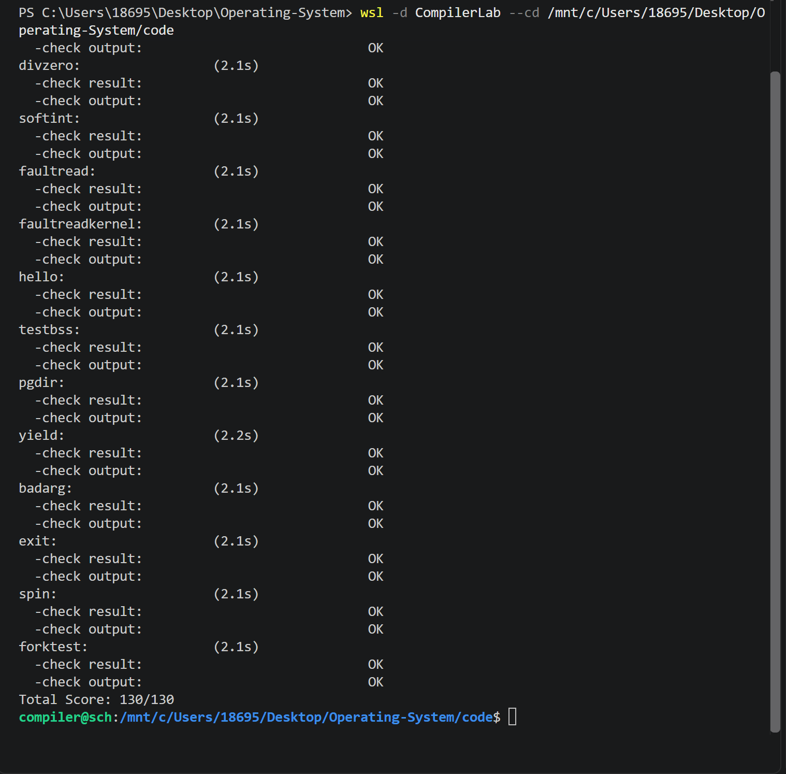
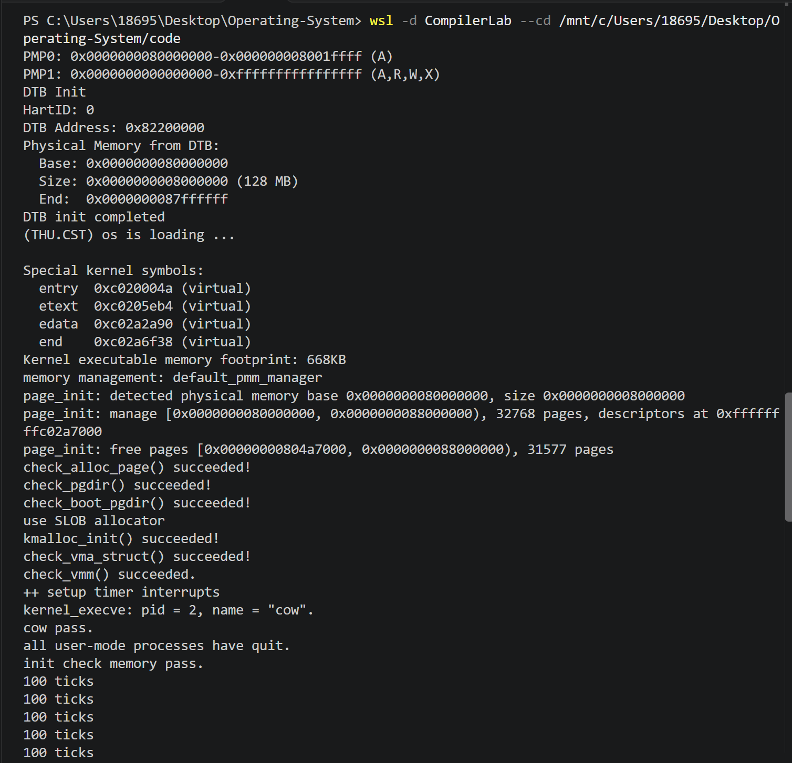

# 操作系统实验报告

## 实验基本信息

| 项目 | 内容 |
| --- | --- |
| **实验名称** | Lab 5 用户程序 |
| **小组成员** | 2412449-石晨昊、2410966-王策、2410668-吕昊远 |
| **整机验证日期** | 2026-11-27 |
| **实验分支** | `lab5` |

### 小组分工

| 成员 | 负责模块 |
| --- | --- |
| 2410966-王策 | 模块一、模块二 |
| 2412449-石晨昊 | 模块三、Challenge |
| 2410668-吕昊远 | 模块四、分支任务 |

### 报告分工

| 成员 | 报告分工 |
| --- | --- |
| 2410966-王策 | 模块一、模块二的实现说明、提示词与验证记录 |
| 2412449-石晨昊 | 模块三、Challenge 的实现说明、提示词与验证记录 |
| 2410668-吕昊远 | 模块四的实现说明、提示词与验证记录，分支任务记录 |

## 一、实验目的

1. 理解 ucore 如何建立独立用户地址空间并启动第一个用户程序。
2. 掌握 RISC-V 用户态经 `ecall` 进入内核、通过 `sret` 返回用户态的过程。
3. 理解 `fork`、`exec`、`exit`、`wait`、`yield`、`kill` 如何共同管理进程的生命周期。
4. 理解写时复制中的页表权限、物理页引用计数和 TLB 同步。

## 二、实验环境

| 项目 | 环境 |
| --- | --- |
| 宿主环境 | Windows 下的 WSL `CompilerLab` |
| 目标平台 | RISC-V RV64、Sv39、QEMU `virt` 单 hart，使用默认 OpenSBI |
| 构建工具 | `riscv64-unknown-elf-gcc` 15.1.0、GNU Make |
| 模拟与调试 | `qemu-system-riscv64` 4.1.1、`riscv64-unknown-elf-gdb` |

| 成员 | AI 编程工具 | 底层模型 | 备注 |
| --- | --- | --- | --- |
| 2412449-石晨昊 | Codex | GPT-6.1 sol | 无 |
| 2410966-王策 | Codex | GPT-6.1 sol | 无 |
| 2410668-吕昊远 | Codex | GPT-6.1 sol | 无 |

## 三、实验整体逻辑分析

### 3.1 本章节的逻辑主线

Lab4 已建立内核线程和调度机制。Lab5 在此基础上为进程建立用户地址空间、切换到 U 态，并把 U 态发起的请求交给内核处理。程序成功启动后，`fork` 创建新的执行流，`exit` 和 `wait` 回收新进程及其资源，`yield`、时钟抢占和 `kill` 让其余进程继续推进。

~~~text
kern_init → proc_init → idleproc 调度 initproc → init_main
  → kernel_thread(user_main) → kernel_execve → do_execve → load_icode
  → forkrets → __trapret → sret → 用户程序入口

用户库封装 → ecall → __alltraps → trap → exception_handler → syscall
  → do_* 处理 → 写回 trapframe → __trapret → sret
~~~

### 3.2 功能的逐步实现

1. 模块一统一系统调用入口，确定编号、参数、返回值和返回地址的寄存器约定。
2. 模块二构造首个用户进程的 ELF 映射、用户栈和中断帧，使启动链真正到达 U 态。
3. 模块三构造子进程控制块、内核栈和独立页表，并管理父子关系。Challenge 在这个调用路径上引入写时复制。
4. 模块四让退出进程先释放用户地址空间，再由父进程回收内核栈和 PCB，并处理等待唤醒、抢占与孤儿进程收养。

## 四、实验内容与实现

### 功能模块一 · 用户态系统调用

**负责人** 2410966-王策

#### 模块功能描述

`exception_handler()` 接收 `CAUSE_USER_ECALL`，`syscall()` 分发 `exit`、`fork`、`wait`、`exec`、`yield`、`kill`、`getpid`、`putc`、`pgdir`。系统调用由 [trap.c](../code/kern/trap/trap.c) 转入 [syscall.c](../code/kern/syscall/syscall.c)，用户态寄存器约定见 [用户库封装](../code/user/libs/syscall.c)。

#### 最终提示词与 spec 设计

`PROMPT` 限定异常入口和分发表。`RELY` 给出 `pushregs`、`trapframe` 和 `SYS_*`，使实现和用户库采用相同的 ABI。`GUARANTEE` 固定 `a0` 的输入与输出含义。`SPECIFICATION` 逐项约束返回地址推进、合法编号、表内空项和越界编号，并规定用户指针交给对应内核入口核查。[提示词 1](prompt.md#提示词-1-用户态系统调用)

#### 核心实现与理解

用户库把调用号放进 `a0`，最多五个参数放进 `a1` 到 `a5`。进入 trap 后，`exception_handler()` 将保存的 `epc` 增加 4，使返回地址落在 `ecall` 的下一条指令。`syscall()` 先检查调用号范围和函数指针，再分发并把结果写回 `tf->gpr.a0`，未知调用返回 `-E_INVAL`。`wait` 和 `exec` 对用户指针的检查结合了进程 VMA 与有效用户页表项。

`SAVE_ALL` 根据 `sscratch` 区分进入异常时使用的栈，用户态陷入时用它换入内核栈，保存原用户栈指针。`RESTORE_ALL` 依据 `sstatus.SPP` 决定返回用户态前是否在 `sscratch` 重新登记内核栈顶，并最后恢复 `sp`。`sret` 根据恢复的 `sepc` 和状态寄存器继续执行。[trapentry.S](../code/kern/trap/trapentry.S)

#### 实现迭代过程

提交 `48cb0a2` 已包含分发入口和上下文恢复的实现。报告按实际接口整理提示词与 spec。评分中的 `test_lab5_syscall()` 验证 `getpid`、`epc` 前移和非法编号，客户机 GDB 又在真实 `ecall` 上核对了实参、返回值与返回地址。

### 功能模块二 · 创建并装载第一个用户进程

**负责人** 2410966-王策

#### 模块功能描述

`proc_init()` 创建 `idleproc` 和 `initproc`，`init_main()` 再创建暂时在 S 态运行的 `user_main`。`kernel_execve()` 将这个内核线程转换为执行目标 ELF 的用户进程。`do_wait()` 负责等待子进程和最终回收。相关实现集中于 [proc.c](../code/kern/process/proc.c)。

#### 最终提示词与 spec 设计

将启动分为选择镜像、装载段、构造现场、异常返回和回收五步。spec 对 ELF 的边界、页权限、BSS 清零、用户栈、失败清理和 `wait` 写回分别给出条件。`RELY` 同时列出链入内核的 ELF 符号和 trap 恢复入口，确保首个进程实际能回到 U 态。[提示词 2](prompt.md#提示词-2-首个用户进程的创建与装载)

#### 核心实现与理解

`user_main()` 选择编译时嵌入的默认程序 `exit`，也可由评分构建的 `TEST` 指定其他 ELF。`load_icode()` 检查 ELF 头、程序头表与文件段的范围，通过 `mm_map()` 建立 VMA。它给 `PT_LOAD` 段分配用户页，按照段标志设置 R/W/X 权限，先清零再复制文件字节，因此 `p_memsz` 超出 `p_filesz` 的部分保留为零。用户栈建立 VMA 后，栈顶四页分配并清零。

加载成功后，内核更新 `current->mm` 和页表，设置 `tf->epc` 为 ELF 入口、`tf->gpr.sp` 为 `USTACKTOP`、清除 `SPP` 并设置 `SPIE`。`kernel_execve()` 直接调用 `forkrets()` 进入已有恢复路径。用户进程再次调用 `exec` 时，内核先核对并暂存来自旧地址空间的镜像，再切回内核页表并释放旧地址空间，之后装载新映像。

`do_wait()` 支持指定子进程和等待任意子进程。存在存活子进程时，父进程以 `WT_CHILD` 睡眠。找到僵尸子进程时先写回退出码，再解除哈希和进程树登记，最后释放其内核栈和 PCB。`init_main()` 验证全部用户进程回收后的进程数和空闲页数，完成后转入睡眠。

#### 实现迭代过程

提交 `48cb0a2` 记录了装载链路。整机联调补齐进程树与退出逻辑后，`hello` 验证进入用户态，`testbss` 验证段装载和零初始化，`exit` 与 `badarg` 分别验证正常退出码与非法等待参数。以上结果来自最终整机验证。

### 功能模块三 · 复制用户进程

**负责人** 2412449-石晨昊

#### 模块功能描述

`do_fork()` 创建 PCB、内核栈和子进程执行现场，`copy_mm()` 决定共享或复制地址空间，`dup_mmap()` 复制 VMA，`copy_range()` 建立目标页映射。[proc.c](../code/kern/process/proc.c) · [vmm.c](../code/kern/mm/vmm.c) · [pmm.c](../code/kern/mm/pmm.c)

#### 最终提示词与 spec 设计

spec 分别描述内核线程、`CLONE_VM` 与普通用户 `fork` 的地址空间关系。成功条件同时覆盖父子返回值、子进程登记和可运行状态。失败条件按 PCB、栈、根页表、VMA 与叶子映射的取得顺序写出对应的回收要求。[提示词 3](prompt.md#提示词-3-复制用户进程)

#### 核心实现与理解

父进程没有 `mm` 时，子进程沿用内核页表。设置 `CLONE_VM` 时，共享 `mm` 并增加其进程引用。普通用户 `fork` 建立独立根页表，持有源 `mm` 的锁复制 VMA 与有效页映射。`copy_range()` 具备逐页复制路径，当前普通 `fork` 选择 COW 路径。

`copy_thread()` 在新内核栈上复制 trapframe，将子进程的 `a0` 设为零，把首次调度的返回地址设为 `forkret`。父进程的系统调用返回值由分发器写为子 PID。PID、哈希表和父子链表在关中断区间完成登记，然后才将子进程置为可运行。切换到不同根页表时，同步更新 `satp` 和 TLB。

若复制中途失败，子进程尚未发布，已建立的映射、页表、VMA、内核栈与 PCB 会被回收。源页若已变为 COW，保留该标记。单一引用的源页下次写入时可直接恢复写权限。

#### 实现迭代过程

检查时发现原 `copy_mm()` 只允许内核线程，且旧 `do_fork()` 将子进程放入全局链表，却没有挂入父进程的子链表，按任意子进程等待时便无法枚举它。实现改用 `set_links()`，并加入 VMA 与页映射复制。QEMU 的 `forktest` 验证批量创建和等待，`forktree` 验证多层进程树退出与最终回收。

### 功能模块四 · 退出、让出与终止

**负责人** 2410668-吕昊远

#### 模块功能描述

`do_exit()` 负责退出与父子关系收束，`do_yield()` 请求调度，`do_kill()` 标记目标退出，并在目标处于可打断的等待时唤醒它。相关逻辑连接 [proc.c](../code/kern/process/proc.c)、[trap.c](../code/kern/trap/trap.c) 和 [sched.c](../code/kern/schedule/sched.c)。

#### 最终提示词与 spec 设计

spec 以状态转换描述退出、睡眠、唤醒和回收。对 `kill` 分别规定目标不存在、重复请求和可打断等待的行为，对 `exit` 规定仍在使用的内核栈交给父进程回收。调度验收使用主动让出、一直运行的子进程和被终止的等待者。[提示词 4](prompt.md#提示词-4-退出让出与终止)

#### 核心实现与理解

`do_exit()` 先将当前进程切回内核页表，减少旧 `mm` 的进程引用，最后一个使用者退出时回收映射和页表。随后在关中断区间发布 `PROC_ZOMBIE` 和退出码，唤醒等待中的父进程，把仍存在的子进程交给 `initproc`，最后调度其他可运行进程。

`do_yield()` 设置 `need_resched`，在返回用户态的安全点调度。S 态时钟中断若打断了用户进程，也会设置该标志，因此纯忙等的 `spin` 子进程能够被抢占。`do_kill()` 设置 `PF_EXITING`，睡在可打断等待上的进程被唤醒后会在 `do_wait()` 中退出，其余用户进程在 trap 返回前检查该标记。无法修复的用户态访问异常终止当前用户进程。

#### 实现迭代过程

| 实际现象 | 定位与修复 |
| --- | --- |
| 默认编译卡在 `kva2page()`，绕过该诊断后出现链接错误 | 恢复指针类型转换和 `default_pmm_manager` 注册，补齐链接所依赖的 `do_yield()`、`do_kill()` |
| `forktree` 已显示用户进程全部退出，空闲页数检查仍失败 | SLOB 保留了全空的堆页。限制空闲块在同一物理页内合并，整页空闲时归还物理页分配器 |
| 评分启动后持续显示时钟输出 | 评分脚本提前构建了未带 `DEBUG_GRADE` 的内核，后续构建复用了 trap 目标文件。取消预构建，由评分流程首次带标志编译 |
| 完整评分首次得到 `123/130`，`divzero` 输出 `0` | C 的除零表达式是未定义行为。测试改为直接执行 RISC-V `div`，验证结果为 `-1`。复跑得到 `130/130` |

### 扩展练习 Challenge

**负责人** 2412449-石晨昊

#### 1. 写时复制及保护验证

普通 `fork` 保持父子各自的 VMA 和页表。原可写页面在双方的末级 PTE 中清除 `PTE_W`、设置软件位 `PTE_COW`，双方映射同一物理页。父进程权限下调后同步失效对应 TLB 项。原只读页面可共享，权限仍为只读且不设置 COW 位。写缺页检查 VMA 写权限、有用户权限的有效映射和 COW 位，随后在地址空间锁内处理分离或恢复。内核经 `copy_to_user()` 写回退出码前也进行相同的权限准备。[提示词 5](prompt.md#提示词-5-challenge-写时复制与预加载)

| 当前状态 | 事件与条件 | 转换结果 |
| --- | --- | --- |
| 私有可写 | 普通 `fork` | 父子只读共享，含 `PTE_COW`，物理页引用增加 |
| COW 共享，引用大于 1 | 合法写缺页或系统调用写回 | 分配新页并复制内容，写入方得到私有可写页，旧页引用减少 |
| COW 映射，引用等于 1 | 合法写缺页或系统调用写回 | 复用原页，清除 `PTE_COW` 并恢复 `PTE_W` |
| 原本只读或未映射 | 写入请求 | 权限检查拒绝。用户态无法修复的写缺页使当前进程退出 |
| 任一映射 | 退出或取消映射 | 各自撤销映射，物理页最后一条引用消失后释放 |

Dirty COW 涉及写时复制和写权限判断之间的竞争。本实验从防护角度验证关键约束，实际只读页不能因共享而恢复写位，写入方在取得可写映射前必须满足 VMA 权限与 COW 标记条件。`test_lab5_cow()` 检查共享页、PTE 位、引用数、最后引用优化和回收。用户程序 `cow` 检查父子数据隔离、拒绝向只读目标写回，以及内核对 COW 页写回退出码后其他进程仍看到旧值。[内核测试](../code/tools/test_lab5.c) · [用户测试](../code/user/cow.c)

#### 2. 用户 ELF 何时预加载

构建时，`tools/user.ld` 将用户 ELF 链接到预定用户虚拟地址。内核链接命令用 `--format=binary` 将这些 ELF 字节嵌入内核镜像。运行 `make qemu` 时，QEMU 的 loader 把整个镜像放入从物理地址 `0x80200000` 开始的来宾内存，此时原始 ELF 字节随镜像在场。真正的用户地址空间要等到 `kernel_execve()` 选中 ELF，`load_icode()` 解析程序头、建立段映射和用户栈之后才形成。

常见操作系统的 `exec` 通过文件系统打开可执行文件，建立段映射，并可在首次访问时按需调页。Lab5 将镜像内嵌，原因是本阶段的重点是进程加载和特权级转换，入口可以直接使用链接器生成的起始地址和镜像大小。[Makefile](../code/Makefile) · [user.ld](../code/tools/user.ld)

## 五、测试与验证

### 原有评分与专项测试

| 验证方式 | 实际覆盖 | 结果 |
| --- | --- | --- |
| 普通 `make` 和 `make qemu` | 内核编译链接、启动自检、默认 `exit`、子进程退出码、回收后稳定运行 | 通过，出现 `exit pass.` 与 `init check memory pass.` |
| `make grade` | 13 个原有用户程序，覆盖正常系统调用、非法参数、访问异常、退出、抢占、批量 `fork` 和回收 | **130/130** |
| 注入的内核 COW 测试与用户程序 `cow` | 物理页共享、权限、引用计数、写时分离、单引用复用、退出码写回 | 出现 `[Test Copy on Write] PASS`、`cow pass.` 和 `init check memory pass.` |
| 独立运行 `waitkill`、`forktree` | 等待中的进程被终止，孤儿收养，多层进程树回收 | 均通过，出现 `init check memory pass.` |

评分程序通过 `tools/inject.py` 把内核断言注入临时构建副本。复现整机和用户态 COW 的命令分别如下，在 `code` 目录执行。

~~~sh
make grade
~~~

~~~sh
make build-cow
make qemu
~~~

最终评分摘要如下。

~~~text
forktest:                (2.1s)
  -check result:                             OK
  -check output:                             OK
Total Score: 130/130
~~~

图 1 完整评分截图，`make grade` 得到 **130/130**。

图 2 用户态 COW 测试输出 `cow pass.`，用户进程退出后输出 `init check memory pass.`。

### 分支任务 · GDB 调试系统调用与异常返回

**负责人** 2410668-吕昊远

本次用 `hello` 跟踪输出首字符 `H` 的 `SYS_putc`，调用号为 30。内核与用户 ELF 分别提供符号。客户机 GDB 连接 QEMU 后，以 `add-symbol-file obj/__user_hello.out` 加载用户符号，再从反汇编中定位实际 `ecall` 和 `sret` 指令。使用硬件断点，在第一次用户调用后以 `sepc == ecall 地址 + 4` 筛选与该调用配对的返回。

| 观测位置 | `pc` | 实测寄存器与含义 |
| --- | --- | --- |
| U 态执行 `ecall` 前 | `0x8000a0` | `a0=30`，`a1=0x48`，`sp=0x7ffffe50` |
| S 态进入 `__alltraps` | `0xffffffffc0200e6c` | `scause=8`、`sepc=0x8000a0`。首条指令交换 `sp` 和 `sscratch`。断点位于该指令之前，`sp` 仍是用户栈 |
| S 态执行 `sret` 前 | `0xffffffffc0200f32` | `sepc=0x8000a4`、`a0=0`，`sstatus.SPP=0` |
| 返回 U 态 | `0x8000a4` | 下一条指令保存 `a0`，用户栈指针与调用前一致 |

<!-- 如已完成宿主 GDB 实拍，可在此插入 images/lab5-double-gdb.png。 -->

**QEMU 源码对照。** QEMU 4.1.1 的 `riscv_cpu_do_interrupt()` 根据虚拟 CPU 的当前特权级确定 `ecall` 对应的异常号。若该异常委托给 S 态，函数写入 `scause`、`sepc`，更新 `SPP` 等状态位，把 PC 指向 `stvec` 对应入口并切到 S 态。`helper_sret()` 从 `sepc` 读取返回地址，再按 `SPP` 和 `SPIE` 恢复相应的特权级与中断状态。`sepc` 增加 4 发生在 ucore 的 `exception_handler()`。[异常分派源码](https://github.com/qemu/qemu/blob/v4.1.1/target/riscv/cpu_helper.c#L473-L531) · [返回指令源码](https://github.com/qemu/qemu/blob/v4.1.1/target/riscv/op_helper.c#L68-L94)

**TCG 与 Lab2 的联系。** 本次用 `-d in_asm,op` 核对了两条指令的翻译输出。`0x8000a0` 的 `ecall` 所在块生成带异常号 `0x8` 的 `call raise_exception`，`0xffffffffc0200f32` 的 `sret` 所在块生成 `call sret`，两条路径都结束当前翻译块。TCG 将来宾指令转换为宿主可执行的代码，按翻译块缓存，块的匹配还依赖虚拟 CPU 状态。Lab2 的页表观测重点是取指或数据访问触发的软件 MMU 地址转换。Lab5 在同一个模拟执行框架内观察指令异常、CSR 更新和特权级切换。[QEMU Translator Internals](https://www.qemu.org/docs/master/devel/tcg.html)

本节的寄存器表来自客户机 GDB 实测，宿主侧结合 QEMU 4.1.1 源码和实际 TCG 输出分析。本机安装的 QEMU 可执行文件已剥离调试符号，双 GDB 的宿主断点现场尚待补充。此次借助 Codex 从用户 ELF 与内核镜像中查找两条指令的实际地址，并用返回地址条件将 `sret` 与本次 `ecall` 配对。[调试提示词](prompt.md#分支任务提示词-gdb-跟踪系统调用)

## 六、实验总结与收获

### 对操作系统的理解

| 实验知识点 | 对应 OS 原理 | 联系与当前实现的边界 |
| --- | --- | --- |
| `ecall`、trapframe、`sret` | 系统调用和特权级切换 | 用户态按 ABI 传参，内核保存现场并验证请求，随后恢复用户执行 |
| VMA、页表与 ELF 段 | 进程映像、虚拟内存保护 | VMA 描述合法区间与期望权限，PTE 落实逐页映射；本实验从内嵌 ELF 装载 |
| `fork` 的两条返回路径 | 执行上下文与资源继承 | 父子从同一个调用附近继续执行，返回值与地址空间区分两个执行流 |
| `exit`、`wait`、孤儿收养 | 进程生命周期和资源所有权 | 当前进程释放地址空间，父进程接手其剩余内核资源 |
| `need_resched` 与时钟中断 | 主动让出、抢占、调度点 | 用户程序可主动让出或被时钟打断，当前调度器按可运行进程遍历 |
| COW 权限和物理页引用 | 延迟复制、页级隔离 | 用权限触发写缺页，分离写入者的页面，最后引用消失后归还物理页 |

本实验的边界包括文件系统支持的 `exec`、文件映射与通用按需调页、页面置换、多核调度和跨 hart 的 TLB 同步。COW 专项中的锁和 TLB 操作以本实验的单 hart 环境为验证范围。

### AI 协作开发的经验

把 spec 写成能观察的状态有助于定位错误。以 `fork` 为例，返回 PID 之外还要检查父子链表、子进程返回寄存器和内存回收。COW 也需要结合页号、权限位、引用计数与行为断言，因为只看子进程的输出无法区分两进程是否曾共享物理页。

联调把问题划分为工具链、系统行为和验证脚本三个层面。先解决编译及链接，再从 `forktree` 的空闲页断言追到 SLOB，最后核对 `divzero` 的机器指令语义与评分预期。客户机 GDB 则把源码里的调用约定落实到实测的寄存器、栈指针和 PC。
