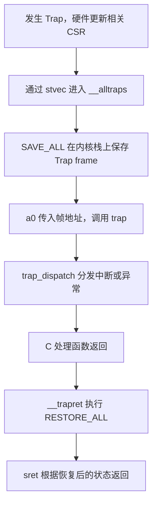

# 操作系统实验报告

## 实验基本信息

| 项目 | 内容 |
|------|------|
| **实验名称** | Lab 3：中断与异常处理 |
| **小组成员** | 2412449-石晨昊、2410966-王策、2410668-吕昊远 |
| **本部分负责人** | 2412449-石晨昊 |
| **本部分内容** | 功能模块一：Trap 上下文恢复与 Trap 入口 |
| **记录日期** | 2026-10-28 |
| **完成范围** | 汇编待填写代码已完成，独立模块验证通过；完整实验联调待进行 |

本文记录石晨昊负责的实验目的、整体逻辑、功能模块一、对应验证与原理总结。小组计划分工见 [分工文档](分工.md)，本模块定稿提示词见 [prompt.md](prompt.md)。

## 一、实验目的

1. 理解 Trap 发生后处理器状态与软件保存上下文之间的关系，掌握 Trap frame 的作用。
2. 对照已有 `SAVE_ALL`，实现与其布局一致的 `RESTORE_ALL`，正确恢复通用寄存器、栈指针及返回所需 CSR。
3. 按 RISC-V 调用约定，将汇编入口保存的 Trap frame 传给 C 语言 `trap()`，连接汇编与 C 的处理流程。
4. 理解 `sret` 如何依据 `sepc` 和 `sstatus` 返回，区分函数返回与特权返回。
5. 通过结构化 Spec、Prompt 和独立运行验证，检查 AI 生成代码是否符合已有接口与布局约束。

## 二、本模块验证环境

以下信息来自本次独立测试与实际工具版本核对，完整实验环境由相应负责人后续汇总。

| 项目 | 本次实际使用情况 |
|------|------------------|
| 宿主与命令行 | Windows、PowerShell |
| 构建环境 | WSL 发行版 `CompilerLab` |
| 目标平台 | QEMU `virt`，RV64，单 hart，128 MiB 内存 |
| 交叉编译器 | `/opt/riscv-elf-toolchains/bin/riscv64-unknown-elf-gcc`，15.1.0（g1b306039ac4） |
| 模拟器 | `/home/compiler/.local/opt/qemu-4.1.1/bin/qemu-system-riscv64`，4.1.1 |
| 固件 | 默认 OpenSBI 0.4，Runtime SBI 0.1 |
| 测试构建 | GNU99、RV64IMAC 加 CSR/指令同步扩展、LP64、独立链接镜像 |
| 验证方式 | 实际编译正式 `trapentry.S`，链接隔离测试函数，在 QEMU 触发断点并核对返回状态 |

独立镜像使用自己的启动入口和链接脚本，不代表完整高地址内核已经启动或通过评分。

## 三、实验整体逻辑分析

### 3.1 本章节的逻辑主线

本实验在能够启动、管理内存的内核基础上增加 Trap 处理。Trap 包括中断与异常：硬件负责记录返回地址、原因与部分状态并转入入口，软件还需要保存通用寄存器、执行处理逻辑，最后恢复执行环境。

从代码阅读角度，可沿“上下文保存与恢复 → 汇编入口与 C 接口 → 中断与异常处理”理解各部分；一次实际 Trap 的执行顺序如下：



我负责其中“把帧交给 C”与“从帧恢复状态”两个连接点。`SAVE_ALL` 已由框架给出，中断和异常的具体处理由另外两位成员负责。

### 3.2 功能的逐步实现

| 阶段 | 本部分工作 | 目的 |
|------|------------|------|
| 1 | 对照 `trap.h` 与 `SAVE_ALL` | 确定保存格式，避免自行假设布局 |
| 2 | 补全 `RESTORE_ALL` | 先保证已有帧可以完整恢复 |
| 3 | 补全 `__alltraps` 中的调用 | 将汇编入口连接到 C 处理接口 |
| 4 | 编译并运行隔离测试 | 在其他处理函数未实现时验证本模块 |
| 5 | 等待完整实验联合验证 | 后续检查真实中断、异常处理与入口返回的衔接 |

## 四、实验内容与实现

### 4.1 功能模块一：Trap 上下文恢复与 Trap 入口

**负责人：2412449-石晨昊。**

正式实现位于 [trapentry.S](../code/kern/trap/trapentry.S)，结构体布局位于 [trap.h](../code/kern/trap/trap.h)。本次只填写两处 `lab3 function1` 标记，并将 `YOUR CODE` 替换为自己的学号；未修改 `SAVE_ALL`、结构体或其他成员负责的处理函数。

#### 模块功能描述

`SAVE_ALL` 将当前处理器上下文组织成内存中的 `struct trapframe`。`__alltraps` 把这个结构体的地址传给 `trap()`，使 C 代码可以查看 Trap 原因和返回状态。`trap()` 返回后，`RESTORE_ALL` 读取同一个帧，恢复处理器执行所需的寄存器；已有的 `sret` 完成返回。

恢复使用的是处理完成后的帧内容。因此，如果处理函数合法调整了 `tf->epc` 或其他保存值，这些调整应在返回时生效。

#### Trap frame 与寄存器布局

当前 RV64 框架中 `REGBYTES=8`，共保存 36 个寄存器宽度的字段，大小为 288 字节。

| 槽位 | RV64 字节偏移 | 内容 | 恢复处理 |
|------|----------------|------|----------|
| 0 | 0 | `x0` | 保持硬连线零值，无需加载 |
| 1 | 8 | `x1/ra` | 从对应槽位恢复 |
| 2 | 16 | Trap 发生前的 `x2/sp` | 最后恢复 |
| 3～31 | 24～248 | `x3～x31` | 按编号恢复 |
| 32 | 256 | `sstatus` | 写回对应 CSR |
| 33 | 264 | `sepc` | 写回对应 CSR |
| 34 | 272 | `sbadaddr/stval` | 已保存的诊断信息，本模块不写回 |
| 35 | 280 | `scause` | 已保存的原因信息，本模块不写回 |

`SAVE_ALL` 先把旧 `sp` 写入 `sscratch`，再下移栈指针建立帧。随后通过 `csrrw s0, sscratch, x0` 取出旧 `sp`，保存到槽位 2，并清零 `sscratch`。这说明当前帧基址与原始栈指针不是同一个值。

#### RESTORE_ALL 的实现

首先借用 `s0`、`s1`，读取帧中的返回状态并写回 CSR：

```asm
LOAD s0, 32*REGBYTES(sp)
LOAD s1, 33*REGBYTES(sp)
csrw sstatus, s0
csrw sepc, s1
```

此时借用 `s0`、`s1` 是安全的，因为它们原本的值已经保存在帧中。随后按槽位恢复 `x1`、`x3～x31`，其中也包括 `x8/s0` 和 `x9/s1`，避免把临时使用的值带回被打断程序。

最后执行：

```asm
LOAD x2, 2*REGBYTES(sp)
```

所有帧读取都依赖当前 `sp`。如果提前恢复 `sp`，后续加载就会以错误地址为基址。因此必须最后恢复。直接读取保存槽位也支持处理函数合法修改帧中的栈指针；仅给当前栈指针加 288 无法体现这种修改。

本宏不对 `epc` 固定加 2 或加 4，也不强制改变 `SPP`。异常是否跳过指令由异常处理层决定；返回目标和状态应来自处理后的帧。

#### __alltraps 的实现与调用约定

在已有 `SAVE_ALL` 之后补入：

```asm
mv a0, sp
jal trap
```

`a0` 是第一个整数或指针参数寄存器，因此 `trap()` 收到的 `tf` 就是当前帧地址。`jal` 将调用返回地址写入 `ra`；旧 `ra` 与旧 `a0` 已在帧中保存，最终由恢复宏还原。C 函数返回后，执行流自然进入已有的 `__trapret`。

RV64 标准调用约定要求函数入口栈按 16 字节对齐。输入内核栈对齐时，分配 288 字节仍保持对齐，因为 288 是 16 的整数倍。本模块没有额外调整栈指针。调用约定依据见 [RISC-V psABI](https://riscv-non-isa.github.io/riscv-elf-psabi-doc/#_integer_calling_convention)。

#### sret 与普通函数返回的区别

`jal trap` 和 C 函数返回解决“汇编与 C 之间如何调用”的问题。`sret` 则依据 `sepc` 返回，并按 `sstatus` 中保存的字段处理特权级与中断使能状态。当前实验的 Trap 来自内核态，不能把“执行 `sret`”一概描述为“切换到用户态”。相关机制见 [RISC-V 特权架构规范](https://docs.riscv.org/reference/isa/v20240411/_attachments/riscv-privileged.pdf)。

#### 规格设计与提示词组织

我按原有四段模板整理定稿提示词，并把两个待填写位置作为一个完整模块描述：

| 部分 | 设计内容 |
|------|----------|
| `[PROMPT]` | 明确目标、负责人、两处填写位置及禁止修改的接口 |
| `[RELY]` | 提供现有结构体布局、`SAVE_ALL` 行为、访问宏、C 接口和返回入口 |
| `[GUARANTEE]` | 指定恢复宏和入口调用完成后的可观察行为 |
| `[SPECIFICATION]` | 分别写出前置条件、后置条件、帧被修改时的情况和验证要求 |

Spec 重点约束三个方面：恢复偏移必须与保存布局一致；临时寄存器和 `sp` 的恢复顺序正确；传参和返回必须遵守调用约定。这样可以根据状态变化核对结果，而不是只要求 AI 输出一段“看起来正确”的汇编。

#### 最终提示词

完整定稿见 [prompt.md](prompt.md)。该文件依据实际实现与验证过程整理，包含实现要求和独立测试要求。

#### 实现与验证迭代中的问题

本轮未发现需要返修的模块一汇编实现缺陷。实际遇到的问题发生在构建与验证环节，记录如下。

| 问题与现象 | 原因分析 | 本次处理 |
|------------|----------|----------|
| 汇编报 `unknown CSR sbadaddr` | 框架使用旧 CSR 名称，当前汇编器使用 `stval` | 独立测试编译时添加 `-Dsbadaddr=stval`；保留要求不变的 `SAVE_ALL` |
| C 编译报 `bool cannot be defined via typedef` | 测试命令最初未指定 GNU99，新版 GCC 默认语言模式与旧 `defs.h` 定义不兼容 | 按项目原有标准补充 `-std=gnu99` |
| 初始 CSR 检查失败 | 测试先设置了 `SPIE`，而要验证进入 Trap 前的中断使能应设置 `SIE`；同时旧 QEMU 的 `sret` 行为与规范不同 | 将测试入口初值改为 `SIE=1`，检查 Trap 中保存状态和返回后的 `SIE`，不修改正式汇编代码迎合测试 |

对最后一项另作说明：规范规定 `sret` 后 `SPIE=1`，而 QEMU 4.1.1 的 [helper_sret 实现](https://raw.githubusercontent.com/qemu/qemu/v4.1.1/target/riscv/op_helper.c)将该位清零。测试因此保留两种保存的 `SPIE` 对返回后 `SIE` 的检查，不将模拟器该位的行为当作本模块必须实现的功能。

这些问题分别属于工具链兼容与测试预期的调整，未发现需要修改正式恢复汇编的实现错误。

## 五、本模块测试与验证

### 5.1 验证方式与材料

正式 `trap.c` 中其他成员负责的处理函数尚未补齐，所以本次没有运行完整实验评分，而是编译正式 `trapentry.S`，链接一个独立 C `trap()` 测试函数。测试在真实断点入口检查帧，再修改帧内容并返回，验证恢复结果。

为保留可复核材料，将原先位于忽略目录 `code/obj/trapentry/` 的测试源码与成功日志归档至 [validation/trapentry](validation/trapentry/)。该目录中的 `check.c` 是测试替身，不会替换正式工程的 `trap()`，也不属于其他成员的异常处理实现。

在 WSL 中进入仓库根目录，可以重新执行：

```sh
bash report/validation/trapentry/run.sh
```

脚本将新生成的文件写入 `code/obj/trapentry-recheck/`，检查明确的成功标记及失败标记。归档日志见 [qemu.log](validation/trapentry/qemu.log)。

### 5.2 检查项目与实际结果

| 检查项目 | 实际方法 | 结果 |
|----------|----------|------|
| 汇编与 C 布局 | 编译期检查帧大小为 288；运行时逐项比较保存字段 | 通过 |
| Trap frame 传参和栈对齐 | 检查 `tf` 等于输入栈顶减帧大小，且地址按 16 字节对齐 | 通过 |
| 全部整数寄存器保存 | 为可写通用寄存器设置已知值，检查保存帧；`sp` 使用真实栈地址 | 通过 |
| 全部整数寄存器恢复 | 测试函数修改所有可写通用寄存器的帧值，返回后重新采集比较 | 通过 |
| 栈指针恢复 | 将保存的 `sp` 改为另一段测试栈，检查返回后的实际 `sp` | 通过 |
| 返回地址恢复 | 分别触发 16 位和 32 位断点，由测试函数按已知长度前移 EPC，验证继续执行 | 通过 |
| 状态恢复 | 检查 `SUM` 修改生效、返回后 `SPP` 状态和两种 `SPIE` 输入对应的 `SIE` | 通过 |
| `sscratch` 约定 | 处理函数入口与返回后均检查为零 | 通过 |

成功日志的关键部分为：

```text
MODULE1 PASS: 16-bit breakpoint, all GPRs, sp, CSR, return
MODULE1 PASS: 32-bit breakpoint, all GPRs, sp, CSR, return
MODULE1 ALL PASS
```

测试镜像链接时存在单一装载段具有 RWX 权限的警告。该镜像仅用于本模块验证，警告未阻止生成或运行；它不表示正式内核的段权限已经验证。

### 5.3 验证边界

本次通过的是模块一独立验证，并非 `make grade` 的完整成绩。测试中的 EPC 前移由已知断点长度决定，不能据此声称正式 `exception_handler()` 已完成指令长度识别。

持续时钟中断、关机阈值、非法指令及其他异常处理、正式高地址内核中的联合运行，仍需对应成员实现后验证。本次也未验证用户态 Trap 栈切换、嵌套 Trap、多 hart、浮点或向量寄存器上下文。

## 六、实验总结与收获

### 6.1 本部分知识点与 OS 原理的联系

| 实验知识点 | 对应 OS 原理 | 含义、联系与差异 |
|------------|-------------|------------------|
| Trap frame 保存与恢复 | 执行上下文保护 | 用确定布局保存被打断程序的状态；本实验保存当前整数上下文，不等同于完整进程控制块 |
| 硬件 CSR 与软件通用寄存器保存 | 中断入口中的软硬件分工 | 硬件记录原因和返回信息，软件补齐通用寄存器；仅有硬件入口不能保证 C 处理后状态不丢失 |
| 汇编入口调用 C 函数 | ABI 与内核接口 | 通过参数寄存器和栈约定连接不同语言；普通函数调用只需遵守 ABI 的保存责任，Trap 返回还要恢复被异步打断的寄存器 |
| `sepc` 与 `sret` | 异常返回和特权级恢复 | 处理函数决定合法返回位置，恢复代码落实该状态，处理器完成特权返回；其机制不同于普通 `ret` |
| 最后恢复 `sp` | 栈管理与上下文一致性 | 保存帧既是数据也是恢复期间的寻址依据，提前改变基址会破坏剩余加载 |

### 6.2 AI 协作开发的经验

本部分的关键是先提供框架事实，再让 AI 补全实现。把 `SAVE_ALL`、结构体和调用约定写入依赖条件，可以减少偏移、寄存器顺序和接口方面的错误。

验证不能只依赖“代码看起来对”或“编译成功”。独立测试主动修改保存的寄存器值与栈指针，能够检查实现是否确实从帧中恢复状态。测试失败时也应区分正式代码、测试设置和模拟器差异，依据实际证据修改相应环节。

## 附录：本部分材料

- [定稿提示词与 Spec](prompt.md)
- [小组分工文档](分工.md)
- [正式汇编实现](../code/kern/trap/trapentry.S)
- [独立测试脚本](validation/trapentry/run.sh)
- [独立测试运行日志](validation/trapentry/qemu.log)
