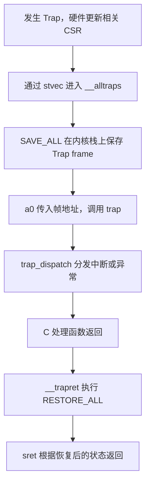

# 操作系统实验报告

## 实验基本信息

| 项目 | 内容 |
|------|------|
| **实验名称** | Lab 3：中断与异常处理 |
| **小组成员** | 2412449-石晨昊、2410966-王策、2410668-吕昊远 |
| **报告整理日期** | 2026-10-30 |
| **代码分支** | `lab3` |
| **当前实现版本** | `029e0a1`，包含上下文恢复、中断与异常处理、启动映射和输出截断修复 |
| **完成范围** | 两个必做功能模块已实现，独立测试、正常启动与当前环境下的官方评分通过 |
| **待补充材料** | 测试截图；QEMU 环境统一后的最终复验记录 |

本报告在石晨昊已完成的模块一报告基础上，补充模块二、前置代码迁移、整体联调和专项验证。模块一原有的布局分析、实现说明及独立测试结论予以保留；后续联调结果按对应版本与环境另行说明。各轮提示词统一引用已经整理的 [prompt.md](prompt.md)，不在本报告中重复抄录。

### 小组分工

| 成员 | 负责模块与报告内容 |
|------|--------------------|
| 2412449-石晨昊 | 功能模块一：`RESTORE_ALL`、`__alltraps`；Trap frame 布局、调用约定、上下文恢复及独立验证 |
| 2410966-王策 | 功能模块二中的中断与时钟：中断分类、事件重设、计数、周期输出和关机条件 |
| 2410668-吕昊远 | 功能模块二中的异常与整体联调：指令长度、EPC 更新、兜底诊断及测试证据汇总 |

以上沿用 [小组分工](分工.md) 的职责安排。实现和联调中对公共接口、工作区及测试结论共同复核，报告不据此推定每次 AI 操作的实际执行人。

## 一、实验目的

1. 理解 Trap 发生后处理器状态与软件保存上下文之间的关系，掌握 Trap frame 的作用。
2. 对照已有 `SAVE_ALL`，实现与其布局一致的 `RESTORE_ALL`，正确恢复通用寄存器、栈指针及返回所需 CSR。
3. 按 RISC-V 调用约定，将汇编入口保存的 Trap frame 传给 C 语言 `trap()`，连接汇编与 C 的处理流程。
4. 理解 `sret` 如何依据 `sepc` 和 `sstatus` 返回，区分函数返回与特权返回。
5. 通过结构化 Spec、Prompt 和独立运行验证，检查 AI 生成代码是否符合已有接口与布局约束。
6. 实现持续的 Supervisor 时钟中断，理解下一事件设置、计数、统计输出与系统关机的关系。
7. 区分中断与异常，对断点和非法指令按实际编码长度更新 EPC，使返回位置与指令边界一致。

## 二、实验环境

实验经历了模块一独立验证和后续整体联调两个阶段。两阶段使用的工具版本不同，以下分别记录真实环境；不能将早期环境直接套用于后续评分结果。

| 项目 | 模块一独立验证 | 后续联调与专项验证 |
|------|----------------|--------------------|
| 宿主与命令行 | Windows、PowerShell | Windows、PowerShell |
| 构建环境 | WSL 发行版 `CompilerLab` | WSL 发行版 `Ubuntu` |
| 目标平台 | QEMU `virt`，RV64，单 hart，128 MiB 内存 | QEMU `virt`，RV64，单 hart，128 MiB 内存 |
| 交叉编译器 | `/opt/riscv-elf-toolchains/bin/riscv64-unknown-elf-gcc`，GCC 15.1.0 | `/opt/riscv/bin/riscv64-unknown-elf-gcc`，SiFive GCC 10.2.0 |
| 模拟器 | `/home/compiler/.local/opt/qemu-4.1.1/bin/qemu-system-riscv64`，QEMU 4.1.1 | `/opt/qemu/bin/qemu-system-riscv64`，QEMU 7.0.0 |
| 默认固件 | OpenSBI 0.4，Runtime SBI 0.1 | OpenSBI 1.0，Runtime SBI 0.3 |
| 构建约定 | GNU99、RV64IMAC 加 CSR/指令同步扩展、LP64 | 项目 Makefile；专项测试为 GNU99、RV64GC、LP64，开启 `-Wall -Werror` |
| 验证入口 | 独立上下文测试镜像 | 正式内核正常启动、官方评分与独立 Trap 测试镜像 |

模块一独立镜像使用自己的启动入口和链接脚本。后续四种真实 Trap 返回测试也使用独立入口，不开启分页；正式高地址内核的运行由正常启动和官方评分另行验证。

QEMU 7.0 环境下，官方命令中的 `-device loader,file=...,addr=0x80200000` 没有使 OpenSBI 正确选择内核入口。本次正常启动使用 `-kernel`；评分时由仓库内的参数适配器将约定的 loader 参数转换为 `-kernel`，真实模拟器由 `QEMU_REAL` 指定。适配器未修改官方测试或内核源码，相关边界见 4.5 节。因此本报告中的 100/100 指当前参数适配环境中的官方测试结果。QEMU 版本统一后还需另存最终复验结果。

> **【截图占位 S1：实验环境】** 后续补充最终采用的 WSL、交叉编译器和 QEMU 版本截图；当前两阶段的历史版本继续保留在上表中。

## 三、实验整体逻辑分析

### 3.1 本章节的逻辑主线

本实验在能够启动、管理内存的内核基础上增加 Trap 处理。Trap 包括中断与异常：硬件负责记录返回地址、原因与部分状态并转入入口，软件还需要保存通用寄存器、执行处理逻辑，最后恢复执行环境。

从代码阅读角度，可沿“上下文保存与恢复 → 汇编入口与 C 接口 → 中断与异常处理”理解各部分；一次实际 Trap 的执行顺序如下：



模块一负责其中“把帧交给 C”与“从帧恢复状态”两个连接点，模块二负责原因分类和具体行为。`SAVE_ALL` 已由框架给出。硬件只自动更新 Trap 相关 CSR，不会替软件保存全部通用寄存器；普通 C 调用约定也不能替代完整的 Trap 上下文保存。

系统启动时先完成 BSS 清零、DTB 解析和内存初始化，再设置时钟事件并开启中断。当前 `kern_init()` 在 `pmm_init()` 前后各调用一次 `idt_init()`，将 `stvec` 指向 `__alltraps`、将 `sscratch` 置零；随后 `clock_init()` 开启 `sie.STIE` 并设置首个事件，`intr_enable()` 设置 `sstatus.SIE`。接收 Supervisor 时钟中断需要局部使能、全局使能和事件条件共同满足。

### 3.2 功能的逐步实现

| 阶段 | 本次工作 | 目的 |
|------|------------|------|
| 1 | 对照 `trap.h` 与 `SAVE_ALL` | 确定保存格式，避免自行假设布局 |
| 2 | 补全 `RESTORE_ALL` | 先保证已有帧可以完整恢复 |
| 3 | 补全 `__alltraps` 中的调用 | 将汇编入口连接到 C 处理接口 |
| 4 | 编译并运行模块一隔离测试 | 在其他处理函数未实现时验证入口与恢复 |
| 5 | 选择性迁移 Lab2 前置代码 | 恢复 `page_init()` 和 Best-Fit 实现，保留 Lab3 的中断保护与接口 |
| 6 | 实现 `interrupt_handler()`、`exception_handler()` | 衔接持续时钟、原因分类、异常诊断与 EPC 更新 |
| 7 | 修复启动映射并归档基本验证 | 使正式内核通过分页开启后的低地址取指阶段，完成启动和评分 |
| 8 | 专项测试与输出截断修复 | 验证状态保持、16/32 位返回和精确关机边界，补足官方测试覆盖 |

与 Lab2 的关系是“复用内存管理作为运行基础”。本次不引入 Buddy、SLUB 或旧 Makefile 配置，默认页管理器保持 `default_pmm_manager`（First-Fit），避免把上一实验的扩展功能混入本次 Trap 任务。

## 四、实验内容与实现

### 4.1 功能模块一：Trap 上下文恢复与 Trap 入口

**负责人：2412449-石晨昊。**

正式实现位于 [trapentry.S](../code/kern/trap/trapentry.S)，结构体布局位于 [trap.h](../code/kern/trap/trap.h)。模块一实现阶段只填写两处 `lab3 function1` 标记，并将 `YOUR CODE` 替换为学号 `2412449`；未修改 `SAVE_ALL`、结构体或其他成员负责的处理函数。

#### 模块功能描述

`SAVE_ALL` 将当前处理器上下文组织成内存中的 `struct trapframe`。`__alltraps` 把这个结构体的地址传给 `trap()`，使 C 代码可以查看 Trap 原因和返回状态。`trap()` 返回后，`RESTORE_ALL` 读取同一个帧，恢复处理器执行所需的寄存器；已有的 `sret` 完成返回。

恢复使用的是处理完成后的帧内容。因此，如果处理函数合法调整了 `tf->epc` 或其他保存值，这些调整应在返回时生效。

#### Trap frame 与寄存器布局

当前 RV64 框架中 `REGBYTES=8`，共保存 36 个寄存器宽度的字段，大小为 288 字节。

| 槽位 | RV64 字节偏移 | 内容 | 恢复处理 |
|------|----------------|------|----------|
| 0 | 0 | `x0` | 保持硬连线零值，无需加载 |
| 1 | 8 | `x1/ra` | 从对应槽位恢复 |
| 2 | 16 | Trap 发生前的 `x2/sp` | 最后恢复 |
| 3～31 | 24～248 | `x3～x31` | 按编号恢复 |
| 32 | 256 | `sstatus` | 写回对应 CSR |
| 33 | 264 | `sepc` | 写回对应 CSR |
| 34 | 272 | `sbadaddr/stval` | 已保存的诊断信息，本模块不写回 |
| 35 | 280 | `scause` | 已保存的原因信息，本模块不写回 |

`SAVE_ALL` 先把旧 `sp` 写入 `sscratch`，再下移栈指针建立帧。随后通过 `csrrw s0, sscratch, x0` 取出旧 `sp`，保存到槽位 2，并清零 `sscratch`。这说明当前帧基址与原始栈指针不是同一个值。

#### RESTORE_ALL 的实现

首先借用 `s0`、`s1`，读取帧中的返回状态并写回 CSR：

```asm
LOAD s0, 32*REGBYTES(sp)
LOAD s1, 33*REGBYTES(sp)
csrw sstatus, s0
csrw sepc, s1
```

此时借用 `s0`、`s1` 是安全的，因为它们原本的值已经保存在帧中。随后按槽位恢复 `x1`、`x3～x31`，其中也包括 `x8/s0` 和 `x9/s1`，避免把临时使用的值带回被打断程序。

最后执行：

```asm
LOAD x2, 2*REGBYTES(sp)
```

所有帧读取都依赖当前 `sp`。如果提前恢复 `sp`，后续加载就会以错误地址为基址。因此必须最后恢复。直接读取保存槽位也支持处理函数合法修改帧中的栈指针；仅给当前栈指针加 288 无法体现这种修改。

本宏不对 `epc` 固定加 2 或加 4，也不强制改变 `SPP`。异常是否跳过指令由异常处理层决定；返回目标和状态应来自处理后的帧。

#### __alltraps 的实现与调用约定

在已有 `SAVE_ALL` 之后补入：

```asm
mv a0, sp
jal trap
```

`a0` 是第一个整数或指针参数寄存器，因此 `trap()` 收到的 `tf` 就是当前帧地址。`jal` 将调用返回地址写入 `ra`；旧 `ra` 与旧 `a0` 已在帧中保存，最终由恢复宏还原。C 函数返回后，执行流自然进入已有的 `__trapret`。

RV64 标准调用约定要求函数入口栈按 16 字节对齐。输入内核栈对齐时，分配 288 字节仍保持对齐，因为 288 是 16 的整数倍。本模块没有额外调整栈指针。调用约定依据见 [RISC-V psABI](https://riscv-non-isa.github.io/riscv-elf-psabi-doc/#_integer_calling_convention)。

#### sret 与普通函数返回的区别

`jal trap` 和 C 函数返回解决“汇编与 C 之间如何调用”的问题。`sret` 则依据 `sepc` 返回，并按 `sstatus` 中保存的字段处理特权级与中断使能状态。当前实验的 Trap 来自内核态，不能把“执行 `sret`”一概描述为“切换到用户态”。相关机制见 [RISC-V 特权架构规范](https://docs.riscv.org/reference/isa/v20240411/_attachments/riscv-privileged.pdf)。

#### 规格设计与提示词组织

模块一按原有四段模板整理提示词，并把两个待填写位置作为一个完整模块描述：

| 部分 | 设计内容 |
|------|----------|
| `[PROMPT]` | 明确目标、负责人、两处填写位置及禁止修改的接口 |
| `[RELY]` | 提供现有结构体布局、`SAVE_ALL` 行为、访问宏、C 接口和返回入口 |
| `[GUARANTEE]` | 指定恢复宏和入口调用完成后的可观察行为 |
| `[SPECIFICATION]` | 分别写出前置条件、后置条件、帧被修改时的情况和验证要求 |

Spec 重点约束三个方面：恢复偏移必须与保存布局一致；临时寄存器和 `sp` 的恢复顺序正确；传参和返回必须遵守调用约定。这样可以根据状态变化核对结果，而不是只要求 AI 输出一段“看起来正确”的汇编。

| 规格项目 | 具体约定 |
|----------|----------|
| 前置条件 | RV64 内核态 Trap，原始栈有效且按 16 字节对齐；保存布局与 `struct trapframe` 一致，C 处理函数遵守 ABI |
| 入口后置条件 | 建立完整保存帧，将帧地址作为 `a0` 传给 `trap()`；C 返回后进入 `__trapret` |
| 恢复后置条件 | 从处理后的帧恢复整数寄存器、`sstatus` 和 `sepc`，最后恢复保存的 `sp`，交给已有 `sret` 返回 |
| 关键情况 | C 修改帧中的寄存器、栈指针或返回地址时，恢复后采用修改值；两种保存的 SPIE 状态应正确影响返回后的 SIE |

#### 最终提示词

见 [prompt.md](prompt.md) 的“提示词 1：Trap 上下文恢复与 Trap 入口”，其中包含实现要求和独立测试要求。后续迁移、实现、启动修复和专项验证分别对应提示词 2～5。

#### 实现与验证迭代中的问题

模块一独立实现与验证阶段未发现需要返修的汇编实现缺陷。实际遇到的问题发生在构建与验证环节，记录如下。

| 问题与现象 | 原因分析 | 本次处理 |
|------------|----------|----------|
| 汇编报 `unknown CSR sbadaddr` | 框架使用旧 CSR 名称，当前汇编器使用 `stval` | 独立测试编译时添加 `-Dsbadaddr=stval`；保留要求不变的 `SAVE_ALL` |
| C 编译报 `bool cannot be defined via typedef` | 测试命令最初未指定 GNU99，新版 GCC 默认语言模式与旧 `defs.h` 定义不兼容 | 按项目原有标准补充 `-std=gnu99` |
| 初始 CSR 检查失败 | 测试先设置了 `SPIE`，而要验证进入 Trap 前的中断使能应设置 `SIE`；同时旧 QEMU 的 `sret` 行为与规范不同 | 将测试入口初值改为 `SIE=1`，检查 Trap 中保存状态和返回后的 `SIE`，不修改正式汇编代码迎合测试 |

对最后一项另作说明：规范规定 `sret` 后 `SPIE=1`，而 QEMU 4.1.1 的 [helper_sret 实现](https://raw.githubusercontent.com/qemu/qemu/v4.1.1/target/riscv/op_helper.c)将该位清零。测试因此保留两种保存的 `SPIE` 对返回后 `SIE` 的检查，不将模拟器该位的行为当作本模块必须实现的功能。

这些问题分别属于工具链兼容与测试预期的调整，未发现需要修改正式恢复汇编的实现错误。

### 4.2 功能模块二：中断分类与持续时钟

**分工负责人：2410966-王策。** 实现位于 [trap.c](../code/kern/trap/trap.c)，依赖 [clock.c](../code/kern/driver/clock.c)、[sbi.h](../code/libs/sbi.h) 和已有的 Trap 分发逻辑。

#### 中断原因与保存状态

`trap_dispatch()` 将 `tf->cause` 转为 `intptr_t` 后检查符号：最高位为 1 时转入 `interrupt_handler()`，否则转入 `exception_handler()`。在 RV64 下，bit63 是中断标志，其余位才是原因编号。处理函数收到的仍是原始 `cause`，因此使用局部值提取编号：

```c
return cause & ~((uintptr_t)1 << (sizeof(uintptr_t) * 8 - 1));
```

这一操作既支持真实入口传入带标志的值，也支持官方测试直接传入裸编号；没有把去掉标志后的值写回 `tf->cause`。中断处理不调整 `tf->epc`，因为时钟事件与某条故障指令无关，返回后应从硬件记录的位置继续执行。

当前框架定义 U/S/H/M 的软件、时钟和外部中断编号。除 Supervisor 时钟外，其余已知编号只输出对应类别，不增加 `ticks`、不设置本实验的时钟事件、不触发统计关机。这里的 H 类名称沿用框架宏，不表示本实验实现了虚拟化中断控制或真实外设驱动。未知编号先输出完整十进制原因，再调用现有 `print_trapframe(tf)`。

#### 时钟事件、周期输出与关机

`clock_init()` 通过 `clock_set_next_event()` 安排首次时钟事件，并将 `ticks` 清零。后续每次 `IRQ_S_TIMER` 都必须重新设置事件，否则只有初次定时器到期，不能形成持续中断。当前处理顺序是：

```c
clock_set_next_event();
ticks ++;
if (ticks % TICK_NUM == 0) {
    print_ticks();
    tick_reports ++;
    if (tick_reports >= SHUTDOWN_AFTER) {
        sbi_shutdown();
    }
}
```

`TICK_NUM=100` 控制输出间隔；`tick_reports` 单独记录累计输出次数，不通过清零 `ticks` 实现周期输出。`SHUTDOWN_AFTER=10` 是本项目明确采用的暂定策略，单位是“统计输出次数”，不是教师给定的数值。因此正常启动时，第 100、200……1000 次时钟中断各输出一行 `100 ticks`，第十行输出完成后才请求关机。每行文本表示本次统计间隔为 100 次，不表示计数器一直等于 100。

驱动使用 `rdtime` 读取时间，并通过 SBI 设置 `当前时间+100000` 的下一事件。现有正常启动日志中的定时器频率为 10 MHz，对应名义间隔约 10 ms、每秒约 100 次中断。处理开销和虚拟机调度会影响实际时间，本次验证不把它当成精确计时基准，也没有实现补偿漏拍的周期调度器。

保留原有 `print_ticks()` 和 `DEBUG_GRADE` 分支：若主动开启该宏，函数会输出测试结束文本并 panic；本次正常启动和 Lab3 官方评分未额外启用它，其行为应与正常自动关机区分。

#### Spec 与提示词设计

模块二使用 [prompt.md](prompt.md) 中的提示词 3。`[PROMPT]` 限定本轮补全两个处理函数；`[RELY]` 给出真实接口、原因宏和官方输出要求；`[GUARANTEE]` 要求两个函数保持外部可调用，因为官方测试会直接调用它们；`[SPECIFICATION]` 用分类后的可观察行为规定结果。

| 规格项目 | 具体约定 | 对应检查 |
|----------|----------|----------|
| 前置条件 | `tf` 指向有效帧；单 hart；允许带标志或裸中断编号 | 真实入口和构造帧直接调用分别验证 |
| S 时钟 | 每次重设事件，`ticks` 恰好加一；每 100 次输出一次，累计第十次输出后关机 | 连续 1000 次逐次断言，加正式内核启动 |
| 其他已知中断 | 分类提示正确，计数、时钟、关机状态及输入帧不变 | 11 个直接调用用例 |
| 未知中断 | 输出完整十进制编号并打印帧，不改变保存状态 | 原因 15、大于 32 位的原因及其带标志版本 |
| 状态不变量 | 所有中断均保持整帧不变，特别是 EPC 和原始 cause | 比较全部 36 个寄存器宽度的字段 |

后续提示词 5 单独负责测试和未知编号输出修复，允许正式源码修改的范围仅为该输出语句。实现轮和测试轮分开，可以让验证从公共行为出发，而不是围绕私有辅助函数复述实现。

### 4.3 功能模块二：异常分类与返回地址更新

**分工负责人：2410668-吕昊远。** 主要实现为 `exception_handler()`，内部辅助函数为 `instruction_length()` 和 `advance_epc()`。

#### 模块功能与地址含义

非法指令（cause=2）和断点（cause=3）先输出原始 `tf->epc`，再更新保存的返回地址。正式内核使用高地址虚拟地址，不能把 EPC 截断为 32 位，也不能再次转换成物理地址。当前输出分别为：

```c
cprintf("Illegal instruction at 0x%016lx\n", tf->epc);
cprintf("Breakpoint at 0x%016lx\n", tf->epc);
```

`RESTORE_ALL` 随后把修改后的 `tf->epc` 写回 `sepc`，`sret` 才会从下一条指令继续。如果只输出文本而不推进 EPC，就会重新执行同一条故障指令并反复进入异常。

本实验对非法指令采取“诊断后跳过”的教学策略，不实现指令模拟或进程终止。其他未要求恢复的异常仅打印帧，EPC 保持不变；若它们真实发生且故障条件仍存在，返回后可能再次异常，不能把兜底输出写成通用恢复能力。

#### 根据编码判断 16/32 位长度

RISC-V 支持压缩指令，同样的断点助记符可能被汇编器编码为 16 位 `c.ebreak` 或 32 位 `ebreak`。当前方法只读取指令起始处的低 16 位：

| 低位条件 | 本轮解释 | 行为 |
|----------|----------|------|
| `low[1:0] != 0b11` | 16 位编码长度 | EPC 加 2 |
| `low[1:0] == 0b11` 且 `low[4:2] != 0b111` | 32 位编码长度 | EPC 加 4 |
| 低五位均为 1 | 本轮不解码的更长编码前缀 | 打印帧，EPC 不变 |

这里识别的是编码长度，不是证明该指令合法。`0x0000` 是两字节的非法编码，仍应按两字节跳过；官方非法指令用例 `.word 0x0000007b` 是四字节。只读取 `uint16_t` 也避免了在地址模 4 等于 2 时依赖未对齐四字节访问。

读取前提是 EPC 指向可读取、至少两字节对齐的内核指令地址。本次没有用户地址安全取指、跨不可访问页面取指或无法访问指令地址时的恢复机制；`badvaddr` 也没有被一概当成指令内容使用。

#### Spec 与提示词设计

异常部分与中断部分共用提示词 3，但分别规定前后置条件。前置条件强调可读取内核指令地址和本轮支持的长度；后置条件仅允许更新已支持异常的 EPC，禁止意外改写通用寄存器、status、cause 或 badvaddr。

| 情况 | 后置条件 | 验收方式 |
|------|----------|----------|
| 16 位断点/非法指令 | 输出原始地址，EPC 精确加 2，其余帧字段不变 | 直接调用加真实指令触发 |
| 32 位断点/非法指令 | 输出原始地址，EPC 精确加 4；支持地址为 2 mod 4 | 显式编码、反汇编检查、返回后哨兵比较 |
| 更长编码前缀 | 输出诊断和帧，EPC 不变 | 构造低 16 位为 `0x001f` 的直接调用 |
| 其他异常 | 只打印帧，不读取 EPC 指向内存，整帧不变 | cause=20，使用不可读地址哨兵 |

规格没有要求所有异常统一加 4，也没有把所有断点统一视为 2 字节。模块一负责落实保存帧，模块二负责决定是否以及如何改变返回位置，两者通过同一个 Trap frame 协作。

### 4.4 Lab2 前置代码的选择性恢复

Lab3 需要在已有物理内存初始化基础上运行。迁移前的框架中，`page_init()` 留有 TODO，`best_fit_pmm.c` 也缺少内部状态与管理函数。直接构建时，即使默认未选 Best-Fit，该源文件仍参与编译，不能靠不调用它绕过缺失实现。

提示词 2 指定从 Lab2 提交 `f53bf66` 读取相应函数，按当前版本迁入，形成提交 `8108993`：

| 文件 | 迁移内容 | Lab3 约束 |
|------|----------|----------|
| `pmm.c` | `page_init()` 的范围检查、描述符布局、保留标记和空闲页登记 | 保留已有 `pmm_init()` 顺序与分配包装函数的中断保护 |
| `best_fit_pmm.c` | `free_area`、相关宏、五个管理函数及管理器对象 | 保留框架两个自检函数，默认管理器仍为 First-Fit |

Lab2 的 `PHYSICAL_MEMORY_END` 宏在本次框架中已删除，因此用当前定义推导管理上界：

```text
mem_limit = (uint64_t)KERNTOP - PHYSICAL_MEMORY_OFFSET
          = 0xffffffffc8000000 - 0xffffffff40000000
          = 0x88000000
```

这保持了原有上界含义。`page_init()` 仍先保留固件、内核和 `Page` 数组占用，再将数组之后的完整页交给管理器；`npage` 表示物理页号排他上界。迁移没有覆盖整份文件，也未引入 Buddy、SLUB、旧测试或旧构建开关。

本轮先强制编译两个目标对象，证明迁移后的语法和接口相容；当时完整构建仍因两个 Trap 处理函数未实现而失败。后来正常启动出现 `check_alloc_page() succeeded!`，验证的是当前 First-Fit。不能由 Best-Fit 编译通过推导本次已运行它的完整自检。

Lab3 中 `alloc_pages()`、`free_pages()`、`nr_free_pages()` 通过 `local_intr_save/restore` 保护管理器操作：先保存当前 SIE 状态并按需关闭中断，操作后只在原本开启时恢复。它能防止当前单 hart 上的本地中断重入，不提供多 hart 互斥，`volatile ticks` 也不等价于并发同步机制。

### 4.5 启动映射修复与 QEMU 参数适配

#### 分页开启后的取指为何仍需要恒等映射

正式启动代码写入 `satp` 时，PC 仍位于物理装载附近。最早故障发生在 `0x80200038` 的 `sfence.vma` 取指，原因 `0xc` 为指令缺页。它对应 Sv39 根索引 2：

```text
VPN[2] = (0x80200038 >> 30) & 0x1ff = 2
```

修复前只有根索引 511 有效，低地址没有映射，因此尚未执行跳往高地址的指令就先取指失败。故障日志中后来反复出现的 `0x80200000` 属于后续现象，不能据此替代第一次故障的位置。先前隔离副本上的诊断也不能作为正式源码已经修复的证据，正式修复后才重新执行正常启动和评分。

本次在 [entry.S](../code/kern/init/entry.S) 保留高地址项，新增低地址恒等项：

```asm
.zero 8 * 2
.quad (0x80000 << 10) | 0xcf
.zero 8 * 508
.quad (0x80000 << 10) | 0xcf
```

| 根索引 | 虚拟范围 | 对应物理范围 | PTE |
|--------|----------|--------------|-----|
| 2 | `[0x80000000,0xc0000000)` | `[0x80000000,0xc0000000)` | `0x200000cf` |
| 511 | `[0xffffffffc0000000,2^64)` | `[0x80000000,0xc0000000)` | `0x200000cf` |

两项都是 1 GiB 叶项，PPN 为 `0x80000`，V/R/W/X/A/D 置位，U/G 清零；权限沿用教学框架。根表项数为 `2+1+508+1=512`，占 4096 字节，没有挤占随后保存 hartid 和 DTB 的位置。静态检查见 [页表检查日志](validation/boot/logs/page_table_check.log)。窗口上界 `2^64` 只作为数学排他边界，不在普通 `uint64_t` 变量中表示。

该修复保证从开启分页到跳入高地址 `kern_init()` 的过渡取指可达。页表覆盖 1 GiB 窗口不意味着这 1 GiB 都存在或可分配，实际可分配范围仍由 DTB 和 `page_init()` 决定。本轮没有改变原有精确栈顶设置、hartid/DTB 保存或高地址跳转逻辑。

#### 版本差异与验证入口

QEMU 7.0 环境中的另一问题是：按官方 loader 参数装入文件后，OpenSBI 的下一阶段地址为 `0x0`。这发生在进入内核之前，与内核开启分页后的故障属于不同层次，分别处理。

[参数适配器](validation/boot/qemu-adapter/qemu-system-riscv64)只接受一份 `loader,file=<path>,addr=0x80200000` 并转换为 `-kernel <path>`；对其他 loader 地址、重复 loader 或已存在 `-kernel` 的调用拒绝执行。其他参数透传，真实模拟器不被替换。拒绝行为记录在 [adapter_reject.log](validation/boot/logs/adapter_reject.log)。

提示词 4 将正式页表修复、运行参数适配和官方测试注入分别归档。官方 `make grade` 在临时副本中注入测试，完成后删除副本，因此另用源码一致副本直调同一 `inject.py` 和 `grade.sh` 保存子项日志。没有为得到分数修改官方测试、增加伪成功输出或给正式内核注入额外补丁。

### 4.6 AI 生成、验证与修复中的实际问题

模块一的工具链及 CSR 测试问题已在 4.1 节保留。后续各轮的主要问题如下，区分正式代码缺陷、框架前置条件和验证脚本错误。

| 问题与现象 | 原因 | 处理与复验 |
|------------|------|------------|
| 内存对象无法完整编译 | Lab3 框架缺少 Lab2 的函数与 Best-Fit 内部状态 | 选择性迁移，强制编译两个对象；后续正式启动通过 First-Fit 自检 |
| 开启分页后反复异常，无法进入 C 初始化 | 低地址 PC 缺少根索引 2 映射，首次取指故障在 `0x80200038` | 正式根表补恒等映射，静态检查 512 项和两项值，再运行启动与评分 |
| QEMU 退出但看不到预期内核启动 | 当前 loader 方式未为 OpenSBI 设置内核入口 | 采用参数适配器，日志确认 Next Address 为 `0x80200000` |
| 正常启动日志已有十行统计，脚本却计为零 | 串口输出为 CRLF，原先行首行尾匹配未考虑 `\r` | 修正匹配后复跑，得到 `exit=0`、`ticks=10`；不是内核漏中断 |
| 大原因 `0x10000000f` 被打印为 `15` | `%d` 配合 `(int)cause` 丢弃高 32 位 | 先保存两个失败用例，再改为 `%lu` 和 `unsigned long`，21 个直接用例通过 |
| 测试失败时帧转储诊断不完整 | 测试骨架的短格式化缓冲截断长输出 | 失败路径改用 `raw_puts` 输出捕获缓冲，并将捕获溢出作为失败 |
| 测试脚本定位不到仓库 | 从 `report/validation/trap` 向上定位的层数写错 | 修正三级父目录定位，统一入口重新执行通过 |

大编号修复前后使用相同的直接调用测试。失败证据见 [修复前日志](validation/trap/logs/prefix/direct.log)及 [修复差异](validation/trap/logs/prefix/fix.diff)，修复后见 [direct.log](validation/trap/logs/direct.log)。`printfmt.c` 对 `%lu` 使用 `unsigned long` 取参，在当前 RV64 LP64 环境中保留完整 64 位，输出 `4294967311`；输入帧始终保持原值。

测试框架本身也需要审查：本机 QEMU 对向测试设备写入失败码 `0x3333` 的镜像可能仍返回进程状态 0，因此运行器同时要求完整成功标记、正确用例数量且无失败标记，超时也判失败。不能把“进程退出 0”单独当作功能正确的证明。

## 五、测试与验证

### 5.1 验证版本、分层与复验入口

本报告采用已有实际运行证据，报告整理本身没有重新生成或覆盖历史日志。主要代码阶段为：

| 版本 | 内容 | 对应证据 |
|------|------|----------|
| `d765ac8` | 模块一入口与上下文恢复 | `validation/trapentry/` |
| `8108993` | Lab2 前置代码选择性恢复 | 迁移来源与对象编译记录；正式启动结果在后续版本验证 |
| `3a4b0f2` | 模块二实现、启动根表修复、基本验证入口 | `validation/boot/` |
| `029e0a1` | 大编号输出修复及专项测试 | `validation/trap/` |

历史元数据记录的是“运行时的 HEAD 与工作区”，并非后来的提交号。例如 Trap 专项日志在 `3a4b0f2` 上带一行 `trap.c` 修改时生成，随后才提交为 `029e0a1`。因此用源码 SHA-256 对应当前实现，而不篡改旧日志中的 HEAD：

| 文件 | 专项验证对应的 SHA-256 |
|------|------------------------|
| `code/kern/trap/trap.c` | `976a91fb49158cb8856d127aa9f06fbdabc63450c14c652e6d6d594554368503` |
| `code/kern/trap/trapentry.S` | `e6b25bb16509bc3bac9e1eed019b0b97d26a7fd409bdfab90bf208ce8e2edd47` |
| `code/kern/init/entry.S` | `afd6309b38888d9500ee3d723f7d0db7c69f24e5a5280430ba4bc0ccd10d15f6` |

完整记录见 [fingerprints.txt](validation/trap/logs/fingerprints.txt)、[unit.meta](validation/trap/logs/unit.meta)、[real.meta](validation/trap/logs/real.meta) 和 [regression.meta](validation/trap/logs/regression/regression.meta)。早期 `boot/` 验证发生在大编号修复之前，其 `trap.c` 哈希为 `1c16ed56...`，保留作为历史证据。

| 验证层 | 正式被测实现 | 隔离或替身部分 | 结果 |
|--------|--------------|----------------|------|
| 模块一独立测试 | 正式 `trapentry.S` | 独立入口、测试 `trap()` | 两种断点、全整数寄存器及 CSR 检查通过 |
| 处理函数直接调用 | 正式 `trap.c`、`printfmt.c`、`string.c` | 控制台捕获、时钟和关机记录接口 | 21/21 |
| 时钟精确边界 | 正式 `interrupt_handler()` | 独立镜像，时钟与关机替身 | 1000 次逐次检查通过 |
| 真实 Trap 返回 | 正式 `trapentry.S` 和 `trap.c` | 独立低地址入口、测试链接脚本及驱动替身 | 4/4，编码核对通过 |
| 正常内核启动 | 正式启动、内存、Trap、时钟和 SBI 路径 | QEMU 的 `-kernel` 加载参数 | 十行统计后主动关机 |
| 官方评分 | 正式源码副本加官方测试注入 | QEMU 参数适配器 | 35+25+40=100/100 |

在当前 Ubuntu 联调环境中，从仓库根目录可以执行：

```sh
sh report/validation/trap/run_unit.sh       # 直接处理函数与时钟边界
sh report/validation/trap/run_real.sh       # 真实 Trap 返回与反汇编核对
sh report/validation/trap/run_regression.sh # 正常启动和官方评分
sh report/validation/trap/run_all.sh        # 依次运行上述三层
```

前三个入口可以分别执行，也可以只执行总入口。脚本默认使用环境表中的工具路径，支持 `RISCV_BIN`、`QEMU` 或 `QEMU_REAL` 覆盖；回归入口以 `QEMU_REAL` 指定真实模拟器。复跑会更新本目录的相应日志，如需保留本次历史证据，应先归档或另存输出；正式环境统一的复验结果应单独留存。官方评分还会清空 `code/bin`，需要正常启动镜像时须重新构建。

### 5.2 模块一独立验证

模块一独立验证时，正式 `trap.c` 中其他成员负责的处理函数尚未补齐，所以当时没有运行完整实验评分，而是编译正式 `trapentry.S`，链接一个独立 C `trap()` 测试函数。测试在真实断点入口检查帧，再修改帧内容并返回，验证恢复结果。

为保留可复核材料，将原先位于忽略目录 `code/obj/trapentry/` 的测试源码与成功日志归档至 [validation/trapentry](validation/trapentry/)。该目录中的 `check.c` 是测试替身，不会替换正式工程的 `trap()`，也不属于其他成员的异常处理实现。

在对应的 CompilerLab 环境中进入仓库根目录，可以重新执行：

```sh
bash report/validation/trapentry/run.sh
```

脚本将新生成的文件写入 `code/obj/trapentry-recheck/`，检查明确的成功标记及失败标记。归档日志见 [qemu.log](validation/trapentry/qemu.log)。

该脚本默认使用模块一环境表中的工具路径，与后续 Ubuntu 环境不同；换环境时应先核对脚本支持的 `TRAPENTRY_CC`、`TRAPENTRY_OBJCOPY`、`TRAPENTRY_QEMU` 及工具参数兼容性，不能直接套用后续专项脚本的环境变量。

#### 检查项目与实际结果

| 检查项目 | 实际方法 | 结果 |
|----------|----------|------|
| 汇编与 C 布局 | 编译期检查帧大小为 288；运行时逐项比较保存字段 | 通过 |
| Trap frame 传参和栈对齐 | 检查 `tf` 等于输入栈顶减帧大小，且地址按 16 字节对齐 | 通过 |
| 全部整数寄存器保存 | 为可写通用寄存器设置已知值，检查保存帧；`sp` 使用真实栈地址 | 通过 |
| 全部整数寄存器恢复 | 测试函数修改所有可写通用寄存器的帧值，返回后重新采集比较 | 通过 |
| 栈指针恢复 | 将保存的 `sp` 改为另一段测试栈，检查返回后的实际 `sp` | 通过 |
| 返回地址恢复 | 分别触发 16 位和 32 位断点，由测试函数按已知长度前移 EPC，验证继续执行 | 通过 |
| 状态恢复 | 检查 `SUM` 修改生效、返回后 `SPP` 状态和两种 `SPIE` 输入对应的 `SIE` | 通过 |
| `sscratch` 约定 | 处理函数入口与返回后均检查为零 | 通过 |

成功日志的关键部分为：

```text
MODULE1 PASS: 16-bit breakpoint, all GPRs, sp, CSR, return
MODULE1 PASS: 32-bit breakpoint, all GPRs, sp, CSR, return
MODULE1 ALL PASS
```

测试镜像链接时存在单一装载段具有 RWX 权限的警告。该镜像仅用于本模块验证，警告未阻止生成或运行；它不表示正式内核的段权限已经验证。

> **【截图占位 S2：模块一上下文验证】** 补充两行 `MODULE1 PASS` 及 `MODULE1 ALL PASS` 的终端结果。该图标明模块一独立镜像及对应环境，不作为完整内核评分截图。

#### 验证边界

这一阶段通过的是模块一独立验证，并非 `make grade` 的完整成绩。测试中的 EPC 前移由已知断点长度决定，不能据此声称正式 `exception_handler()` 已完成指令长度识别。

在这一早期阶段，持续时钟、关机阈值、正式异常长度识别与高地址联合运行尚未验证；后续结果分别见 5.3～5.6 节。用户态 Trap 栈切换、嵌套 Trap、多 hart、浮点或向量寄存器上下文仍不在本次覆盖范围内。

### 5.3 正常内核启动与页表检查

启动修复后的基本入口为 `sh report/validation/boot/run_normal.sh`，专项修复后的最新归档来自 `run_regression.sh`。运行器从正式源码 clean 重建，设置有界等待，正常镜像未启用官方评分宏。它需要日志中出现 DTB 初始化、内存自检、时钟设置和十行统计，且 QEMU 正常退出，无 panic、FAIL 或异常帧循环。

[最新正常启动日志](validation/trap/logs/regression/normal.log)给出以下结果：

| 观察项 | 本次值或输出 | 解释 |
|--------|--------------|------|
| OpenSBI 入口 | Next Address 为 `0x80200000`，Next Mode 为 S-mode | 已进入正确装载位置 |
| DTB 内存范围 | 基址 `0x80000000`，大小 `0x08000000`，128 MiB | 使用设备树提供的实际物理范围 |
| 当前页管理器 | `memory management: default_pmm_manager` | 本次正常启动选择 First-Fit |
| 页描述符 | 32768 个，起点 `0xffffffffc0208000` | 对管理范围建立描述符 |
| 空闲区 | `[0x80348000,0x88000000)`，31928 页 | 排除固件、内核、描述符与对齐占用 |
| 原有内存检查 | `check_alloc_page() succeeded!` | 当前管理器通过框架检查 |
| 根页表地址 | VA `0xffffffffc0206000`，PA `0x80206000` | 与当前虚实偏移相符 |
| 时钟启动 | `++ setup timer interrupts` | 已设置首个事件及局部使能 |
| 持续中断 | 十行 `100 ticks` | 周期统计可持续执行 |
| 结束方式 | `normal_qemu_exit: 0`、`normal_ticks: 10` | 由正常路径请求关机，非外部超时终止 |

页数与描述符起点依赖本次内核体积，后续构建不要求逐字相同。该快照应与 [构建日志](validation/trap/logs/regression/build.log)和 [回归元数据](validation/trap/logs/regression/regression.meta)一起阅读。

另外，[启动页表静态检查](validation/boot/logs/page_table_check.log)记录根表恰为 512 项、4096 字节，只有索引 2 与 511 有效，值均为 `0x200000cf`。静态检查证明镜像中的表布局；正常启动才进一步证明该映射能支持本次实际引导。

> **【截图占位 S3：正常内核启动】** 补充 DTB、管理器名称、`check_alloc_page() succeeded!`、时钟设置、十行统计及正常结束结果。可分上下两张，保留命令和环境信息。

### 5.4 官方评分与测试注入

本次保留两个评分入口：官方 `make grade`，以及在源码一致临时副本中直接调用官方 `inject.py` 和 `grade.sh`。后者用于保留子项串口日志；两者执行同一套官方测试，不是两套互相独立的覆盖。

| 官方子项 | 实际观察内容 | 得分 |
|----------|--------------|------|
| CONTEXT | 正式入口、寄存器恢复、断点 EPC 返回；出现 `Breakpoint at` 与测试成功标记 | 35/35 |
| ILLEGAL | 四字节非法指令返回、S 软件中断、未知原因 15、异常原因 20 的帧输出 | 25/25 |
| TIMER | 重新设定时钟，持续经过 Trap 返回，`ticks` 达到 200 | 40/40 |
| 合计 | `Total Score: 100/100` | **100/100** |

最新证据见 [make grade 输出](validation/trap/logs/regression/make_grade.out)、[直调评分输出](validation/trap/logs/regression/grade_direct.out)和以下子项日志：

- [CONTEXT](validation/trap/logs/regression/.qemu.GRADE_LAB3_CONTEXT.out)
- [ILLEGAL](validation/trap/logs/regression/.qemu.GRADE_LAB3_ILLEGAL.out)
- [TIMER](validation/trap/logs/regression/.qemu.GRADE_LAB3_TIMER.out)

两个入口的退出码均为 0，归档子项没有 FAIL 或 panic。评分使用 4.5 节说明的 QEMU 参数适配器，不能表述为未经适配的默认环境结果。官方 TIMER 在 `ticks=200` 时已打印成功标记，因此 100/100 本身不证明第 1000 次才关机；这由正常启动和精确边界测试补足。

> **【截图占位 S4：官方评分】** 补充完整的三个子项得分与总分；图注注明真实 QEMU 版本和参数适配方式。最终环境统一后，以新复验图另行标明环境和日期。

### 5.5 处理函数直接调用与精确时钟边界

#### 21 个公共接口用例

`run_unit.sh` 编译正式 `trap.c`、`printfmt.c` 和 `string.c`，通过构造帧调用两个公共处理函数。控制台捕获、`clock_set_next_event()` 和 `sbi_shutdown()` 由 [console.c](validation/trap/common/console.c) 提供记录型替身；测试不复制处理函数实现，也不直接调用私有长度辅助函数。

| 用例组 | 数量 | 构造与关键断言 |
|--------|------|----------------|
| 未知中断 | 3 | 15、`0x10000000f`、大编号带 bit63；文本包含完整编号，随后输出帧；帧及计数、时钟、关机状态不变 |
| 其他已知中断 | 11 | U/S/H/M 软件、U/H/M 时钟、U/S/H/M 外部；分类正确，无 S 时钟副作用 |
| 16/32 位断点与非法指令 | 4 | 分别 EPC 加 2/4；32 位指令放在 2 mod 4 地址；其余帧字段不变 |
| 更长编码前缀 | 2 | 非法指令与断点分别使用 `0x001f` 前缀，输出帧且 EPC 不变 |
| 其他异常 | 1 | cause=20，EPC 为不可读哨兵 `0xdeadbeef`；只打印帧，不解引用该地址 |
| 合计 | **21** | `DIRECT TESTS PASS` |

帧比较覆盖 `gpr[32]`、status、epc、badvaddr、cause 共 36 个 `uintptr_t` 字。捕获缓冲 8192 字节、每次格式化缓冲 4096 字节，溢出置标志并判失败，避免输出丢失导致断言误判。用例和结果分别见 [test_direct.c](validation/trap/direct/test_direct.c)与 [direct.log](validation/trap/logs/direct.log)。

大编号在修复前被转成 `int`，裸编号和带标志的两个用例均失败；[修复前日志](validation/trap/logs/prefix/direct.log)最终为 `DIRECT TESTS FAIL (2)`。修复后两处均输出 `4294967311`，21 项全部通过。这组前后对照说明测试确实可以发现该截断问题。

> **【截图占位 S5：直接调用与大编号修复】** 补充修复前两个失败及截断为 15 的输出、修复后完整编号和 `DIRECT TESTS PASS`。标明前后版本，避免把旧失败图误认为当前结果。

#### 连续 1000 次时钟的边界断言

[test_clock.c](validation/trap/direct/test_clock.c)在独立镜像中运行，启动入口清零 BSS，`ticks` 和正式 `trap.c` 中的私有报告计数自然从零开始。测试不直接访问或重置该私有计数，而是连续调用 1000 次 `interrupt_handler()`，逐次验证：

| 范围 | 必须满足的结果 |
|------|----------------|
| 每一次 | 下一事件调用恰好一次，`ticks` 恰好等于调用序号，整帧不变 |
| 非 100 的倍数 | 无统计输出，无关机调用 |
| 第 100、200……900 次 | 各一次统计输出，无关机调用 |
| 第 1000 次 | 第十次统计输出，随后恰好一次关机调用 |

关机替身记录它被调用前的输出事件数，与当次总输出事件数比较，检查统计先于关机。日志最终为：

```text
[clock] tick=1000 stats=10 shutdown=1 order=1/1
[clock] checked 1000 interrupts: one re-arm per tick, ticks 1..1000, ten reports, shutdown only at tick 1000 after the report
CLOCK BOUNDARY PASS
```

完整结果见 [clock.log](validation/trap/logs/clock.log)。这证明处理函数的计数、调用次数和边界顺序，不能替代真实定时器或 SBI 关机；真实路径另由正常内核启动覆盖。

> **【截图占位 S6：时钟边界】** 补充十个边界标记，尤其是第 900 次 `shutdown=0`、第 1000 次 `shutdown=1 order=1/1` 和最终 PASS。

### 5.6 四种真实指令的 Trap 返回

直接调用不能证明汇编入口和 `sret` 正确，因此 `run_real.sh` 另外链接正式 `trapentry.S` 与 `trap.c`，使用独立 [start.S](validation/trap/common/start.S) 和 [链接脚本](validation/trap/common/link.ld)，从 `0x80200000` 运行，不开启分页。调用正式 `idt_init()` 后由显式编码触发异常，再检查返回后的执行状态。

| 用例 | 显式编码 | 本次陷入地址 | 下一条地址 | 长度 |
|------|----------|--------------|------------|------|
| 压缩断点 | `0x9002` | `0x802004ce` | `0x802004d0` | 2 |
| 普通断点 | `0x00100073` | `0x80200562` | `0x80200566` | 4 |
| 两字节非法指令 | `0x0000` | `0x802005f2` | `0x802005f4` | 2 |
| 四字节非法指令 | `0x0000007b` | `0x80200686` | `0x8020068a` | 4 |

两条 32 位指令均位于地址模 4 等于 2 的位置。汇编用例设置 `s1`～`s3`、`t0`～`t2` 哨兵，并检查 `sp` 和 `ra`；测试函数自身保存恢复使用的 callee-saved 寄存器，避免测试违反 ABI。返回后全部比较通过，得到四项 `ok` 和 `REAL TRAP TESTS PASS`。

[编码检查脚本](validation/trap/check_real_disasm.py)根据 [反汇编](validation/trap/logs/real_disasm.txt)核对编码、位置、下一条地址，再与 [串口日志](validation/trap/logs/real.log)中的原始 EPC 对照，结果为 [real encoding check: PASS](validation/trap/logs/real_encoding_check.txt)。上述绝对地址是当前测试构建的快照，重新链接后可以变化，应按当次反汇编重新核对。

该层检查正式处理函数与真实汇编返回的衔接，覆盖列出的哨兵寄存器，不取代模块一的全整数寄存器测试。高地址正式内核中的运行仍由 5.3、5.4 节提供证据。

> **【截图占位 S7：真实 Trap 返回】** 补充四种返回用例及最终 PASS，再附编码检查表，显示两条 32 位指令均为 2 mod 4 地址且推进 4 字节。

### 5.7 已知限制与最终整理事项

目前 `print_trapframe()` 对 status、epc、badvaddr、cause，`print_regs()` 对通用寄存器均使用 `%08x`。在当前格式化器下，高 32 位不会完整显示。例如大原因的帧仍保存 `0x10000000f`，但转储显示 `0x0000000f`。整帧比较证明数据未被改写，独立的 Unknown 行已输出完整编号；显示限制与上下文破坏是不同问题。此轮遵守不修改框架既有打印函数的约束，报告记录该限制。

本次也未覆盖用户态入口与内核栈切换、嵌套中断、多 hart 并发、浮点或向量上下文、外设确认/清除、长指令真实执行、不可读 EPC 的安全取指或计时精度基准。其他已知中断只提供分类提示，默认异常只提供诊断，不承诺从所有真实故障恢复。

最终提交前还需完成以下材料整理：

1. 统一 QEMU 环境后重新执行最终启动、专项测试和评分，将新证据与当前历史结果分开保存。
2. 按 S1～S7 占位补充真实截图，图注注明环境、版本和测试层次。
3. 确认 `trap.c` 中 `lab3 function2 YOUR CODE` 的实际署名；当前报告按分工说明职责，不替操作者猜测学号。

这些事项不改变已经归档的验证事实，也不把当前参数适配结果描述为最终统一环境的结果。

## 六、实验总结与收获

### 6.1 实验知识点与 OS 原理的联系

| 实验知识点 | 对应 OS 原理 | 含义、联系与差异 |
|------------|-------------|------------------|
| Trap frame 保存与恢复 | 执行上下文保护 | 用确定布局保存被打断程序的状态；本实验保存当前整数上下文，不等同于完整进程控制块 |
| 硬件 CSR 与软件通用寄存器保存 | 中断入口中的软硬件分工 | 硬件记录原因和返回信息，软件补齐通用寄存器；仅有硬件入口不能保证 C 处理后状态不丢失 |
| 汇编入口调用 C 函数 | ABI 与内核接口 | 通过参数寄存器和栈约定连接不同语言；普通函数调用只需遵守 ABI 的保存责任，Trap 返回还要恢复被异步打断的寄存器 |
| `sepc` 与 `sret` | 异常返回和特权级恢复 | 处理函数决定合法返回位置，恢复代码落实该状态，处理器完成特权返回；其机制不同于普通 `ret` |
| 最后恢复 `sp` | 栈管理与上下文一致性 | 保存帧既是数据也是恢复期间的寻址依据，提前改变基址会破坏剩余加载 |
| `scause` 标志与原因分离 | 中断与异常的分类分发 | 中断由异步事件引起，异常与当前指令有关；分发后仍保留原始原因用于诊断 |
| `clock_set_next_event()` 与 `ticks` | 时钟管理与抢占的基础 | 本实验安排下一事件并统计次数；时钟中断本身不等于进程调度，也未发生运行进程切换 |
| `SIE`、`STIE` 和本地中断保存恢复 | 中断屏蔽与临界区 | 使能条件和状态恢复共同保证单 hart 下的操作边界；不能代替多核锁或内存屏障 |
| 16/32 位 EPC 推进 | 同步异常的恢复策略 | 返回地址必须落在下一条指令边界；本实验选择跳过，不代表真实 OS 对所有非法指令都这样处理 |
| 启动恒等映射与高地址映射 | 虚拟内存与引导 | 开启地址翻译后仍需覆盖过渡取指；相同物理页可有多个虚拟别名，页表覆盖不等于可分配内存 |
| SBI 时钟与关机接口 | 特权层次与固件服务 | S 模式内核通过约定接口请求固件服务；本实验未实现 M 模式定时器及平台关机驱动 |

从 Lab2 到 Lab3，内存管理不再只是顺序执行的一组函数。中断可能在内核执行途中到来，保存现场、恢复使能状态和保护共享数据都成为正确性条件。Trap frame 记录的是一次进入内核的执行现场；完整进程切换还需要进程状态、地址空间和调度策略，两者不能等同。

### 6.2 AI 协作开发的经验

**先提供真实接口，再要求实现。** 模块一把 `SAVE_ALL`、结构体和 ABI 写入依赖条件；模块二明确 `cause` 仍带标志、EPC 使用内核虚拟地址、时钟阈值按输出次数计算。这样的 Spec 能约束状态变化，减少 AI 自行假设布局、固定加 4 或错误转换地址的机会。

**把实现、启动和专项验证分轮。** 内存前置迁移、两个处理函数、启动页表和边界测试分别限定修改范围。对象编译通过时没有宣称完整内核可运行；隔离副本启动时也没有宣称正式源码已修复。每轮以实际 diff、构建和日志决定下一步，避免一次扩大修改范围掩盖故障来源。

**用可以区分错误实现的用例验收。** 只有普通编号和压缩断点不足以验证完整行为。大于 32 位的原因能暴露整数截断，2 mod 4 的四字节指令能检查长度与访问方式，连续 1000 次时钟能区分“评分在 200 次通过”和“关机边界正确”。测试接口、状态不变量和成功条件应在提示词中说清楚。

**同时审查测试与工具环境。** CRLF 计数、短缓冲诊断、仓库定位和 QEMU 退出码都曾影响判断。失败时先看原始日志，判断问题属于正式实现、测试预期还是加载环境，再修改对应位置。不能因为日志有成功字符串就跳过失败检查，也不能因为测试使用了替身就声称真实硬件路径通过。

**保留历史与人工决策。** 代码迁移读取指定 Git 版本，不整文件覆盖队友成果；失败证据、修复差异和源码指纹一起保留。提示词说明了工作边界，提交由成员逐次确认。AI 给出的完成说明仍需结合仓库、源码和证据核对。

### 6.3 OS 原理中重要但本实验未对应实现的内容

| 原理内容 | 与本实验的关系及未实现部分 |
|----------|--------------------------|
| 进程、线程与调度 | 时钟中断提供调度时机，但当前仅计数和输出，没有任务队列、时间片分配或进程切换 |
| 用户态隔离与系统调用 | 当前运行在 S 模式，未建立用户地址空间、用户 Trap 栈切换、系统调用表或参数检查 |
| 按需分页与缺页恢复 | 启动页表保证映射可达；本次不实现分配缺页、页替换、交换或写时复制 |
| 多核同步与内存一致性 | 本地关中断只影响当前 hart；多核共享页管理器仍需锁、原子操作和相应内存顺序 |
| 外设驱动与中断控制器 | 分类提示不等于驱动；未实现 PLIC 的领取/完成、设备状态清除或中断下半部 |
| 文件系统与持久化 I/O | 实验没有文件、块设备缓存、日志恢复或权限管理机制 |
| 信号与故障隔离 | 真实 OS 可终止故障任务或向进程递送信号；本实验仅诊断并对两类异常跳过指令 |

本实验完成了“进入 Trap—保存现场—分类处理—恢复现场—返回”的基础流程。更完整的操作系统会在这个入口上衔接调度、地址空间、设备管理与故障隔离，而不只输出提示。

## 附录：提示词、证据与报告材料

### A. 各轮提示词与本报告对应关系

提示词原文统一保存在 [prompt.md](prompt.md)，本报告只说明规格设计与对应验证，不改写或重复维护一份原文。

| 已整理提示词 | 任务 | 本报告对应部分 |
|--------------|------|----------------|
| 提示词 1 | Trap 上下文恢复与入口 | 4.1、5.2 |
| 提示词 2 | Lab2 前置代码迁移 | 4.4 |
| 提示词 3 | 中断与异常处理 | 4.2、4.3 |
| 提示词 4 | 正式启动映射、参数适配和基本验证 | 4.5、5.3、5.4 |
| 提示词 5 | 专项测试与大编号输出修复 | 4.6、5.5、5.6 |

### B. 主要材料索引

- [小组分工文档](分工.md)
- [正式汇编实现](../code/kern/trap/trapentry.S)
- [正式中断与异常实现](../code/kern/trap/trap.c)
- [正式启动映射](../code/kern/init/entry.S)
- [模块一独立脚本](validation/trapentry/run.sh)与 [历史运行日志](validation/trapentry/qemu.log)
- [启动修复和参数适配说明](validation/boot/README.md)
- [Trap 专项验证说明](validation/trap/README.md)与 [统一入口](validation/trap/run_all.sh)
- [最新正常启动](validation/trap/logs/regression/normal.log)与 [评分输出](validation/trap/logs/regression/make_grade.out)

### C. 截图占位索引

| 编号 | 放置位置 | 应呈现的证据 |
|------|----------|--------------|
| S1 | 第二节 | 最终实际采用的环境版本 |
| S2 | 5.2 | 模块一两种断点和全部上下文检查通过 |
| S3 | 5.3 | 正式内核初始化、十行统计及正常退出 |
| S4 | 5.4 | 官方三个子项与 100/100，总分对应的环境说明 |
| S5 | 5.5 | 大原因修复前失败、修复后完整输出与 21 项通过 |
| S6 | 5.5 | 第 900/1000 次边界和输出先于关机的证据 |
| S7 | 5.6 | 四种真实返回、编码、地址对齐与长度核对 |

截图按对应的真实运行结果或归档证据补充，保留其测试阶段和环境说明。
